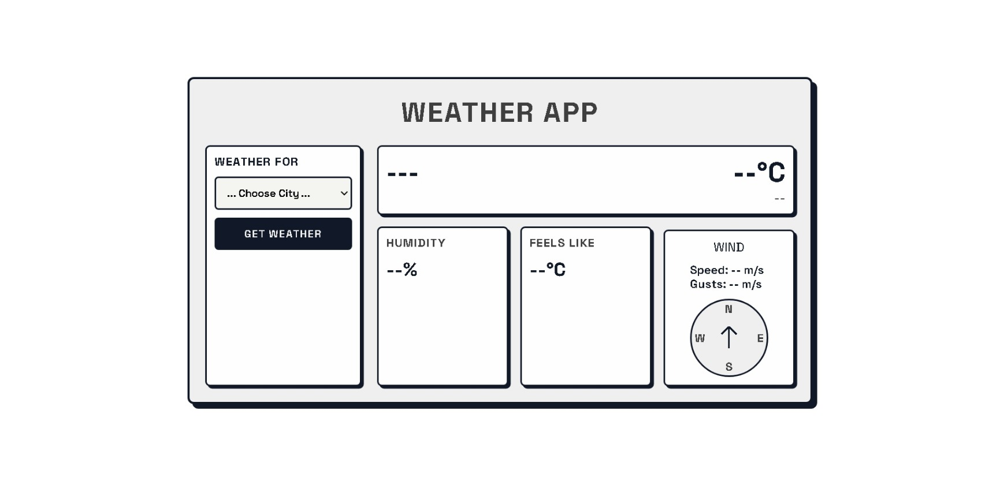
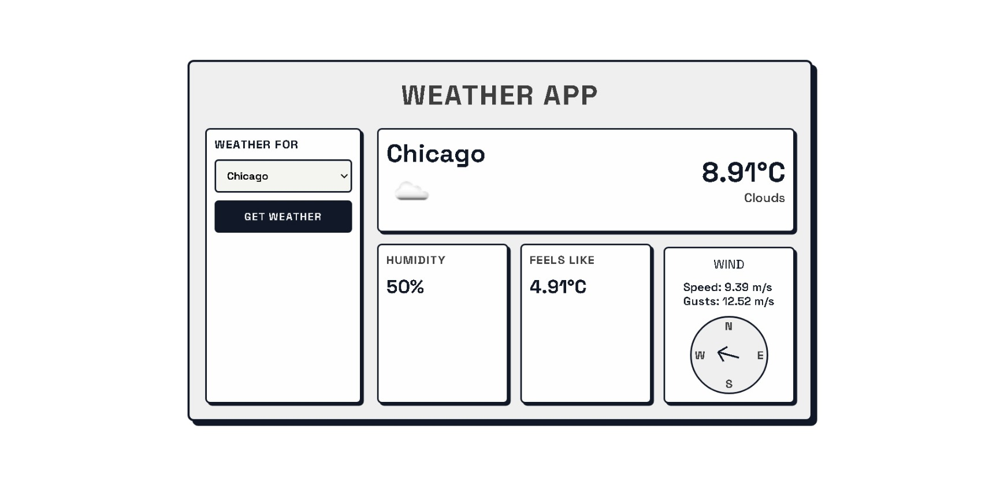
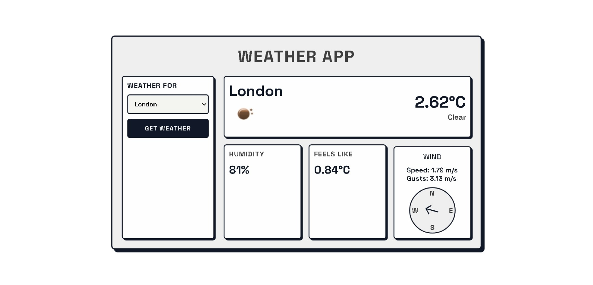

# Build a Weather App

<p align="center">
    
  
  
  
</p>

> **Milestone:** Certification Project setelah mempelajari Asynchronous JavaScript.

## About

Project ini membuat **Weather App** yang mengambil informasi cuaca berdasarkan kota yang dipilih pengguna.

Pengguna dapat memilih salah satu dari enam kota yang tersedia, kemudian menekan tombol **GET WEATHER**. JavaScript akan memanggil Weather API freeCodeCamp menggunakan asynchronous function `getWeather()`.

Data yang berhasil diterima kemudian diproses oleh `showWeather()` dan ditampilkan pada interface, meliputi lokasi, icon cuaca, temperature, weather type, humidity, feels-like temperature, wind speed, dan wind gust.

Project juga menangani nilai API yang tidak tersedia dengan menampilkan `"N/A"`, menangani kegagalan request menggunakan `try...catch`, dan menampilkan alert ketika weather data tidak berhasil diperoleh.

## Preview







## Konsep Utama

- Asynchronous JavaScript
- `async` function
- `await`
- Fetch API
- `try...catch`
- HTTP response checking
- Error handling
- JSON response
- Function declaration
- Function default parameter
- Conditional statement
- Optional chaining
- Template literal
- DOM Selection
- DOM Manipulation
- Event Listener
- Dynamic element content
- Dynamic CSS style
- CSS Grid
- Flexbox
- Media Query
- CSS Transition
- Responsive Layout

## Struktur Project

```text
weather-app/
├── index.html
├── styles.css
└── script.js
```

## Source Code

- [`index.html`](index.html)
- [`styles.css`](styles.css)
- [`script.js`](script.js)

## Pembahasan

### 1. Struktur Pemilihan Kota

HTML menyediakan `<select>` dengan ID:

```html
<select id="city-choices" name="city">
```

Pilihan pertama memiliki:

```html
value=""
```

dan digunakan sebagai kondisi awal sebelum pengguna memilih kota.

Enam kota yang tersedia adalah:

- New York
- Los Angeles
- Chicago
- Paris
- Tokyo
- London

Value setiap kota menggunakan lowercase seperti yang dibutuhkan oleh API.

### 2. Tombol Mengambil Weather

```html
<button id="get-weather-btn">GET WEATHER</button>
```

Tombol memiliki ID `get-weather-btn`.

Elemen ini kemudian diambil dari JavaScript menggunakan:

```javascript
const getWeatherBtn = document.getElementById("get-weather-btn");
```

Klik pada tombol menjadi pemicu pemanggilan `showWeather()`.

### 3. Elemen Hasil Weather

HTML menyiapkan beberapa elemen untuk menampilkan response API.

Lokasi:

```html
<h2 id="location">---</h2>
```

Weather icon:

```html

```

Main temperature:

```html
<span id="main-temperature">--°C</span>
```

Weather type:

```html
<span id="weather-main">--</span>
```

Humidity:

```html
<span id="humidity" class="card-value">--%</span>
```

Feels-like temperature:

```html
<span id="feels-like" class="card-value">--°C</span>
```

Wind speed:

```html
<span id="wind">-- m/s</span>
```

Wind gust:

```html
<span id="wind-gust">-- m/s</span>
```

JavaScript memperbarui elemen-elemen tersebut setelah weather data berhasil diterima.

### 4. Elemen Tambahan Wind Direction

Source juga memiliki:

```html
<div id="wind-arrow" class="compass-arrow">↑</div>
```

Elemen ini digunakan untuk menampilkan arah angin berdasarkan nilai `deg` yang tersedia pada object `wind`.

JavaScript mengambil elemen tersebut melalui:

```javascript
const windArrowEl = document.getElementById("wind-arrow");
```

### 5. Mengambil Elemen dari DOM

```javascript
const citySelect = document.getElementById("city-choices");
const getWeatherBtn = document.getElementById("get-weather-btn");

const locationEl = document.getElementById("location");
const weatherIconEl = document.getElementById("weather-icon");
const mainTempEl = document.getElementById("main-temperature");
const weatherMainEl = document.getElementById("weather-main");
const humidityEl = document.getElementById("humidity");
const feelsLikeEl = document.getElementById("feels-like");
const windEl = document.getElementById("wind");
const windGustEl = document.getElementById("wind-gust");
const windArrowEl = document.getElementById("wind-arrow");
```

`document.getElementById()` digunakan untuk menghubungkan JavaScript dengan elemen-elemen pada halaman.

Setelah referensi elemen tersedia, JavaScript dapat membaca pilihan kota dan memperbarui hasil weather.

### 6. Function `getValue()`

```javascript
function getValue (val, suffix = "") {
  return (val !== undefined && val !== null) ? `${val}${suffix}` : "N/A";
}
```

Function menerima:

- `val`
- optional parameter `suffix`

Default value dari `suffix` adalah string kosong.

Function memeriksa bahwa `val` bukan `undefined` dan bukan `null`.

Jika tersedia, function mengembalikan value tersebut sebagai string bersama `suffix`.

Jika tidak tersedia, function mengembalikan:

```text
N/A
```

### 7. Mempertahankan Nilai `0`

Pemeriksaan dilakukan menggunakan:

```javascript
val !== undefined && val !== null
```

bukan hanya pemeriksaan truthy/falsy.

Dengan demikian, nilai:

```text
0
```

tetap dianggap sebagai nilai valid dan tidak diganti dengan `"N/A"`.

Prinsip yang sama juga digunakan secara langsung untuk beberapa weather measurement.

### 8. Asynchronous Function `getWeather()`

```javascript
async function getWeather (city) {
```

`getWeather()` dibuat menggunakan function declaration dengan keyword `async`.

Function menerima tepat satu parameter:

```javascript
city
```

Function declaration digunakan sesuai kebutuhan project yang mengharuskan `getWeather` dapat diakses sebagai function dan tidak dideklarasikan menggunakan `const`.

### 9. Memeriksa Parameter `city`

```javascript
if (!city) return;
```

Jika nilai `city` kosong, function langsung berhenti.

Tidak ada request API yang dilakukan pada kondisi tersebut.

### 10. Mengambil Data Weather

```javascript
const res = await fetch(`https://weather-proxy.freecodecamp.rocks/api/city/${city}`);
```

`fetch()` digunakan untuk melakukan network request.

Nama city dimasukkan ke URL menggunakan template literal.

Keyword `await` membuat execution di dalam `getWeather()` menunggu response sebelum melanjutkan ke bagian berikutnya.

### 11. Memeriksa HTTP Response

```javascript
if (!res.ok) {
  throw new Error(`HTTP error! status: ${res.status}`)
}
```

Property `ok` digunakan untuk memeriksa status response.

Jika `res.ok` bernilai false, kode membuat dan melempar `Error`.

Status HTTP dimasukkan ke pesan error melalui:

```javascript
res.status
```

### 12. Memproses JSON

```javascript
const data = await res.json();
```

Jika HTTP response lolos pemeriksaan, `.json()` digunakan untuk memproses response body.

Karena operasi tersebut asynchronous, kode menggunakan `await`.

### 13. Mengembalikan Weather Data

```javascript
return data;
```

Weather data yang sudah diproses dikembalikan kepada function yang memanggil `getWeather()`.

Pada project ini, function tersebut adalah `showWeather()`.

### 14. Menangani Error pada `getWeather()`

```javascript
catch (err) {
  console.error(`Error: ${err}`);
}
```

Request dan JSON processing ditempatkan di dalam `try...catch`.

Jika terjadi error, `catch` menampilkan error melalui `console.error()`.

Tidak terdapat explicit `return` di dalam `catch`, sehingga ketika proses gagal tidak ada weather data yang dikembalikan untuk digunakan oleh `showWeather()`.

### 15. Asynchronous Function `showWeather()`

```javascript
async function showWeather (city) {
```

`showWeather()` juga menggunakan function declaration dan keyword `async`.

Function menerima parameter:

```javascript
city
```

### 16. Menghentikan Function Jika Kota Tidak Ada

```javascript
if (!city) return;
```

Jika `city` kosong, function berhenti tanpa mengubah weather yang sedang ditampilkan.

### 17. Memanggil `getWeather()`

```javascript
const data = await getWeather(city);
```

`showWeather()` memanggil asynchronous function `getWeather()`.

Keyword `await` digunakan agar weather data tersedia sebelum DOM diperbarui.

### 18. Menangani Weather Data yang Tidak Tersedia

```javascript
if (!data) {
  alert("Something went wrong, please try again later");
  return;
}
```

Jika `getWeather()` tidak menghasilkan data yang dapat digunakan, aplikasi menampilkan tepat pesan:

```text
Something went wrong, please try again later
```

Setelah alert, function langsung menjalankan `return`.

Karena DOM weather belum diperbarui sebelum bagian ini, data weather yang sebelumnya tampil tidak diubah oleh jalur error tersebut.

### 19. Menampilkan Nama Lokasi

```javascript
locationEl.textContent = getValue(data.name);
```

Property `name` dari response API diberikan ke `getValue()`.

Jika value tersedia, nama lokasi ditampilkan.

Jika tidak, hasilnya adalah:

```text
N/A
```

### 20. Memeriksa Weather Array

```javascript
if (data.weather && data.weather[0]) {
```

Kode memastikan bahwa property `weather` tersedia dan memiliki elemen pertama sebelum membaca property di dalamnya.

### 21. Menampilkan Weather Icon

```javascript
weatherIconEl.style.visibility = "visible";
weatherIconEl.src = data.weather[0].icon || "";
weatherIconEl.alt = data.weather[0].description || "Weather Icon";
```

Ketika weather data tersedia, icon dibuat visible.

`src` diambil dari:

```javascript
data.weather[0].icon
```

sedangkan `alt` menggunakan:

```javascript
data.weather[0].description
```

Jika description tidak tersedia, fallback yang digunakan adalah:

```text
Weather Icon
```

### 22. Menampilkan Main Weather

```javascript
weatherMainEl.textContent = getValue(data.weather[0].main);
```

Main weather type diberikan ke `getValue()`.

Contoh property yang dapat diterima dari API adalah seperti `"Clear"`.

### 23. Kondisi Weather Array Tidak Tersedia

```javascript
else {
  weatherIconEl.src = "";
  weatherMainEl.textContent = "N/A";
}
```

Jika `data.weather` atau `data.weather[0]` tidak tersedia, source mengosongkan image `src` dan mengubah weather type menjadi `"N/A"`.

### 24. Menampilkan Main Temperature

```javascript
mainTempEl.textContent =
  data.main?.temp !== undefined ? `${data.main.temp}°C` : "N/A";
```

Optional chaining:

```javascript
data.main?.temp
```

digunakan agar property `temp` dapat diperiksa tanpa langsung mengakses property dari `main` yang mungkin tidak tersedia.

Jika temperature tersedia, unit:

```text
°C
```

ditambahkan.

### 25. Menampilkan Feels-Like Temperature

```javascript
feelsLikeEl.textContent =
  data.main?.feels_like !== undefined ? `${data.main.feels_like}°C` : "N/A";
```

Property:

```javascript
data.main?.feels_like
```

digunakan untuk menampilkan feels-like temperature.

Nilai yang tidak tersedia menghasilkan `"N/A"`.

### 26. Menampilkan Humidity

```javascript
humidityEl.textContent =
  data.main?.humidity !== undefined ? `${data.main.humidity}%` : "N/A";
```

Humidity diperoleh dari:

```javascript
data.main?.humidity
```

Jika tersedia, tanda `%` ditambahkan.

### 27. Menampilkan Wind Speed

```javascript
windEl.textContent =
  data.wind?.speed !== undefined ? `${data.wind.speed} m/s` : "N/A";
```

Wind speed menggunakan unit:

```text
m/s
```

sesuai data metric dari API.

### 28. Menampilkan Wind Gust

```javascript
windGustEl.textContent =
  data.wind?.gust !== undefined ? `${data.wind.gust} m/s` : "N/A";
```

Property `gust` juga diperiksa menggunakan optional chaining.

Jika tidak tersedia, output menjadi `"N/A"`.

### 29. Nilai Nol Tetap Ditampilkan

Pemeriksaan measurement menggunakan bentuk seperti:

```javascript
data.main?.temp !== undefined
```

dan:

```javascript
data.wind?.speed !== undefined
```

Karena pemeriksaan tidak menggunakan truthiness sederhana, nilai `0` tetap lolos sebagai weather measurement yang valid.

### 30. Menampilkan Arah Angin

```javascript
if (windArrowEl && data.wind?.deg !== undefined) {
  windArrowEl.style.transform = `rotate(${data.wind.deg}deg)`;
}
```

Jika elemen arrow tersedia dan API menyediakan `wind.deg`, JavaScript mengubah CSS `transform`.

Nilai degree digunakan pada:

```css
rotate(...)
```

sehingga arrow mengikuti nilai arah angin dari response.

### 31. Memeriksa Tombol Sebelum Event Listener

```javascript
if (getWeatherBtn) {
```

Event listener hanya ditambahkan jika `getWeatherBtn` benar-benar ditemukan pada DOM.

### 32. Event Tombol GET WEATHER

```javascript
getWeatherBtn.addEventListener("click", () => {
```

Ketika button diklik, callback dijalankan.

### 33. Membaca Kota yang Dipilih

```javascript
const selectedCity = citySelect.value;
```

Value dari `<select>` disimpan ke `selectedCity`.

### 34. Tidak Melakukan Apa Pun Jika Kota Belum Dipilih

```javascript
if (selectedCity) {
  showWeather(selectedCity);
}
```

`showWeather()` hanya dipanggil jika `selectedCity` memiliki value.

Karena pilihan awal menggunakan:

```html
value=""
```

menekan button tanpa memilih kota tidak memulai proses weather request.

### 35. Layout Utama HTML

Interface dibungkus oleh:

```html
<main class="main-container">
```

Di dalamnya terdapat title:

```html
<h1 class="app-title">WEATHER APP</h1>
```

dan layout utama:

```html
<div class="app-grid">
```

### 36. Selection Card

Bagian pemilihan kota menggunakan:

```html
<div id="selection" class="card selection-card">
```

Card tersebut berisi label, select, dan button.

### 37. Results Grid

Weather result ditempatkan di:

```html
<div id="results" class="results-grid">
```

Area ini memiliki main weather card dan beberapa sub-card untuk measurement berbeda.

### 38. Main Weather Card

```html
<div class="card main-weather-card">
```

Bagian ini menampilkan lokasi, weather icon, main temperature, dan main weather type.

### 39. Sub-card Weather Measurement

Humidity dan feels-like temperature menggunakan card terpisah.

Hal ini membuat setiap measurement memiliki area visual sendiri di interface.

### 40. Wind Card dan Compass

Wind card menampilkan:

- wind speed;
- wind gust;
- compass labels N, E, S, W;
- arrow untuk arah angin.

Arrow memiliki ID `wind-arrow` sehingga JavaScript dapat mengubah rotasinya berdasarkan weather data.

### 41. Google Font

CSS mengimpor font:

```css
@import url('https://fonts.googleapis.com/css2?family=Space+Grotesk:wght@300..700&display=swap');
```

Font tersebut kemudian digunakan pada `body`, `select`, dan button.

### 42. Styling Main Container

```css
.main-container {
  background-color: #efefef;
  border: 3px solid #111827;
  border-radius: 8px;
  box-shadow: 6px 6px 0 #111827;
  padding: 20px;
  max-width: 800px;
  width: 100%;
}
```

Container utama menggunakan border, border radius, dan box shadow.

### 43. CSS Grid pada Layout Utama

```css
.app-grid {
  display: grid;
  grid-template-columns: 200px 1fr;
  gap: 20px;
}
```

Pada ukuran normal, layout memiliki dua column:

- `200px` untuk selection;
- ruang tersisa untuk weather results.

### 44. Responsive Layout

```css
@media (max-width: 650px) {
  .app-grid {
    grid-template-columns: 1fr;
  }
}
```

Jika viewport berada di bawah atau sama dengan `650px`, layout berubah menjadi satu column.

### 45. Card Styling

```css
.card {
  background-color: #fefefe;
  border: 2px solid #111827;
  border-radius: 6px;
  padding: 10px;
  box-shadow: 3px 3px 0 #111827;
}
```

Class `.card` menjadi base visual style untuk beberapa bagian interface.

### 46. Button Interaction

Button memiliki:

```css
transition: transform 0.3s, box-shadow 0.3s;
```

Pada hover:

```css
.selection-card button:hover {
  background-color: #4d4d4d;
  border-color: #4d4d4d;
}
```

dan pada active:

```css
.selection-card button:active {
  transform: translate(2px, 2px);
}
```

### 47. Results Grid

```css
.results-grid {
  display: grid;
  grid-template-columns: repeat(3, 1fr);
  gap: 15px;
}
```

Weather results menggunakan tiga column dengan ukuran yang sama.

Main weather card mengambil ketiganya melalui:

```css
grid-column: span 3;
```

### 48. Weather Icon Awalnya Disembunyikan

```css
.weather-header img {
  width: 64px;
  height: 64px;
  visibility: hidden;
}
```

Icon tidak terlihat pada keadaan awal.

JavaScript mengubah:

```javascript
weatherIconEl.style.visibility = "visible";
```

ketika weather data tersedia.

### 49. Compass

```css
.compass-box {
  position: relative;
  width: 100px;
  height: 100px;
  border: 2px solid #111827;
  border-radius: 50%;
}
```

Compass dibuat sebagai lingkaran berukuran `100px × 100px`.

Label arah diposisikan menggunakan `position: absolute`.

### 50. Compass Arrow Transition

```css
.compass-arrow {
  transform-origin: center;
  transition: transform 0.5s cubic-bezier(0.4, 0, 0.2, 1);
}
```

Perubahan rotation dari JavaScript dianimasikan menggunakan CSS transition.

## Method yang Dipakai

- `document.getElementById()` digunakan untuk mengambil elemen interface.
- `fetch()` digunakan untuk mengambil weather data.
- `json()` digunakan untuk memproses HTTP response menjadi JavaScript data.
- `addEventListener()` digunakan untuk menangani klik tombol.
- `console.error()` digunakan untuk mencatat error.
- `alert()` digunakan untuk memberi tahu pengguna ketika weather data gagal diperoleh.

## Eksperimen Tambahan

Sebagian besar styling CSS pada project ini merupakan eksplorasi tambahan di luar user stories utama freeCodeCamp.

User stories terutama menentukan elemen yang harus tersedia, weather data yang harus ditampilkan, serta behavior JavaScript yang diperlukan. Tampilan visualnya kemudian dikembangkan lebih jauh melalui CSS yang dibuat sendiri.

Eksplorasi CSS tersebut mencakup:

- penggunaan font **Space Grotesk**;
- visual card dengan border tebal, rounded corner, dan box shadow;
- layout dua column menggunakan CSS Grid;
- responsive layout melalui breakpoint `650px`;
- styling khusus untuk selection card dan weather cards;
- state `:hover` dan `:active` pada button;
- three-column grid untuk weather result;
- styling compass berbentuk lingkaran;
- positioning label `N`, `E`, `S`, dan `W`;
- transition pada compass arrow ketika arah angin berubah.

Styling tersebut tidak diposisikan sebagai requirement dari user stories, tetapi sebagai bagian personalisasi tampilan project.

## Ringkasan Cepat

| Konsep | Fungsi |
|---|---|
| `getValue()` | Mengembalikan value yang tersedia atau `"N/A"` |
| `getWeather()` | Mengambil weather data berdasarkan city |
| `async` | Menandai function sebagai asynchronous |
| `await` | Menunggu hasil Fetch API dan JSON processing |
| `fetch()` | Melakukan request ke Weather API |
| `res.ok` | Memeriksa apakah HTTP response berhasil |
| `throw new Error()` | Membuat error untuk response yang tidak berhasil |
| `try...catch` | Menangani error dalam `getWeather()` |
| `showWeather()` | Memproses dan menampilkan weather data |
| Optional chaining | Mengakses nested weather property dengan aman |
| `!== undefined` | Mempertahankan nilai `0` sebagai data valid |
| `textContent` | Memperbarui teks pada weather elements |
| `style.visibility` | Menampilkan weather icon setelah data tersedia |
| `style.transform` | Merotasi wind arrow |
| `addEventListener()` | Menjalankan weather process ketika button diklik |
| CSS Grid | Mengatur selection dan weather result layout |
| Flexbox | Mengatur alignment beberapa komponen |
| Media query | Mengubah layout untuk viewport yang lebih kecil |

## Catatan Belajar

- **`getWeather()`** menggunakan function declaration dan menerima satu argument `city`.
- **`async/await`** digunakan untuk menangani proses network request dan JSON parsing.
- **`res.ok`** diperiksa sebelum response diproses lebih lanjut.
- **HTTP error** dibuat menggunakan `throw new Error()` dan ditangani oleh `catch`.
- **`console.error()`** digunakan ketika `getWeather()` mengalami error.
- **`showWeather()`** menunggu hasil dari `getWeather()` sebelum mengubah DOM.
- **Jika weather data tidak tersedia**, alert ditampilkan dan function berhenti sebelum weather lama diubah.
- **Optional chaining** digunakan pada `data.main` dan `data.wind`.
- **Pemeriksaan terhadap `undefined`** membuat measurement bernilai `0` tetap ditampilkan sebagai `0`.
- **Temperature** ditampilkan menggunakan unit Celsius.
- **Wind speed dan gust** ditampilkan menggunakan unit `m/s`.
- **`data.weather[0]`** digunakan untuk icon, description, dan main weather type.
- **Button tidak melakukan request** jika belum ada city yang dipilih.
- **Wind direction** dari `data.wind.deg` digunakan untuk mengubah rotation compass arrow.
- **CSS Grid** digunakan untuk menyusun interface utama dan weather result.
- **Sebagian besar styling CSS** merupakan eksplorasi tambahan yang dikonfirmasi di luar requirement user stories.

## What I Practiced

```text
HTML Forms
HTML Select Elements
HTML Weather Output Elements
Asynchronous JavaScript
Async Functions
Await Expressions
Fetch API
HTTP Response Handling
JSON Responses
Try...catch
Error Handling
Function Declarations
Default Parameters
Optional Chaining
Template Literals
DOM Selection
DOM Manipulation
Event Listeners
Dynamic CSS Styles
CSS Grid
CSS Flexbox
Responsive Design
CSS Media Queries
CSS Transitions
```

---

**Platform:** freeCodeCamp  
**Certification Project:** Build a Weather App  
**Languages:** HTML, CSS & JavaScript

---

<p align="center">
  <strong>Certification Project — Build a Weather App Completed</strong><br>
  <sub>Next stop: continue the JavaScript Certification journey.</sub>
</p>
