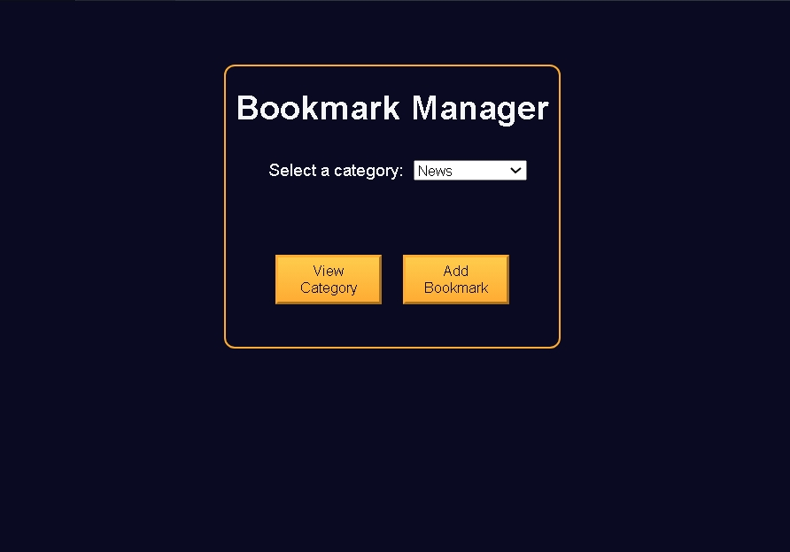

# Build a Bookmark Manager App

<p align="center">
  
  
  
  
  
</p>

> **Milestone:** Lab setelah mempelajari localStorage and CRUD Operations.

## About

Project ini membuat aplikasi Bookmark Manager untuk menyimpan bookmark berdasarkan kategori.

Pengguna dapat memilih kategori, menambahkan bookmark, melihat bookmark dalam kategori tersebut, dan menghapus bookmark.

Data bookmark disimpan di `localStorage` sehingga dapat dibaca kembali saat aplikasi dijalankan.

## Preview



## Konsep Utama

- **DOM Manipulation** digunakan untuk mengambil dan memperbarui elemen halaman.
- **localStorage** digunakan untuk menyimpan dan mengambil data bookmark.
- **JSON** digunakan untuk mengubah data object menjadi string dan sebaliknya.
- **Array Methods** digunakan untuk memvalidasi, memfilter, mencari, dan menghapus bookmark.
- **Event Handling** digunakan untuk menangani interaksi tombol dan form.
- **Object** digunakan untuk menyimpan data setiap bookmark.
- **Template Literal** digunakan untuk membuat elemen bookmark secara dinamis.

## Struktur Project

```text
bookmark-manager-app/
├── index.html
├── styles.css
└── script.js
```

## Source Code

- [`index.html`](./index.html)
- [`styles.css`](./styles.css)
- [`script.js`](./script.js)

## Pembahasan

### 1. Mengambil Elemen DOM

Beberapa elemen HTML diambil menggunakan `getElementById()` dan `querySelectorAll()`.

```js
const mainSection = document.getElementById("main-section");
const formSection = document.getElementById("form-section");
const bookmarkListSection = document.getElementById("bookmark-list-section");
const categoryList = document.getElementById("category-list");
```

Referensi tersebut digunakan untuk mengubah tampilan halaman dan menampilkan data bookmark.

### 2. Mengambil Data dari `localStorage`

Function `getBookmarks()` mengambil data bookmark dari `localStorage`.

```js
const getLocalStorage = localStorage.getItem("bookmarks");
const storedBookmarks = JSON.parse(getLocalStorage);
```

Data yang tersimpan kemudian diperiksa untuk memastikan bentuk datanya sesuai.

Jika data bukan array atau terjadi error saat parsing, function mengembalikan array kosong.

### 3. Memvalidasi Data Bookmark

Setiap bookmark diperiksa menggunakan `every()`.

```js
const itemValid = storedBookmarks.every(
  bookmark =>
    bookmark !== null &&
    !Array.isArray(bookmark) &&
    typeof bookmark === "object" &&
    "name" in bookmark &&
    "category" in bookmark &&
    "url" in bookmark
);
```

Validasi memastikan setiap item merupakan object yang memiliki property `name`, `category`, dan `url`.

### 4. Menampilkan Bookmark Berdasarkan Kategori

Function `displayBookmarks()` mengambil bookmark lalu memfilter berdasarkan kategori yang dipilih.

```js
const filteredBookmarks = getBookmarks().filter(
  bookmark => bookmark.category === categoryDropdown.value
);
```

Bookmark yang sesuai kemudian dibuat menjadi elemen HTML menggunakan `forEach()` dan template literal.

### 5. Menambahkan Bookmark

Bookmark baru dibuat sebagai object.

```js
const newBookmark = {
  name: nameInput.value,
  category: categoryDropdown.value,
  url: urlInput.value
};
```

Object tersebut ditambahkan ke array bookmark menggunakan `push()`.

```js
oldBookmarks.push(newBookmark);
```

Array kemudian disimpan kembali ke `localStorage`.

```js
localStorage.setItem("bookmarks", JSON.stringify(oldBookmarks));
```

### 6. Menampilkan dan Menyembunyikan Section

Function `displayOrCloseForm()` dan `displayOrHideCategory()` menggunakan `classList.toggle()`.

```js
mainSection.classList.toggle("hidden");
formSection.classList.toggle("hidden");
```

Class `hidden` digunakan untuk mengatur section yang sedang ditampilkan.

### 7. Menghapus Bookmark

Bookmark yang dipilih dicari menggunakan `findIndex()`.

```js
const bookmarkIndex = bookmarks.findIndex(
  bookmark =>
    bookmark.name === selectedRadioValue &&
    bookmark.category === categoryDropdownValue
);
```

Bookmark kemudian dihapus dari array menggunakan `splice()`.

```js
bookmarks.splice(bookmarkIndex, 1);
```

Data yang telah diperbarui disimpan kembali ke `localStorage`.

## Method yang Dipakai

- `getItem()` digunakan untuk mengambil data dari `localStorage`.
- `JSON.parse()` digunakan untuk mengubah JSON string menjadi data JavaScript.
- `every()` digunakan untuk memvalidasi seluruh item bookmark.
- `filter()` digunakan untuk memilih bookmark berdasarkan kategori.
- `forEach()` digunakan untuk memproses setiap bookmark.
- `toggle()` digunakan untuk menampilkan atau menyembunyikan section.
- `push()` digunakan untuk menambahkan bookmark ke array.
- `JSON.stringify()` digunakan untuk mengubah data JavaScript menjadi JSON string.
- `setItem()` digunakan untuk menyimpan data ke `localStorage`.
- `findIndex()` digunakan untuk mencari posisi bookmark yang dipilih.
- `splice()` digunakan untuk menghapus bookmark dari array.

## Ringkasan Cepat

| Konsep | Fungsi |
|---|---|
| `localStorage` | Menyimpan dan mengambil data bookmark. |
| `JSON.parse()` | Mengubah JSON string menjadi data JavaScript. |
| `JSON.stringify()` | Mengubah data JavaScript menjadi JSON string. |
| `filter()` | Memilih bookmark berdasarkan kategori. |
| `findIndex()` | Mencari posisi bookmark dalam array. |
| `splice()` | Menghapus bookmark dari array. |
| `classList.toggle()` | Menampilkan atau menyembunyikan section. |

## Catatan Belajar

- **localStorage** dapat digunakan untuk menyimpan data pada browser.
- **JSON.parse()** digunakan untuk membaca data JSON sebagai data JavaScript.
- **JSON.stringify()** digunakan sebelum object atau array disimpan ke `localStorage`.
- **filter()** menghasilkan array baru berdasarkan kondisi tertentu.
- **findIndex()** menghasilkan posisi item yang sesuai dengan kondisi.
- **splice()** dapat digunakan untuk menghapus item dari array.
- **Event Listener** digunakan untuk menjalankan function berdasarkan interaksi pengguna.

## What I Practiced

```text
DOM Manipulation
localStorage
JSON.parse()
JSON.stringify()
Array Methods
Object
Template Literals
Event Handling
classList.toggle()
```

---

**Platform:** freeCodeCamp  
**Lab:** Build a Bookmark Manager App  
**Languages:** HTML, CSS & JavaScript  
**Focus:** localStorage and CRUD Operations

---

<p align="center">
  <strong>localStorage and CRUD Operations Section — Build a Bookmark Manager App Completed</strong><br>
  <sub>Next stop: continue the JavaScript Certification journey.</sub>
</p>
