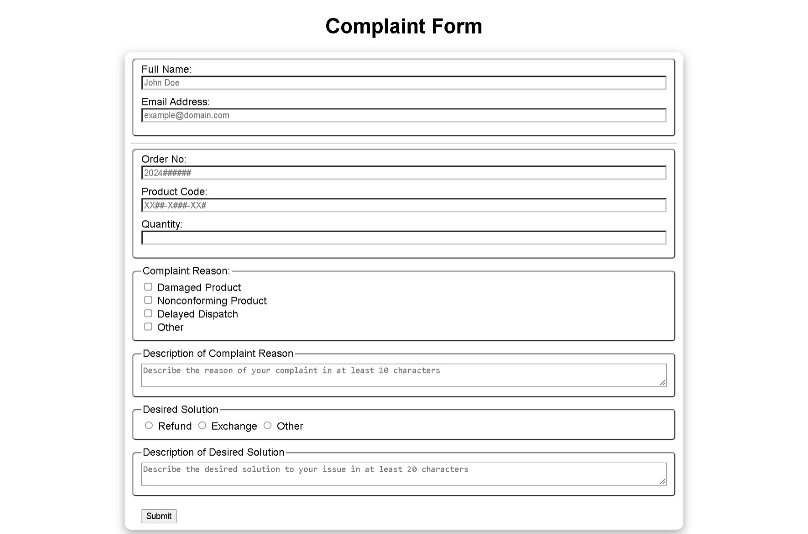

# Build a Customer Complaint Form

<p align="center">
  
  
  
  
  
</p>

> **Milestone:** Lab setelah mempelajari Form Validation.

## About

Project ini membuat form untuk menerima data keluhan pelanggan.

Form mencakup data pelanggan, informasi produk, alasan keluhan, deskripsi keluhan, serta solusi yang diinginkan.

JavaScript digunakan untuk memvalidasi setiap input menggunakan kondisi, regular expression, dan event listener.

## Konsep Utama

- **HTML Form** digunakan untuk menerima data keluhan pelanggan.
- **Form Validation** digunakan untuk memeriksa kelengkapan dan format input.
- **Regular Expressions** digunakan untuk memvalidasi email, nomor pesanan, kode produk, dan jumlah produk.
- **DOM Selection** digunakan untuk mengambil elemen form yang akan divalidasi.
- **Functions** digunakan untuk memisahkan proses validasi form dan field.
- **Event Listeners** digunakan untuk menjalankan validasi ketika nilai input berubah dan ketika form dikirim.
- **Conditional Logic** digunakan untuk menentukan validitas setiap bagian form.
- **Object Values** digunakan untuk memeriksa seluruh hasil validasi.
- **CSS Manipulation** digunakan untuk memberikan tanda visual pada input yang valid atau tidak valid.
- **ARIA Attribute** digunakan pada message box agar pembaruan pesan dapat dibaca oleh teknologi bantu.

## Preview



## Struktur Project

```text
customer-complaint-form/
├── index.html
├── styles.css
└── script.js
```

## Source Code

- [`index.html`](./index.html)
- [`styles.css`](./styles.css)
- [`script.js`](./script.js)

## Pembahasan

### 1. Struktur Form

`index.html` membagi form menjadi beberapa kelompok menggunakan elemen `fieldset`.

Kelompok tersebut mencakup informasi pribadi, informasi produk, alasan keluhan, deskripsi keluhan, solusi yang diinginkan, dan deskripsi solusi.

Checkbox digunakan untuk memilih alasan keluhan.

Radio button digunakan untuk memilih solusi yang diinginkan.

### 2. Mengambil Elemen Form

JavaScript mengambil berbagai elemen menggunakan `getElementById()` dan `querySelectorAll()`.

```js
const nameInput = document.getElementById("full-name");
const emailInput = document.getElementById("email");
const orderNoInput = document.getElementById("order-no");
const productCodeInput = document.getElementById("product-code");
const quantityInput = document.getElementById("quantity");
```

Elemen tersebut kemudian digunakan dalam proses validasi.

### 3. Function `validateForm()`

`validateForm()` mengambil seluruh nilai input dan menentukan apakah setiap bagian form memenuhi aturan validasi.

Function ini menghasilkan object yang berisi status valid atau tidak valid untuk setiap field.

```js
return {
  "full-name": isNameValid,
  "email": emailRegex.test(emailValue),
  "order-no": orderNoRegex.test(orderNoValue),
  "product-code": productCodeRegex.test(productCodeValue),
  "quantity": quantityRegex.test(quantityValue),
  "complaints-group": isComplaintChecked,
  "complaint-description": isComplaintDescValid,
  "solutions-group": isSolutionChecked,
  "solution-description": isSolutionDescValid
};
```

### 4. Validasi dengan Regular Expression

Regular expression digunakan untuk memeriksa format beberapa input.

Email diperiksa menggunakan `emailRegex`.

Nomor pesanan harus mengikuti pola `2024` yang diikuti enam angka.

Kode produk harus mengikuti pola dua huruf, dua angka, satu huruf, tiga angka, dua huruf, dan satu angka.

Jumlah produk harus berupa bilangan bulat positif.

```js
const emailRegex = /^[a-zA-Z0-9._]+@[a-zA-Z0-9._]+\.[a-zA-Z]{2,}$/;
const orderNoRegex = /^2024\d{6}$/;
const productCodeRegex = /^[a-zA-Z]{2}\d{2}-[a-zA-Z]\d{3}-[a-zA-Z]{2}\d$/;
const quantityRegex = /^[1-9]\d*$/;
```

### 5. Validasi Kelompok Complaint dan Solution

Program memeriksa apakah setidaknya satu checkbox complaint telah dipilih.

```js
const isComplaintChecked =
  document.querySelector(`input[name="complaint"]:checked`) !== null;
```

Hal yang sama dilakukan untuk radio button pada kelompok solusi.

```js
const isSolutionChecked =
  document.querySelector(`input[name="solutions"]:checked`) !== null;
```

### 6. Validasi Deskripsi

Deskripsi complaint hanya diwajibkan memiliki minimal 20 karakter ketika pilihan `Other` dipilih.

```js
const isComplaintDescValid =
  !otherComplaintChecked ||
  complaintDescValue.trim().length >= 20;
```

Deskripsi solusi menggunakan aturan yang sama ketika pilihan `Other` dipilih.

```js
const isSolutionDescValid =
  !otherSolutionChecked ||
  solutionDescValue.trim().length >= 20;
```

### 7. Function `validateField()`

`validateField()` menjalankan `validateForm()` ketika sebuah field berubah.

Border field diberi warna hijau ketika valid dan merah ketika tidak valid.

```js
if (validation[fieldName]) {
  e.target.style.borderColor = "green";
} else {
  e.target.style.borderColor = "red";
}
```

### 8. Validasi Complaint Group

`validateComplaintGroup()` memeriksa hasil validasi kelompok checkbox complaint.

Border `complaints-group` diubah menjadi hijau jika valid dan merah jika belum valid.

### 9. Validasi Solution Group

`validateSolutionGroup()` melakukan proses yang sama untuk kelompok radio button solusi.

Border `solutions-group` digunakan sebagai indikator visual status validasi.

### 10. Memeriksa Seluruh Hasil Validasi

Function `isValid()` menggunakan `Object.values()` dan `every()`.

```js
function isValid(validationObject) {
  return Object.values(validationObject).every(
    value => value === true
  );
}
```

Function ini menghasilkan `true` hanya ketika seluruh nilai validasi bernilai `true`.

### 11. Validasi Saat Form Dikirim

Event `submit` digunakan untuk menjalankan validasi ketika pengguna mengirim form.

```js
form.addEventListener("submit", function handleSubmit(e) {
  e.preventDefault();

  const validation = validateForm();
  const formIsValid = isValid(validation);
});
```

`preventDefault()` mencegah form melakukan pengiriman bawaan browser.

Setelah validasi dilakukan, setiap field diberi border hijau atau merah berdasarkan hasil validasinya.

## Method yang Dipakai

- `getElementById()` digunakan untuk mengambil elemen form berdasarkan `id`.
- `querySelector()` digunakan untuk mencari checkbox atau radio button yang dipilih.
- `querySelectorAll()` digunakan untuk mengambil seluruh checkbox dan radio button.
- `trim()` digunakan untuk menghapus spasi di awal dan akhir teks.
- `test()` digunakan untuk memeriksa string berdasarkan regular expression.
- `Object.values()` digunakan untuk mengambil seluruh nilai dari object hasil validasi.
- `every()` digunakan untuk memeriksa apakah seluruh hasil validasi bernilai `true`.
- `addEventListener()` digunakan untuk menangani perubahan input dan submit form.
- `preventDefault()` digunakan untuk mencegah aksi submit bawaan browser.

## Ringkasan Cepat

| Konsep | Fungsi |
|---|---|
| `fieldset` | Mengelompokkan bagian form |
| `getElementById()` | Mengambil elemen berdasarkan `id` |
| `querySelector()` | Mencari pilihan checkbox atau radio |
| `querySelectorAll()` | Mengambil kumpulan elemen |
| Regular Expression | Memeriksa pola input |
| `test()` | Menguji input terhadap regex |
| `trim()` | Membersihkan spasi pada teks |
| `Object.values()` | Mengambil nilai dari object validasi |
| `every()` | Memastikan seluruh validasi bernilai `true` |
| `addEventListener()` | Menangani event pengguna |
| `preventDefault()` | Mencegah submit bawaan browser |
| `style.borderColor` | Memberikan indikator visual validasi |

## Catatan Belajar

- **Form Validation** digunakan untuk memastikan data memenuhi aturan yang ditentukan.
- **Regular Expression** dapat digunakan untuk memeriksa pola data tertentu.
- **Function** membantu memisahkan setiap proses validasi.
- **Conditional Logic** digunakan untuk menentukan status setiap field.
- **Object** dapat menyimpan hasil validasi beberapa field dalam satu struktur.
- **`every()`** dapat digunakan untuk memastikan seluruh kondisi terpenuhi.
- **Event Listener** membuat validasi dapat berjalan saat pengguna berinteraksi dengan form.
- **DOM Manipulation** dapat memberikan indikator visual berdasarkan hasil validasi.

## What I Practiced

```text
HTML Forms
HTML Fieldset
CSS Form Styling
JavaScript Functions
DOM Selection
DOM Manipulation
Regular Expressions
Regex Validation
String trim()
Object Values
Array every()
Conditional Logic
Event Listeners
Form Submit Events
preventDefault()
Inline Style Manipulation
Checkbox Validation
Radio Button Validation
```

---

**Platform:** freeCodeCamp  
**Lab:** Build a Customer Complaint Form  
**Languages:** HTML, CSS & JavaScript  
**Focus:** Form Validation

---

<p align="center">
  <strong>Form Validation Section — Build a Customer Complaint Form Completed</strong><br>
  <sub>Next stop: continue the JavaScript Certification journey.</sub>
</p>
