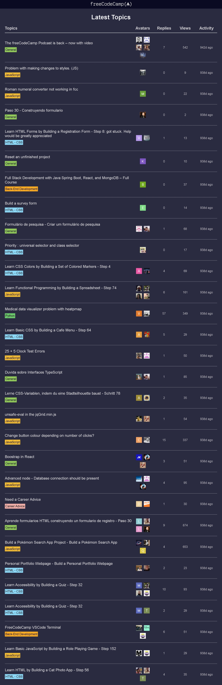

# Build an fCC Forum Leaderboard

<p align="center">  
  
  
  
  
  
</p>

> **Milestone:** Lab setelah mempelajari Asynchronous JavaScript.

## About

Project ini membuat halaman **fCC Forum Leaderboard** yang mengambil data latest topics dari forum freeCodeCamp melalui sebuah JSON endpoint.

JavaScript menggunakan `async/await` dan `fetch()` untuk mengambil data forum. Data tersebut kemudian diproses untuk menampilkan judul topic, kategori, avatar user, jumlah replies, jumlah views, dan waktu aktivitas terakhir.

Beberapa helper function digunakan untuk memformat data sebelum ditampilkan, seperti `timeAgo()` untuk menghitung jarak waktu, `viewCount()` untuk mempersingkat jumlah views, `forumCategory()` untuk membuat link kategori, dan `avatars()` untuk menghasilkan kumpulan avatar poster.

## Preview



## Konsep Utama

- Asynchronous JavaScript
- `async`
- `await`
- Fetch API
- JSON
- `try...catch`
- Date
- Time calculation
- Object
- Nested object
- Object destructuring
- Array
- `map()`
- `find()`
- `join()`
- Template literal
- Conditional statement
- Ternary expression
- DOM Selection
- DOM Manipulation
- Dynamic HTML
- CSS Custom Properties
- Flexbox
- Responsive Table
- Media Query

## Struktur Project

```text
fcc-forum-leaderboard/
├── index.html
├── styles.css
└── script.js
```

## Source Code

- [`index.html`](index.html)
- [`styles.css`](styles.css)
- [`script.js`](script.js)

## Pembahasan

### 1. Menyimpan URL yang Digunakan

```javascript
const forumLatest =
  'https://cdn.freecodecamp.org/curriculum/forum-latest/latest.json';
const forumTopicUrl = 'https://forum.freecodecamp.org/t/';
const forumCategoryUrl = 'https://forum.freecodecamp.org/c/';
const avatarUrl = 'https://cdn.freecodecamp.org/curriculum/forum-latest';
```

Beberapa URL disimpan di dalam constant agar dapat digunakan kembali.

`forumLatest` menjadi endpoint JSON yang digunakan oleh `fetch()`.

`forumTopicUrl` digunakan untuk membentuk link menuju sebuah topic.

`forumCategoryUrl` digunakan untuk membuat link menuju category forum.

`avatarUrl` digunakan sebagai base URL untuk avatar tertentu.

### 2. Object `allCategories`

```javascript
const allCategories = {
  299: { category: 'Career Advice', className: 'career' },
  409: { category: 'Project Feedback', className: 'feedback' },
  417: { category: 'freeCodeCamp Support', className: 'support' },
  421: { category: 'JavaScript', className: 'javascript' },
  423: { category: 'HTML - CSS', className: 'html-css' },
  424: { category: 'Python', className: 'python' },
  432: { category: 'You Can Do This!', className: 'motivation' },
  560: { category: 'Back-End Development', className: 'backend' }
};
```

`allCategories` menyimpan informasi category berdasarkan ID.

Setiap entry memiliki:

- `category`, nama yang ditampilkan;
- `className`, class CSS yang digunakan untuk styling.

### 3. Function `timeAgo()`

```javascript
const timeAgo = (past) => {
```

Function ini menerima waktu sebelumnya melalui parameter `past`.

Tujuannya adalah menghasilkan teks waktu dalam bentuk:

```text
Xd ago
Xh ago
Xm ago
```

tergantung selisih waktu yang dihitung.

### 4. Membuat Object `Date`

```javascript
const pastTime = new Date(past);
const presentTime = new Date();
```

`pastTime` dibuat berdasarkan nilai waktu yang diberikan.

`presentTime` menggunakan waktu ketika function dijalankan.

### 5. Menampilkan Waktu Saat Ini

```javascript
console.log(presentTime.toISOString());
```

`toISOString()` digunakan untuk menampilkan `presentTime` dalam format ISO melalui console.

### 6. Memeriksa Waktu yang Tidak Sesuai

```javascript
if (presentTime < pastTime) {
  return "Check your past time!"
}
```

Jika `pastTime` berada setelah `presentTime`, function langsung mengembalikan:

```text
Check your past time!
```

### 7. Menghitung Selisih Millisecond

```javascript
let msDiff = presentTime - pastTime;
```

Pengurangan dua object `Date` menghasilkan selisih waktu yang digunakan untuk perhitungan berikutnya.

### 8. Menentukan Satuan Waktu

```javascript
const oneMin = 1000 * 60;
const oneHour = 60 * oneMin;
const oneDay = 24 * oneHour;
```

Nilai millisecond untuk satu menit, satu jam, dan satu hari disimpan ke constant terpisah.

### 9. Menghitung Hari

```javascript
let days = Math.floor(msDiff / oneDay);
msDiff %= oneDay;
```

Selisih waktu dibagi dengan `oneDay`.

`Math.floor()` mengambil jumlah hari penuh.

Operator `%=` kemudian menyimpan sisa millisecond yang belum masuk ke jumlah hari.

### 10. Menghitung Jam

```javascript
let hours = Math.floor(msDiff / oneHour);
msDiff %= oneHour;
```

Proses yang sama digunakan untuk menghitung jumlah jam dari sisa waktu.

### 11. Menghitung Menit

```javascript
let minutes = Math.floor(msDiff / oneMin);
```

Sisa millisecond dibagi dengan `oneMin` untuk memperoleh jumlah menit.

### 12. Pemeriksaan Menit dan Jam

```javascript
if (minutes >= 60) {
  minutes = 0;
  hours++;
}

if (hours >= 24) {
  hours = 0;
  days++;
}
```

Kode melakukan pemeriksaan tambahan pada nilai `minutes` dan `hours`.

Jika `minutes` mencapai `60`, nilainya direset dan `hours` ditambah.

Jika `hours` mencapai `24`, nilainya direset dan `days` ditambah.

### 13. Menghasilkan Teks Waktu

```javascript
if (days > 0) {
  return `${days}d ago`;
} else if (hours > 0) {
  return `${hours}h ago`;
} else {
  return `${minutes}m ago`;
}
```

Function memilih satu unit untuk ditampilkan.

Hari memiliki prioritas pertama, kemudian jam, lalu menit.

### 14. Function `viewCount()`

```javascript
const viewCount = (views) => {
  if (views >= 1000) {
    return `${Math.floor(views / 1000)}k`;
  } else return views;
}
```

Jika jumlah views mencapai `1000` atau lebih, nilai dibagi dengan `1000` dan dibulatkan menggunakan `Math.floor()`.

Hasil kemudian ditambahkan:

```text
k
```

Jika views kurang dari `1000`, nilai asli langsung dikembalikan.

### 15. Function `forumCategory()`

```javascript
const forumCategory = (id) => {
```

Function ini menerima category ID dan mengembalikan markup link kategori.

### 16. Memeriksa Category yang Tidak Tersedia

```javascript
if (!(id in allCategories) || allCategories[id] === null) {
```

Operator `in` digunakan untuk memeriksa apakah `id` tersedia sebagai property di dalam `allCategories`.

Jika tidak tersedia atau nilainya `null`, function menggunakan category `General`.

### 17. Membuat Link General

```javascript
return `<a class="category general" href="${forumCategoryUrl}general/${id}">General</a>`;
```

Category yang tidak terdapat di `allCategories` menghasilkan link dengan class:

```text
category general
```

### 18. Mengambil Category yang Sesuai

```javascript
const selectedCategory = allCategories[id].category;
const selectedClassName = allCategories[id].className
```

Jika ID ditemukan, nama category dan class CSS diambil dari `allCategories`.

### 19. Membuat Link Category

```javascript
return `<a class="category ${selectedClassName}" href="${forumCategoryUrl}${selectedClassName}/${id}">${selectedCategory}</a>`
```

Template literal digunakan untuk membentuk link berdasarkan data category yang telah dipilih.

### 20. Function `avatars()`

```javascript
const avatars = (posters, users) => {
```

Function menerima dua data:

- `posters`;
- `users`.

Function kemudian mencocokkan poster dengan user yang sesuai.

### 21. Memproses Poster dengan `map()`

```javascript
return posters
  .map((poster) => {
```

`map()` digunakan untuk mengubah setiap poster menjadi markup ``.

### 22. Mencari User

```javascript
const user = users.find((u) => u.id === poster.user_id);
```

Method `find()` mencari user yang memiliki `id` sama dengan `poster.user_id`.

### 23. Membentuk Avatar Source

```javascript
const avatarSrc = user.avatar_template.replace("{size}", 30);
```

String `"{size}"` pada `avatar_template` diganti dengan:

```text
30
```

menggunakan `replace()`.

### 24. Memeriksa Bentuk URL Avatar

```javascript
const src = avatarSrc.startsWith("/") ? `${avatarUrl}${avatarSrc}` : avatarSrc;
```

`startsWith("/")` digunakan untuk menentukan apakah `avatarSrc` dimulai dengan `/`.

Jika iya, `avatarUrl` ditambahkan ke depannya.

Jika tidak, `avatarSrc` digunakan langsung.

### 25. Membuat Elemen Avatar

```javascript
return ``;
```

Jika user ditemukan, function menghasilkan markup `` menggunakan URL avatar dan nama user.

### 26. Menangani User yang Tidak Ditemukan

```javascript
return "";
```

Jika `find()` tidak menghasilkan user, callback mengembalikan string kosong.

### 27. Menggabungkan Semua Avatar

```javascript
}).join("");
```

`map()` menghasilkan array string.

`join("")` menggabungkan seluruh markup tersebut menjadi satu string tanpa separator.

### 28. Mengambil Container Posts

```javascript
const postsContainer = document.getElementById("posts-container");
```

Elemen `<tbody>` dengan ID `posts-container` digunakan sebagai tempat menampilkan rows topic forum.

### 29. Function `showLatestPosts()`

```javascript
const showLatestPosts = (data) => {
```

Function ini menerima seluruh data hasil fetch dan mengubah topic menjadi rows tabel.

### 30. Object Destructuring Data

```javascript
const {users, topic_list} = data;
const {topics} = topic_list;
```

Object destructuring digunakan untuk mengambil `users` dan `topic_list`.

Kemudian `topics` diambil dari `topic_list`.

### 31. Memproses Topics

```javascript
postsContainer.innerHTML = topics
  .map((item) => {
```

Setiap topic diproses menggunakan `map()`.

Hasil akhirnya akan menjadi string HTML yang dimasukkan ke `postsContainer`.

### 32. Destructuring Setiap Topic

```javascript
const {
  id,
  title,
  views,
  posts_count,
  slug,
  posters,
  category_id,
  bumped_at
} = item;
```

Property yang diperlukan langsung diambil dari setiap `item`.

### 33. Membuat Link Topic

```javascript
<a class="post-title" href="${forumTopicUrl}${slug}/${id}">${title}</a>
```

URL topic dibentuk menggunakan:

- `forumTopicUrl`;
- `slug`;
- `id`.

Judul topic ditampilkan sebagai isi link.

### 34. Menampilkan Category

```javascript
${forumCategory(category_id)}
```

`category_id` dikirim ke `forumCategory()` untuk menghasilkan link kategori.

### 35. Menampilkan Avatar

```javascript
<div class="avatar-container">${avatars(posters, users)}</div>
```

`posters` dan `users` dikirim ke `avatars()`.

Markup avatar yang dihasilkan kemudian ditempatkan di dalam `avatar-container`.

### 36. Menghitung Replies

```javascript
<td>${posts_count - 1}</td>
```

Jumlah replies yang ditampilkan diperoleh dari:

```javascript
posts_count - 1
```

### 37. Menampilkan Views

```javascript
<td>${viewCount(views)}</td>
```

Jumlah views dikirim ke `viewCount()` agar dapat diformat sebelum ditampilkan.

### 38. Menampilkan Activity

```javascript
<td>${timeAgo(bumped_at)}</td>
```

`bumped_at` diberikan ke `timeAgo()` untuk menghasilkan teks waktu aktivitas.

### 39. Menggabungkan Rows

```javascript
}).join("");
```

Setelah seluruh topic diproses oleh `map()`, hasil row digabungkan menjadi satu string.

String tersebut menjadi isi `postsContainer.innerHTML`.

### 40. Asynchronous Function `fetchData()`

```javascript
const fetchData = async () => {
```

Function utama untuk mengambil data dibuat dengan keyword `async`.

### 41. Melakukan Fetch

```javascript
const res = await fetch(forumLatest);
```

`fetch()` mengirim request ke URL yang disimpan di `forumLatest`.

Keyword `await` digunakan untuk menunggu response.

### 42. Memproses JSON

```javascript
const data = await res.json();
```

Response diproses menggunakan `.json()`.

Hasilnya disimpan di variable `data`.

### 43. Menampilkan Latest Posts

```javascript
showLatestPosts(data);
```

Setelah data tersedia, seluruh data diberikan ke `showLatestPosts()` untuk diproses dan ditampilkan.

### 44. Menangani Error Fetch

```javascript
catch (error) {
  console.error(`Error: ${error}`);
}
```

Jika terjadi error pada proses di dalam `try`, error ditampilkan ke console menggunakan `console.error()`.

### 45. Menjalankan `fetchData()`

```javascript
fetchData();
```

Pemanggilan ini memulai proses pengambilan data ketika script dijalankan.

### 46. Struktur HTML Utama

HTML menggunakan:

```html
<header>
```

untuk logo dan judul halaman, serta:

```html
<main>
```

untuk area tabel latest topics.

### 47. Logo freeCodeCamp

```html

```

Logo dimuat dari CDN freeCodeCamp.

### 48. Judul Halaman

```html
<h1 class="title">Latest Topics</h1>
```

Heading utama halaman menampilkan:

```text
Latest Topics
```

### 49. Struktur Tabel

```html
<table>
```

Tabel memiliki lima column:

- Topics
- Avatars
- Replies
- Views
- Activity

### 50. Container Data Dinamis

```html
<tbody id="posts-container"></tbody>
```

`tbody` awalnya kosong.

JavaScript kemudian mengisi elemen ini melalui:

```javascript
postsContainer.innerHTML
```

### 51. Menghubungkan JavaScript

```html
<script src="./script.js"></script>
```

`script.js` dimuat pada bagian akhir `<body>`.

### 52. CSS Reset

```css
* {
  margin: 0;
  padding: 0;
  box-sizing: border-box;
}
```

Rule ini mengatur ulang margin dan padding serta menggunakan `border-box`.

### 53. CSS Custom Properties

```css
:root {
  --main-bg-color: #2a2a40;
  --black: #000;
  --dark-navy: #0a0a23;
  ...
}
```

`:root` menyimpan warna yang digunakan kembali pada berbagai selector.

### 54. Background Halaman

```css
body {
  background-color: var(--main-bg-color);
}
```

Background `body` menggunakan custom property `--main-bg-color`.

### 55. Styling Navigation

```css
nav {
  background-color: var(--dark-navy);
  padding: 10px 0;
}
```

Navigation menggunakan warna `dark-navy` dan vertical padding.

### 56. Styling Logo

```css
.fcc-logo {
  width: 210px;
  display: block;
  margin: auto;
}
```

Logo diberi lebar `210px` dan diposisikan di tengah menggunakan `margin: auto`.

### 57. Styling Title

```css
.title {
  margin: 25px 0;
  text-align: center;
  color: var(--light-grey);
}
```

Judul ditempatkan di tengah dan menggunakan warna light grey.

### 58. Wrapper Tabel

```css
.table-wrapper {
  padding: 0 25px;
  overflow-x: auto;
}
```

`overflow-x: auto` memungkinkan scrolling horizontal jika tabel lebih lebar daripada area yang tersedia.

### 59. Styling Tabel

```css
table {
  width: 100%;
  color: var(--dark-grey);
  margin: auto;
  table-layout: fixed;
  border-collapse: collapse;
  overflow-x: scroll;
}
```

Tabel menggunakan seluruh lebar container dan `table-layout: fixed`.

### 60. Lebar Column Topics

```css
#topics {
  text-align: start;
  width: 60%;
}
```

Column Topics menggunakan `60%` lebar tabel.

### 61. Header dan Cell

```css
th {
  border-bottom: 2px solid var(--dark-grey);
  padding-bottom: 10px;
  font-size: 1.3rem;
}
```

Header memiliki border bawah dan font size tertentu.

Cell nonpertama menggunakan:

```css
td:not(:first-child) {
  text-align: center;
}
```

### 62. Styling Post Title

```css
.post-title {
  font-size: 1.2rem;
  color: var(--medium-grey);
  text-decoration: none;
}
```

Judul post ditampilkan sebagai link tanpa underline.

### 63. Styling Category

```css
.category {
  padding: 3px;
  color: var(--black);
  text-decoration: none;
  display: block;
  width: fit-content;
  margin: 10px 0 10px;
}
```

Setiap link category memiliki base style yang sama.

### 64. Warna Berdasarkan Category

Class seperti:

```css
.career
.feedback
.support
.general
.javascript
.backend
.python
.motivation
```

memberikan background color yang berbeda pada masing-masing category.

### 65. Layout Avatar

```css
.avatar-container {
  display: flex;
  justify-content: center;
  gap: 10px;
  flex-wrap: wrap;
}
```

Container avatar menggunakan Flexbox dan dapat membungkus avatar ke baris berikutnya.

### 66. Ukuran Avatar

```css
.avatar-container img {
  width: 30px;
  height: 30px;
}
```

Setiap avatar ditampilkan dengan ukuran `30px × 30px`.

### 67. Responsive Layout

```css
@media (max-width: 750px) {
```

Media query digunakan ketika viewport memiliki lebar maksimal `750px`.

### 68. Penyesuaian Tabel pada Layar Kecil

```css
table {
  width: 700px;
}
```

Pada layar kecil, tabel diberi lebar tetap `700px`.

Karena `.table-wrapper` menggunakan `overflow-x: auto`, tabel dapat diakses melalui horizontal scrolling.

### 69. Penyesuaian Font

```css
th {
  font-size: 1.2rem;
}

.post-title {
  font-size: 1.1rem;
}
```

Ukuran font header dan judul post dikurangi pada viewport yang lebih kecil.

## Method yang Dipakai

- `fetch()` digunakan untuk mengambil JSON latest topics.
- `json()` digunakan untuk memproses response menjadi data JavaScript.
- `Math.floor()` digunakan pada perhitungan waktu dan views.
- `map()` digunakan untuk mengubah poster dan topic menjadi markup HTML.
- `find()` digunakan untuk mencocokkan poster dengan user.
- `replace()` digunakan untuk mengganti `{size}` pada avatar template.
- `startsWith()` digunakan untuk memeriksa bentuk URL avatar.
- `join()` digunakan untuk menggabungkan array string menjadi satu string.
- `document.getElementById()` digunakan untuk mengambil container posts.
- `toISOString()` digunakan untuk menampilkan waktu sekarang di console.

## Ringkasan Cepat

| Konsep | Fungsi |
|---|---|
| `fetchData()` | Mengambil latest forum data secara asynchronous |
| `fetch()` | Melakukan request ke endpoint JSON |
| `await` | Menunggu response dan hasil parsing JSON |
| `try...catch` | Menangani error asynchronous |
| `timeAgo()` | Mengubah selisih waktu menjadi hari, jam, atau menit |
| `viewCount()` | Memformat views berjumlah ribuan |
| `forumCategory()` | Membuat link category berdasarkan category ID |
| `avatars()` | Membuat markup avatar berdasarkan poster dan user |
| `showLatestPosts()` | Mengubah topic menjadi row tabel |
| `map()` | Menghasilkan markup dari array |
| `find()` | Mencari user berdasarkan `user_id` |
| `join("")` | Menggabungkan hasil markup |
| Object destructuring | Mengambil property yang diperlukan dari data |
| `postsContainer` | Menjadi target rendering latest topics |
| CSS custom properties | Menyimpan warna yang digunakan kembali |
| Flexbox | Mengatur layout avatar |
| Media query | Menyesuaikan tabel pada viewport kecil |

## Catatan Belajar

- **`fetchData()`** menjadi titik awal pengambilan latest forum data.
- **`async/await`** digunakan untuk menangani proses fetch dan JSON parsing.
- **`try...catch`** menangani error selama proses asynchronous.
- **`timeAgo()`** menghitung selisih antara waktu sekarang dan `bumped_at`.
- **`viewCount()`** mengubah views `1000` atau lebih menjadi format dengan `k`.
- **`forumCategory()`** menggunakan `allCategories` untuk menentukan nama dan class category.
- **Category yang tidak ditemukan** menggunakan fallback `General`.
- **`avatars()`** mencocokkan `poster.user_id` dengan `user.id` menggunakan `find()`.
- **`replace("{size}", 30)`** menyesuaikan ukuran pada avatar template.
- **`startsWith("/")`** menentukan apakah base `avatarUrl` perlu ditambahkan.
- **`showLatestPosts()`** melakukan destructuring terhadap data dan setiap topic.
- **`map()` + `join("")`** digunakan untuk menghasilkan satu string HTML dari array.
- **`posts_count - 1`** menjadi jumlah replies yang ditampilkan oleh source code.
- **`tbody#posts-container`** menjadi lokasi rendering data secara dinamis.
- **CSS category classes** memberikan warna berbeda untuk masing-masing category.
- **Responsive table** menggunakan horizontal scrolling untuk viewport kecil.

## What I Practiced

```text
Asynchronous JavaScript
Async Functions
Await Expressions
Fetch API
JSON Responses
Try...catch
Error Handling
JavaScript Date
Time Calculations
Objects
Nested Objects
Object Destructuring
Arrays
Array map()
Array find()
Array join()
String replace()
String startsWith()
Template Literals
DOM Selection
DOM Manipulation
Dynamic HTML
CSS Custom Properties
CSS Flexbox
Responsive Tables
CSS Media Queries
```

---

**Platform:** freeCodeCamp  
**Lab:** Build an fCC Forum Leaderboard  
**Languages:** HTML, CSS & JavaScript  
**Focus:** Asynchronous JavaScript

---

<p align="center">
  <strong>Asynchronous JavaScript Section — Build an fCC Forum Leaderboard Completed</strong><br>
  <sub>Next stop: continue the JavaScript Certification journey.</sub>
</p>
