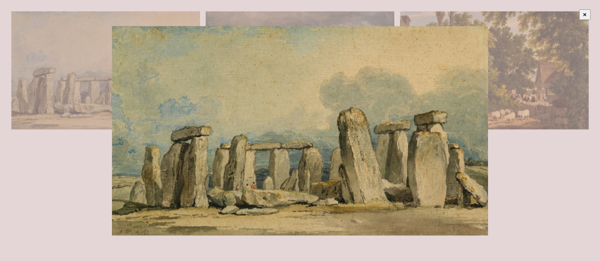

# Build a Lightbox Viewer

<p align="center">
  
  
  
  
  
</p>

> **Milestone:** Lab setelah mempelajari DOM Manipulation and Events.

## About

Build a Lightbox Viewer adalah project web yang membuat galeri gambar sederhana dengan fitur lightbox.

Pengguna dapat memilih salah satu gambar pada galeri untuk menampilkan versi gambar berukuran penuh dalam overlay. Lightbox dapat ditutup melalui tombol close atau dengan mengklik area lightbox.

## Preview



## Konsep Utama

- **DOM Selection** digunakan untuk mengambil elemen galeri, lightbox, gambar preview, dan tombol close.
- **Event Listener** digunakan untuk merespons klik pada gambar dan tombol close.
- **NodeList Iteration** digunakan untuk memasang event pada setiap gambar galeri.
- **String Replacement** digunakan untuk mengubah URL thumbnail menjadi URL gambar berukuran penuh.
- **DOM Property** digunakan untuk mengubah sumber gambar preview.
- **Inline Style** digunakan untuk menampilkan dan menyembunyikan lightbox.
- **CSS Fixed Positioning** digunakan untuk membuat lightbox menutupi halaman.
- **CSS Flexbox** digunakan untuk menempatkan gambar preview di tengah lightbox.

## Struktur Project

```text
lightbox-viewer/
├── index.html
├── styles.css
└── script.js
