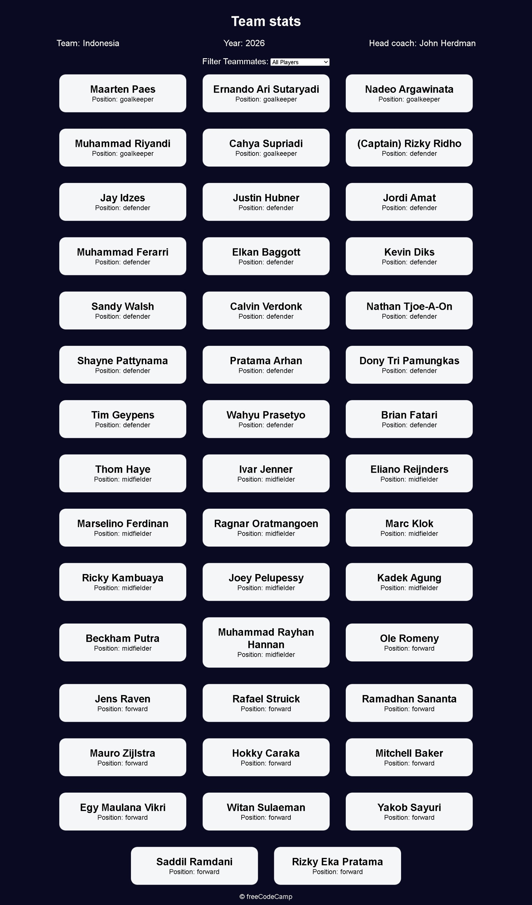

# Build a Set of Football Team Cards

<p align="center">
  
  
  
  
  
</p>

> **Milestone:** Lab setelah mempelajari DOM Manipulation and Events.

## About

Build a Set of Football Team Cards adalah project web yang menampilkan informasi sebuah tim sepak bola beserta daftar pemainnya dalam bentuk kartu.

Data tim disimpan dalam object JavaScript yang berisi nama tim, tahun, kepala pelatih, dan daftar pemain. Pengguna dapat memfilter pemain berdasarkan posisi melalui dropdown.

## Preview



## Konsep Utama

- **Object** digunakan untuk menyimpan data tim dan pemain.
- **Nested Object** digunakan untuk menyimpan setiap data pemain di dalam array `players`.
- **Array** digunakan untuk menyimpan kumpulan pemain.
- **Array `map()`** digunakan untuk menghasilkan elemen kartu pemain.
- **Array `filter()`** digunakan untuk menyaring pemain berdasarkan posisi.
- **Conditional Operator** digunakan untuk menampilkan label Captain pada pemain tertentu.
- **DOM Selection** digunakan untuk mengambil elemen HTML yang akan diperbarui.
- **DOM Manipulation** digunakan untuk menampilkan data tim dan kartu pemain.
- **Event Listener** digunakan untuk mendeteksi perubahan pilihan pada dropdown.
- **Template Literal** digunakan untuk membentuk HTML kartu pemain secara dinamis.

## Struktur Project

```text
set-of-football-team-cards/
├── index.html
├── styles.css
└── script.js
```

## Source Code

Source code tidak tersedia sebagai file repository pada project ini.

## Pembahasan

### 1. Membuat Object Data Tim

Data tim disimpan dalam object `footballTeam`.

```js
const footballTeam = {
  team: "Indonesia",
  year: 2026,
  headCoach: "John Herdman",
  players: [
    // data pemain
  ]
};
```

Object tersebut memiliki property `team`, `year`, `headCoach`, dan `players`.

Property `players` berisi array yang menyimpan data setiap pemain.

### 2. Menyimpan Data Pemain

Setiap pemain direpresentasikan menggunakan object.

```js
{
  name: "Rizky Ridho",
  position: "defender",
  isCaptain: true
}
```

Setiap object pemain memiliki tiga property:

```text
name
position
isCaptain
```

Property `isCaptain` menggunakan nilai boolean untuk menunjukkan apakah pemain tersebut merupakan kapten.

### 3. Menampilkan Informasi Tim

Elemen HTML untuk nama tim, tahun, dan kepala pelatih diambil menggunakan `querySelector()`.

```js
const teamElement = document.querySelector("#team");
const yearElement = document.querySelector("#year");
const headCoachElement = document.querySelector("#head-coach");
```

Nilai dari object `footballTeam` kemudian dimasukkan ke dalam elemen tersebut.

```js
teamElement.textContent = footballTeam.team;
yearElement.textContent = footballTeam.year;
headCoachElement.textContent = footballTeam.headCoach;
```

`textContent` digunakan untuk memperbarui teks pada halaman.

### 4. Membuat Kartu Pemain

Function `displayPlayers()` menerima array pemain.

```js
function displayPlayers(players) {
  const cards = players.map((player) => {
    return `
      <div class="player-card">
        <h2>
          ${player.isCaptain ? "(Captain) " : ""}${player.name}
        </h2>
        <p>Position: ${player.position}</p>
      </div>
    `;
  });

  playerCards.innerHTML = cards.join("");
}
```

Method `map()` digunakan untuk membuat representasi HTML dari setiap pemain.

Template literal digunakan untuk memasukkan data pemain ke dalam struktur HTML.

### 5. Menampilkan Status Kapten

Kode menggunakan conditional operator untuk memeriksa property `isCaptain`.

```js
${player.isCaptain ? "(Captain) " : ""}${player.name}
```

Jika `isCaptain` bernilai `true`, teks `(Captain)` ditampilkan sebelum nama pemain.

Jika bernilai `false`, tidak ada teks tambahan.

### 6. Menampilkan Seluruh Pemain

Pada awal program, seluruh pemain ditampilkan.

```js
displayPlayers(footballTeam.players);
```

Array `players` dikirim sebagai argument ke function `displayPlayers()`.

### 7. Membuat Filter Posisi

Dropdown digunakan untuk memilih posisi pemain.

```html
<select name="players" id="players">
  <option value="all">All Players</option>
  <option value="forward">Position Forward</option>
  <option value="midfielder">Position Midfielder</option>
  <option value="defender">Position Defender</option>
  <option value="goalkeeper">Position Goalkeeper</option>
</select>
```

Pilihan tersebut digunakan untuk menentukan data pemain yang akan ditampilkan.

### 8. Menggunakan Event `change`

Event listener dipasang pada dropdown.

```js
playersDropdown.addEventListener("change", () => {
  const selectedPosition = playersDropdown.value;
```

Event `change` dijalankan ketika pengguna memilih opsi baru.

Nilai pilihan kemudian diambil melalui property `value`.

### 9. Memfilter Pemain

Jika pengguna memilih `all`, seluruh pemain digunakan.

```js
const filteredPlayers = selectedPosition === "all"
  ? footballTeam.players
  : footballTeam.players.filter((player) => {
      return player.position === selectedPosition;
    });
```

Jika pengguna memilih posisi tertentu, method `filter()` hanya mengambil pemain dengan posisi yang sesuai.

Contohnya, ketika memilih:

```text
defender
```

maka hanya pemain dengan:

```js
player.position === "defender"
```

yang dikembalikan.

### 10. Memperbarui Kartu Setelah Filter

Hasil filter dikirim kembali ke `displayPlayers()`.

```js
displayPlayers(filteredPlayers);
```

Kartu pemain kemudian dibuat ulang berdasarkan array hasil filter.

Dengan cara ini, isi halaman berubah tanpa perlu membuat elemen kartu satu per satu secara manual.

## Method yang Dipakai

- `querySelector()` digunakan untuk mengambil elemen HTML berdasarkan selector.
- `map()` digunakan untuk mengubah setiap object pemain menjadi markup HTML.
- `filter()` digunakan untuk mengambil pemain berdasarkan posisi.
- `join()` digunakan untuk menggabungkan hasil `map()` menjadi satu string HTML.
- `addEventListener()` digunakan untuk menangani perubahan pilihan dropdown.

## Ringkasan Cepat

| Konsep | Fungsi |
|---|---|
| Object | Menyimpan data tim dan pemain |
| Array | Menyimpan kumpulan pemain |
| `map()` | Membentuk kartu dari data pemain |
| `filter()` | Menyaring pemain berdasarkan posisi |
| `join()` | Menggabungkan hasil array menjadi string |
| Conditional Operator | Menampilkan status Captain |
| `querySelector()` | Mengambil elemen dari DOM |
| `textContent` | Menampilkan data tim |
| `innerHTML` | Memasukkan kartu pemain ke halaman |
| `addEventListener()` | Menangani perubahan dropdown |
| Template Literal | Membentuk markup kartu secara dinamis |

## Catatan Belajar

- **Object** dapat digunakan untuk mengelompokkan berbagai property yang menggambarkan satu entitas.
- **Array of Objects** cocok digunakan untuk menyimpan kumpulan data dengan struktur yang sama.
- **`map()`** menghasilkan array baru dari setiap item pada array asal.
- **`filter()`** menghasilkan array baru yang hanya berisi item yang memenuhi kondisi.
- **Conditional Operator** dapat membuat keputusan sederhana langsung di dalam template literal.
- **DOM Manipulation** memungkinkan data JavaScript ditampilkan secara dinamis pada halaman.
- **Event `change`** dapat digunakan untuk merespons perubahan pilihan pada elemen select.
- **`innerHTML`** dapat digunakan untuk memasukkan struktur HTML yang dibentuk secara dinamis.

## What I Practiced

```text
JavaScript Objects
Arrays of Objects
Nested Data
Array map()
Array filter()
Array join()
Conditional Operator
Template Literals
DOM Selection
DOM Manipulation
textContent
innerHTML
Change Events
addEventListener()
Dynamic HTML Rendering
```

---

**Platform:** freeCodeCamp  
**Lab:** Build a Set of Football Team Cards  
**Languages:** HTML, CSS & JavaScript  
**Focus:** DOM Manipulation and Events

---

<p align="center">
  <strong>DOM Manipulation and Events Section — Build a Set of Football Team Cards Completed</strong><br>
  <sub>Next stop: continue the JavaScript Certification journey.</sub>
</p>

**Berikutnya mundur ke chapter sebelumnya sesuai aturan progres kita: `JavaScript and Accessibility`.**
