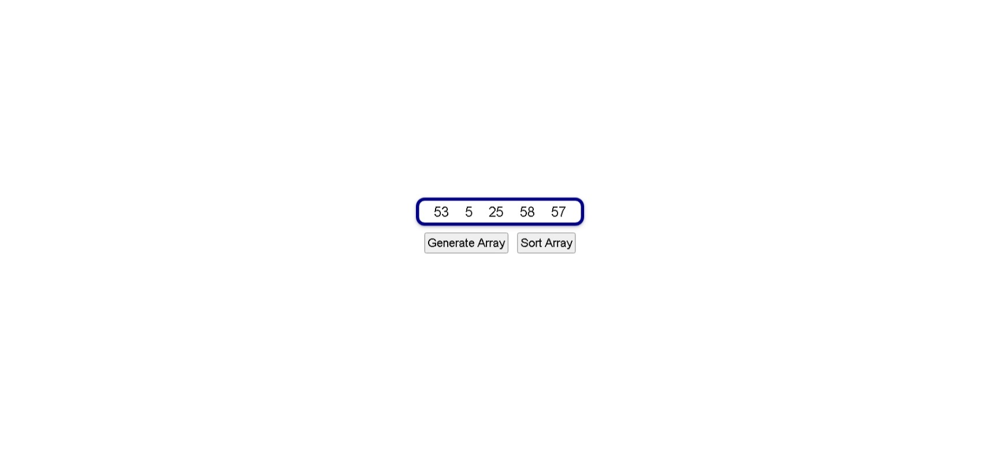
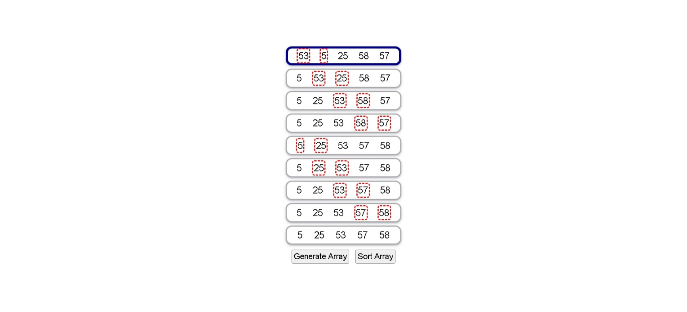

# Build a Sorting Visualizer

<p align="center">
  
  
  
  
  
</p>

> **Milestone:** Lab setelah mempelajari Functional Programming.

## About

Project ini membuat **Sorting Visualizer** berbasis web untuk menampilkan proses pengurutan sebuah array berisi lima angka acak.

Pengguna dapat membuat array baru melalui tombol **Generate Array**. Setelah array tersedia, tombol **Sort Array** digunakan untuk menjalankan proses sorting. Setiap tahap perbandingan disimpan di dalam array `steps`, kemudian ditampilkan sebagai baris terpisah pada halaman.

Dua elemen yang sedang dibandingkan diberi border merah putus-putus agar proses perubahan array pada setiap langkah dapat terlihat.

## Preview





## Konsep Utama

- Function
- Arrow Function
- Array
- Array Copy
- Array Destructuring
- `Math.random()`
- `Math.floor()`
- `new Array()`
- `fill()`
- `map()`
- `forEach()`
- `push()`
- `do...while`
- `for` loop
- Conditional Statement
- Spread Syntax
- DOM Selection
- DOM Element Creation
- DOM Manipulation
- `createElement()`
- `appendChild()`
- `textContent`
- `innerHTML`
- Event Listener
- CSS Flexbox
- Media Query

## Struktur Project

```text
sorting-visualizer/
├── index.html
├── styles.css
└── script.js
```

## Source Code

- [`index.html`](./index.html)
- [`styles.css`](./styles.css)
- [`script.js`](./script.js)

## Pembahasan

### 1. Function `generateElement()`

```javascript
const generateElement = () => {
  const result = Math.floor(Math.random() * 100) + 1;
  return result;
}
```

`generateElement()` menghasilkan satu angka acak.

`Math.random()` menghasilkan nilai acak, kemudian nilainya dikalikan dengan `100`.

`Math.floor()` membulatkan hasil ke bilangan bulat ke bawah.

Tambahan `+ 1` membuat hasil yang dikembalikan berada mulai dari `1`.

### 2. Menampilkan Hasil `generateElement()`

```javascript
console.log(generateElement());
```

Function dipanggil dan hasil angka acaknya ditampilkan ke console.

### 3. Function `generateArray()`

```javascript
const generateArray = () => {
  const arr = new Array(5).fill(null);
  return arr.map(() => generateElement());
}
```

Function ini membuat array dengan panjang `5`.

```javascript
new Array(5).fill
