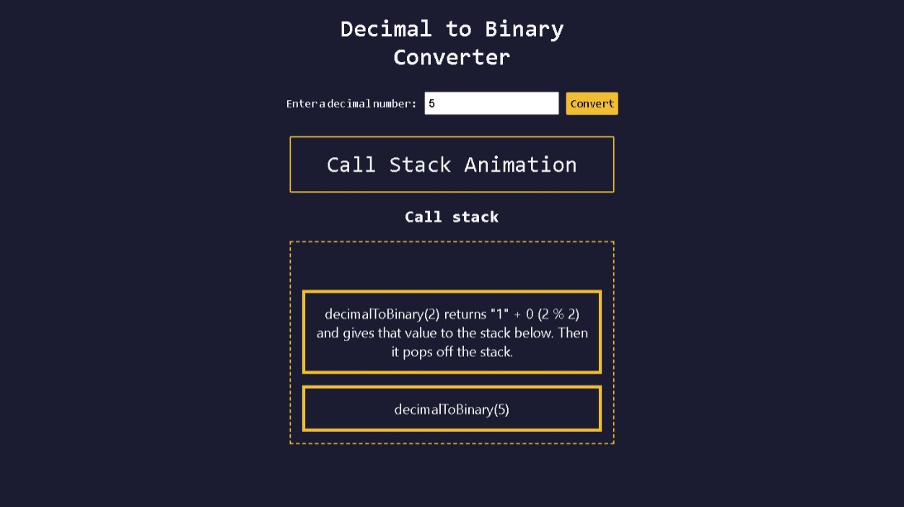

# Build a Decimal to Binary Converter

<p align="center">
  
  
  
  
  
</p>

> **Milestone:** Workshop setelah mempelajari Recursion.

## About

Project ini membuat converter yang mengubah bilangan desimal menjadi bilangan biner menggunakan function `decimalToBinary()` berbasis recursion.

Project juga menampilkan animasi call stack ketika input yang diberikan adalah `5`, sehingga proses pemanggilan `decimalToBinary()` dapat diamati melalui tampilan halaman.

## Preview



## Konsep Utama

- Recursion
- Base case
- Recursive function call
- `Math.floor()`
- Operator modulo `%`
- Call stack
- DOM manipulation
- Event listener
- `setTimeout()`
- Input validation

## Struktur Project

```text
decimal-to-binary-converter/
├── index.html
├── styles.css
└── script.js
```

## Source Code

- [`index.html`](./index.html)
- [`styles.css`](./styles.css)
- [`script.js`](./script.js)

## Pembahasan

### 1. Struktur HTML

File `index.html` menyediakan input angka desimal, tombol `Convert`, area hasil, dan container untuk animasi call stack.

Elemen `output` dengan id `result` digunakan untuk menampilkan hasil konversi atau status animasi.

### 2. Styling dengan CSS

File `styles.css` mengatur tampilan halaman menggunakan warna gelap, input, tombol, area hasil, dan frame animasi.

Layout input berubah dari susunan vertikal menjadi horizontal ketika lebar layar mencapai `36em` melalui media query.

### 3. Mengambil Elemen DOM

```js
const numberInput = document.getElementById("number-input");
const convertBtn = document.getElementById("convert-btn");
const result = document.getElementById("result");
const animationContainer = document.getElementById("animation-container");
```

`document.getElementById()` mengambil elemen HTML berdasarkan nilai `id` agar dapat digunakan oleh JavaScript.

### 4. Base Case pada `decimalToBinary()`

```js
const decimalToBinary = (input) => {
  if (input === 0 || input === 1) {
    return String(input);
  } else {
    return decimalToBinary(Math.floor(input / 2)) + (input % 2);
  }
};
```

Base case terjadi ketika `input` bernilai `0` atau `1`.

Pada kondisi tersebut function langsung mengembalikan nilai sebagai string sehingga recursion berhenti.

### 5. Recursive Call dan Konversi Biner

```js
return decimalToBinary(Math.floor(input / 2)) + (input % 2);
```

Function memanggil dirinya sendiri dengan hasil `Math.floor(input / 2)` untuk terus membagi bilangan sampai mencapai base case.

Operator `%` mengambil sisa pembagian dengan `2`, yaitu digit biner yang ditambahkan setelah hasil recursive call selesai.

Karena hasil recursive call dikembalikan lebih dahulu, digit biner tersusun dari nilai yang paling signifikan menuju nilai yang paling rendah.

### 6. Animasi Call Stack

```js
const animationData = [
  {
    inputVal: 5,
    addElDelay: 1000,
    msg: 'decimalToBinary(5) returns "10" + 1 (5 % 2). Then it pops off the stack.',
    showMsgDelay: 15000,
    removeElDelay: 20000,
  },
];
```

`animationData` menyimpan data yang digunakan untuk membuat frame animasi pemanggilan recursion pada input `5`.

Function `showAnimation()` menambahkan elemen ke `animationContainer`, menampilkan penjelasan setelah jeda tertentu, lalu menghapus frame tersebut.

### 7. Validasi Input dan Menjalankan Konversi

```js
const checkUserInput = () => {
  const inputInt = parseInt(numberInput.value);

  if (!numberInput.value || isNaN(inputInt) || inputInt < 0) {
    alert("Please provide a decimal number greater than or equal to 0");
    return;
  }

  if (inputInt === 5) {
    showAnimation();
    return;
  }

  result.textContent = decimalToBinary(inputInt);
  numberInput.value = "";
};
```

`parseInt()` mengubah nilai input menjadi integer untuk diproses oleh function konversi.

Input kosong, bukan angka, atau bernilai negatif ditolak sebelum proses konversi dijalankan.

Jika input bernilai `5`, program menjalankan `showAnimation()`; selain itu program langsung menampilkan hasil `decimalToBinary(inputInt)`.

### 8. Event Listener

```js
convertBtn.addEventListener("click", checkUserInput);

numberInput.addEventListener("keydown", (e) => {
  if (e.key === "Enter") {
    checkUserInput();
  }
});
```

Tombol `Convert` menjalankan validasi dan konversi ketika diklik.

Input juga dapat diproses dengan menekan tombol `Enter`.

## Method yang Dipakai

- `getElementById()` digunakan untuk mengambil elemen HTML berdasarkan `id`.
- `forEach()` digunakan untuk memproses setiap object dalam `animationData`.
- `addEventListener()` digunakan untuk menangani event `click`, `keydown`, dan input pengguna.
- `remove()` digunakan untuk menghapus frame animasi dari halaman.
- `Math.floor()` digunakan untuk membulatkan hasil pembagian ke bawah pada recursive call.

## Bagian yang Paling Penting Buat Saya

Hal yang paling perlu saya pahami adalah bahwa `decimalToBinary()` tidak langsung selesai ketika memanggil dirinya sendiri. Setiap recursive call menunggu hasil pemanggilan berikutnya sampai mencapai base case `0` atau `1`, kemudian hasilnya dikembalikan satu per satu sambil menambahkan sisa pembagian `% 2`.

## Ringkasan Cepat

| Konsep | Fungsi |
|---|---|
| `decimalToBinary()` | Mengubah bilangan desimal menjadi string biner menggunakan recursion |
| Base case | Menghentikan recursion ketika input bernilai `0` atau `1` |
| `Math.floor()` | Membulatkan hasil pembagian `input / 2` ke bawah |
| `% 2` | Menghasilkan sisa pembagian yang menjadi digit biner |
| Call stack | Menyimpan pemanggilan function selama recursion berlangsung |
| `parseInt()` | Mengubah nilai input menjadi integer |
| `addEventListener()` | Menjalankan function ketika event tertentu terjadi |
| `setTimeout()` | Menunda eksekusi untuk mengatur animasi |

## Catatan Belajar

- **Recursion** terjadi ketika sebuah function memanggil dirinya sendiri.
- **Base case** menghentikan recursion agar function tidak terus memanggil dirinya sendiri.
- **`Math.floor(input / 2)`** membuat nilai input semakin kecil pada setiap recursive call.
- **`input % 2`** menghasilkan digit biner berdasarkan sisa pembagian dengan `2`.
- **Call stack** menampung pemanggilan function yang belum selesai sampai base case tercapai.
- **Urutan `return`** membuat hasil recursive call selesai lebih dahulu sebelum sisa pembagian ditambahkan.

## What I Practiced

```text
JavaScript Recursion
Base Case
Recursive Function Calls
Call Stack
Math.floor()
Modulo Operator
DOM Manipulation
Event Listeners
Input Validation
setTimeout()
Responsive CSS
```

---

**Platform:** freeCodeCamp  
**Workshop:** Build a Decimal to Binary Converter  
**Languages:** HTML, CSS & JavaScript  
**Focus:** Recursion

---

<p align="center">
  <strong>Recursion Section — Build a Decimal to Binary Converter Completed</strong><br>
  <sub>Next stop: continue the JavaScript Certification journey.</sub>
</p>
