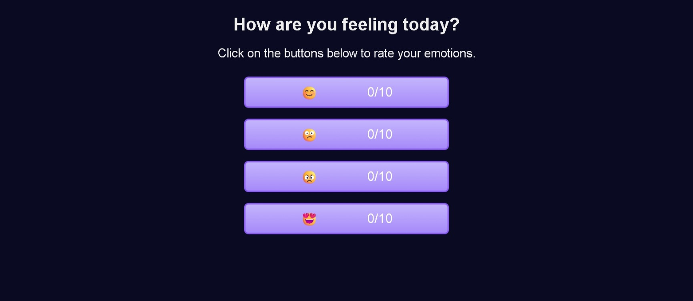

# Build an Emoji Reactor

<p align="center">
  
  
  
  
  
</p>

> **Milestone:** Workshop setelah mempelajari DOM Manipulation and Events.

## About

Build an Emoji Reactor adalah project web yang memungkinkan pengguna memberikan rating terhadap beberapa pilihan emosi melalui tombol emoji.

Setiap tombol memiliki penghitung dengan format `0/10`. Ketika tombol diklik, jumlah rating akan bertambah satu hingga mencapai batas maksimal 10.

Project ini menggunakan JavaScript untuk mengambil elemen dari DOM, menangani event klik, membaca nilai counter, dan memperbarui tampilan secara langsung.

## Preview



## Konsep Utama

- **DOM Selection** digunakan untuk mengambil tombol emoji dan elemen counter.
- **Event Listener** digunakan untuk merespons klik pada setiap tombol.
- **Function** digunakan untuk memperbarui jumlah rating.
- **`querySelector()`** digunakan untuk mengambil elemen counter di dalam tombol.
- **`textContent`** digunakan untuk membaca dan memperbarui nilai counter.
- **`split()`** digunakan untuk memisahkan angka rating dari batas `/10`.
- **Unary Plus** digunakan untuk mengubah nilai teks menjadi number.
- **Conditional Statement** digunakan untuk membatasi rating hingga 10.
- **Increment Operator** digunakan untuk menambah rating sebanyak satu.
- **Template Literal** digunakan untuk membentuk kembali tampilan counter.
- **ARIA Attributes** digunakan untuk memberikan informasi aksesibilitas pada tombol dan emoji.
- **Responsive CSS** digunakan untuk menyesuaikan lebar tombol berdasarkan ukuran layar.

## Struktur Project

```text
emoji-reactor/
├── index.html
├── styles.css
└── script.js
```

## Source Code

- [`index.html`](./index.html)
- [`styles.css`](./styles.css)
- [`script.js`](./script.js)

## Pembahasan

### 1. Struktur Tombol Emoji

Setiap emosi dibuat menggunakan elemen `button`.

```html
<button id="happy-btn" class="emoji-btn" aria-label="Happy face emoji">
  <span role="img" aria-hidden="true">😊</span>
  <span class="count">0/10</span>
</button>
```

Tombol memiliki dua bagian utama.

Emoji ditampilkan pada elemen `span`, sedangkan jumlah rating ditampilkan pada elemen dengan class `count`.

Atribut `aria-label` memberikan nama yang dapat digunakan untuk menjelaskan fungsi tombol.

Emoji menggunakan `role="img"` dan `aria-hidden="true"` sehingga emoji dekoratif tidak perlu dibacakan sebagai bagian terpisah oleh teknologi bantu.

### 2. Function `updateCount()`

Function utama untuk memperbarui rating adalah:

```js
function updateCount(btn) {
  const countEl = btn.querySelector(".count");
  let currCount = +countEl.textContent.split("/")[0];
  
  if (currCount === 10) return;
  
  currCount++;
  countEl.textContent = `${currCount}/10`;
}
```

Function menerima tombol sebagai parameter `btn`.

Dari tombol tersebut, program mencari elemen yang memiliki class `.count`.

### 3. Mengambil Nilai Counter

Program mengambil isi counter menggunakan:

```js
countEl.textContent
```

Nilai awalnya berbentuk string:

```text
0/10
```

String tersebut kemudian dipisahkan menggunakan:

```js
countEl.textContent.split("/")
```

Hasilnya menjadi dua bagian:

```text
["0", "10"]
```

Program mengambil bagian pertama menggunakan:

```js
[0]
```

Unary plus kemudian mengubah nilai tersebut menjadi number.

```js
+countEl.textContent.split("/")[0]
```

Dengan demikian, nilai `"0"` menjadi angka `0`.

### 4. Membatasi Rating hingga 10

Program menggunakan kondisi:

```js
if (currCount === 10) return;
```

Jika rating sudah mencapai 10, function langsung berhenti.

Dengan kondisi tersebut, nilai counter tidak dapat bertambah melewati batas `10`.

### 5. Menambah Rating

Jika rating belum mencapai 10, program menambah nilainya menggunakan increment operator.

```js
currCount++;
```

Nilai rating bertambah satu setiap kali tombol diklik.

### 6. Memperbarui Tampilan Counter

Setelah nilai rating bertambah, isi elemen `.count` diperbarui.

```js
countEl.textContent = `${currCount}/10`;
```

Template literal digunakan untuk menggabungkan nilai rating terbaru dengan batas maksimal.

Contohnya:

```text
0/10
1/10
2/10
3/10
...
10/10
```

### 7. Mengambil Seluruh Tombol

Program mengambil seluruh tombol emoji menggunakan:

```js
const btns = document.querySelectorAll(".emoji-btn");
```

Hasilnya adalah kumpulan seluruh elemen yang memiliki class `.emoji-btn`.

### 8. Memasang Event Listener pada Setiap Tombol

Program menggunakan `forEach()` untuk memproses setiap tombol.

```js
btns.forEach((btn) => {
  btn.addEventListener("click", () => updateCount(btn));
})
```

Setiap tombol mendapatkan event listener `click`.

Ketika tombol diklik, function `updateCount()` dipanggil dengan tombol yang sedang diklik sebagai argument.

Dengan demikian, setiap tombol memiliki counter masing-masing.

### 9. Responsive Layout

CSS menggunakan media query untuk mengubah lebar tombol pada layar yang lebih besar.

```css
@media (min-width: 768px) {
  .emoji-btn {
    width: 30%;
  }
}
```

Pada layar yang lebih kecil, tombol memiliki lebar `70%`.

Pada layar dengan lebar minimal `768px`, lebar tombol berubah menjadi `30%`.

## Method yang Dipakai

- `querySelector()` digunakan untuk mengambil elemen counter di dalam tombol.
- `querySelectorAll()` digunakan untuk mengambil seluruh tombol emoji.
- `addEventListener()` digunakan untuk menangani event klik.
- `forEach()` digunakan untuk melakukan iterasi terhadap seluruh tombol.
- `textContent` digunakan untuk membaca dan memperbarui isi counter.
- `split()` digunakan untuk memisahkan nilai counter berdasarkan karakter `/`.

## Ringkasan Cepat

| Konsep | Fungsi |
|---|---|
| `querySelector()` | Mengambil elemen counter |
| `querySelectorAll()` | Mengambil seluruh tombol emoji |
| `addEventListener()` | Menangani klik tombol |
| `forEach()` | Memproses setiap tombol |
| `textContent` | Membaca dan mengubah isi counter |
| `split()` | Memisahkan angka counter dari `/10` |
| Unary Plus | Mengubah string menjadi number |
| `if` | Membatasi counter hingga 10 |
| `++` | Menambah counter satu angka |
| Template Literal | Membentuk teks counter baru |
| ARIA Attributes | Mendukung struktur aksesibilitas |

## Catatan Belajar

- **`querySelector()`** dapat digunakan untuk mengambil elemen tertentu di dalam sebuah elemen lain.
- **`querySelectorAll()`** dapat digunakan untuk mengambil sekumpulan elemen dengan selector yang sama.
- **`split()`** dapat memecah string menjadi array berdasarkan separator tertentu.
- **Unary Plus** dapat mengubah nilai string numerik menjadi number.
- **`forEach()`** dapat digunakan untuk memberikan event listener kepada banyak elemen.
- **`textContent`** dapat digunakan untuk memperbarui tampilan nilai pada halaman.
- **Conditional Statement** dapat digunakan untuk menghentikan proses ketika batas tertentu tercapai.
- **ARIA Attributes** dapat membantu memberikan informasi tambahan untuk aksesibilitas.

## What I Practiced

```text
DOM Selection
querySelector()
querySelectorAll()
Event Listeners
forEach()
Function Parameters
textContent
split()
Unary Plus
Conditional Statements
Increment Operator
Template Literals
ARIA Attributes
Responsive CSS
```

---

**Platform:** freeCodeCamp  
**Workshop:** Build an Emoji Reactor  
**Languages:** HTML, CSS & JavaScript  
**Focus:** DOM Manipulation and Events

---

<p align="center">
  <strong>DOM Manipulation and Events Section — Build an Emoji Reactor Completed</strong><br>
  <sub>Next stop: continue the JavaScript Certification journey.</sub>
</p>
