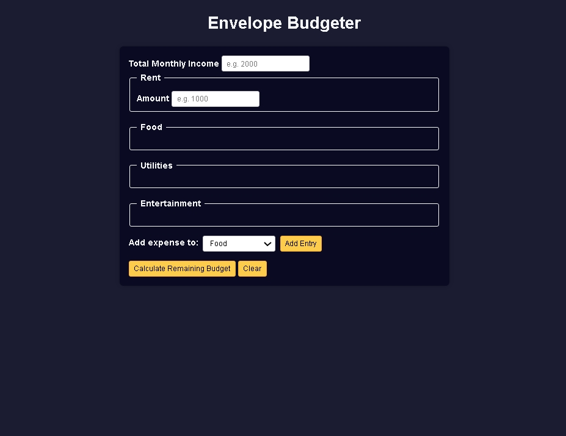

# Build an Envelope Budget App

<p align="center">
  
  
  
  
  
</p>

> **Milestone:** Workshop setelah mempelajari Form Validation.

## About

Project ini membuat aplikasi untuk menghitung sisa anggaran berdasarkan pendapatan bulanan dan pengeluaran.

Pengguna dapat memasukkan pendapatan, biaya sewa, serta menambahkan pengeluaran ke kategori Food, Utilities, dan Entertainment.

Program menghitung total pengeluaran dan menampilkan sisa anggaran atau jumlah kelebihan anggaran.

## Preview



## Konsep Utama

- **HTML Forms** digunakan untuk menerima pendapatan dan data pengeluaran.
- **Fieldset** digunakan untuk mengelompokkan pengeluaran berdasarkan kategori.
- **DOM Manipulation** digunakan untuk menambahkan dan menghapus input pengeluaran secara dinamis.
- **Template Literals** digunakan untuk membuat elemen input pengeluaran.
- **Regular Expressions** digunakan untuk memeriksa input yang tidak valid.
- **Functions** digunakan untuk memisahkan proses penambahan entry, perhitungan, validasi, dan pembersihan form.
- **Loops** digunakan untuk menghitung total dari kumpulan input.
- **Conditional Logic** digunakan untuk menentukan status surplus atau deficit.
- **Event Listeners** digunakan untuk menangani penambahan entry, submit form, dan clear form.
- **CSS Custom Properties** digunakan untuk menyimpan nilai warna.
- **Responsive Design** digunakan untuk menyesuaikan tampilan pada layar kecil.

## Struktur Project

```text
envelope-budget-app/
├── index.html
├── styles.css
├── script.js
└── preview.jpeg
```

## Source Code

- [`index.html`](./index.html)
- [`styles.css`](./styles.css)
- [`script.js`](./script.js)
- [`preview.jpeg`](./preview.jpeg)

## Pembahasan

### 1. Struktur Form

`index.html` menggunakan elemen `form` untuk menerima data anggaran.

Form menyediakan input untuk total pendapatan dan biaya sewa serta beberapa kategori pengeluaran.

Kategori Food, Utilities, dan Entertainment memiliki `input-container` yang digunakan sebagai tempat menambahkan entry pengeluaran secara dinamis.

### 2. Menambahkan Expense Entry

Function `addEntry()` mengambil kategori yang dipilih dari `entryDropdown`.

```js
const category = entryDropdown.value;
const targetInputContainer = document.querySelector(
  `#${category} .input-container`
);
```

Program kemudian menentukan nomor entry berdasarkan jumlah input teks yang sudah tersedia.

HTML untuk nama dan jumlah pengeluaran dibuat menggunakan template literal.

```js
const HTMLString = `
  <label for="${category}-${entryNumber}-name">Expense ${entryNumber} Name</label>
  <input type="text" id="${category}-${entryNumber}-name" placeholder="Name" />
  <label for="${category}-${entryNumber}-amount">Expense ${entryNumber} Amount</label>
  <input 
    type="number" 
    min="0" 
    id="${category}-${entryNumber}-amount" placeholder="Amount" 
    />`;
```

`insertAdjacentHTML()` kemudian memasukkan entry baru ke dalam container kategori.

### 3. Membersihkan Input

Function `cleanInputString()` menghapus karakter `+`, `-`, dan spasi dari nilai input.

```js
function cleanInputString(str) {
  const regex = /[+-\s]/g;
  return str.replace(regex, "");
}
```

Proses ini dilakukan sebelum nilai input dikonversi menjadi angka.

### 4. Memeriksa Input Tidak Valid

Function `isInvalidInput()` menggunakan regular expression untuk memeriksa pola angka dengan notasi `e`.

```js
function isInvalidInput(str) {
  const regex = /\d+e\d+/i;
  return str.match(regex);
}
```

Jika pola tersebut ditemukan, program menampilkan pesan error dan menghentikan proses perhitungan.

### 5. Menghitung Total Input

Function `getTotalFromInputs()` menerima kumpulan input dan menghitung nilainya.

```js
function getTotalFromInputs(list) {
  let total = 0;

  for (const item of list) {
    const currVal = cleanInputString(item.value);
    const invalidInputMatch = isInvalidInput(currVal);

    if (invalidInputMatch) {
      alert(`Invalid Input: ${invalidInputMatch[0]}`);
      isError = true;
      return null;
    }

    total += Number(currVal);
  }

  return total;
}
```

Setiap nilai dibersihkan, diperiksa, lalu dikonversi menjadi angka menggunakan `Number()`.

### 6. Menghitung Budget

Function `calculateBudget()` mengambil seluruh input pengeluaran dari setiap kategori.

Program menghitung:

- total rent;
- total food;
- total utilities;
- total entertainment;
- total income.

Total pengeluaran kemudian dihitung dari seluruh kategori.

```js
const expenses = rent + food + utilities + entertainment;
const netRemaining = income - expenses;
```

### 7. Menentukan Status Budget

Program menggunakan conditional logic untuk menentukan apakah anggaran masih tersisa atau sudah melebihi batas.

Jika `netRemaining` bernilai negatif, program menampilkan jumlah kelebihan anggaran.

Jika nilainya tidak negatif, program menampilkan jumlah anggaran yang tersisa.

```js
if (netRemaining < 0) {
  statusText = `Over Budget by $${Math.abs(netRemaining)}`;
  statusClass = "deficit";
} else {
  statusText = `$${netRemaining} Remaining`;
  statusClass = "surplus";
}
```

Class `surplus` dan `deficit` digunakan untuk membedakan tampilan hasil.

### 8. Menampilkan Hasil

Hasil perhitungan dimasukkan ke dalam elemen `output` menggunakan `innerHTML`.

Output menampilkan status budget, total income, dan total expenses.

Elemen output yang sebelumnya tersembunyi kemudian ditampilkan dengan menghapus class `hide`.

### 9. Membersihkan Form

Function `clearForm()` menghapus seluruh entry pengeluaran tambahan.

Nilai income dan rent juga dikosongkan.

Output kemudian dikosongkan dan kembali disembunyikan.

### 10. Event Listeners

Program menggunakan `addEventListener()` untuk menghubungkan tombol dengan function yang sesuai.

```js
addEntryButton.addEventListener("click", addEntry);
budgetForm.addEventListener("submit", calculateBudget);
clearButton.addEventListener("click", clearForm);
```

Dengan event tersebut, pengguna dapat menambahkan expense entry, menghitung budget, dan membersihkan form.

## Method yang Dipakai

- `getElementById()` digunakan untuk mengambil elemen berdasarkan `id`.
- `querySelector()` digunakan untuk mengambil container kategori tertentu.
- `querySelectorAll()` digunakan untuk mengambil kumpulan input dalam kategori.
- `replace()` digunakan untuk menghapus karakter tertentu dari string input.
- `match()` digunakan untuk memeriksa pola regular expression.
- `insertAdjacentHTML()` digunakan untuk menambahkan HTML expense entry.
- `Array.from()` digunakan untuk membuat array dari kumpulan input container.
- `addEventListener()` digunakan untuk menangani interaksi pengguna.
- `preventDefault()` digunakan untuk mencegah submit form melakukan aksi bawaan browser.
- `Number()` digunakan untuk mengubah nilai input menjadi angka.
- `Math.abs()` digunakan untuk mendapatkan nilai absolut dari kelebihan anggaran.
- `classList.remove()` digunakan untuk menampilkan hasil budget.
- `classList.add()` digunakan untuk menyembunyikan kembali hasil budget.

## Ringkasan Cepat

| Konsep | Fungsi |
|---|---|
| `form` | Menerima data anggaran |
| `fieldset` | Mengelompokkan kategori pengeluaran |
| `querySelector()` | Mengambil container kategori |
| `insertAdjacentHTML()` | Menambahkan expense entry |
| Regular Expression | Memeriksa pola input tidak valid |
| `replace()` | Membersihkan string input |
| `match()` | Mencari pola pada string |
| `for...of` | Memproses kumpulan input |
| `Number()` | Mengubah input menjadi angka |
| Conditional Logic | Menentukan status budget |
| `addEventListener()` | Menangani interaksi pengguna |
| `classList` | Mengatur tampilan output |

## Catatan Belajar

- **Form** digunakan untuk menerima data dari pengguna.
- **DOM Manipulation** digunakan untuk membuat input pengeluaran secara dinamis.
- **Regular Expression** digunakan untuk memeriksa pola input tertentu.
- **Function** digunakan untuk memisahkan setiap proses dalam program.
- **Loop** digunakan untuk menghitung nilai dari beberapa input.
- **Conditional Logic** digunakan untuk menentukan hasil perhitungan budget.
- **Event Listener** digunakan untuk menghubungkan aksi pengguna dengan function.

## What I Practiced

```text
HTML Forms
HTML Fieldset
CSS Custom Properties
CSS Responsive Design
JavaScript Functions
DOM Selection
DOM Manipulation
Template Literals
Regular Expressions
String Methods
for...of Loop
Number Conversion
Conditional Logic
Event Listeners
Form Submission
Dynamic HTML
```

---

**Platform:** freeCodeCamp  
**Workshop:** Build an Envelope Budget App  
**Language:** JavaScript  
**Focus:** Form Validation

---

<p align="center">
  <strong>Form Validation Section — Build an Envelope Budget App Completed</strong><br>
  <sub>Next stop: continue the JavaScript Certification journey.</sub>
</p>
