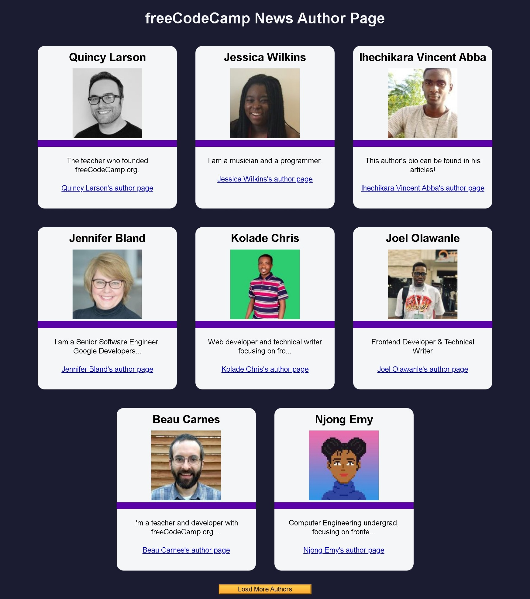

# Build an fCC Authors Page

<p align="center">
  
  
  
  
  
</p>

> **Milestone:** Workshop setelah mempelajari Asynchronous JavaScript.

## About

Project ini membuat **fCC Authors Page** yang mengambil data author freeCodeCamp dari sebuah JSON endpoint menggunakan `fetch()`.

Data dimuat melalui asynchronous function `initialFetch()` dengan `async/await` dan `try...catch`. Setelah data berhasil diperoleh dan diubah menjadi JavaScript data menggunakan `.json()`, delapan author pertama ditampilkan ke halaman.

Tombol **Load More** digunakan untuk menampilkan delapan author berikutnya. Ketika seluruh data sudah mencapai batas akhir, tombol dinonaktifkan dan teksnya diubah menjadi **No more data to load**.

## Preview



## Konsep Utama

- Asynchronous JavaScript
- `async` function
- `await`
- Fetch API
- Promise handling
- `try...catch`
- JSON
- `Response.json()`
- Array
- `slice()`
- `forEach()`
- Object destructuring
- Template literal
- Ternary operator
- DOM Selection
- DOM Manipulation
- Event Listener
- Pagination
- Error handling
- Button state

## Struktur Project

```text
fcc-authors-page/
├── index.html
├── styles.css
└── script.js
```

## Source Code

- [`index.html`](index.html)
- [`styles.css`](styles.css)
- [`script.js`](script.js)

## Pembahasan

### 1. Mengambil Elemen dari DOM

```javascript
const authorContainer = document.getElementById('author-container');
const loadMoreBtn = document.getElementById('load-more-btn');
```

`document.getElementById()` digunakan untuk mengambil dua elemen dari halaman.

`authorContainer` digunakan sebagai tempat menampilkan data author.

`loadMoreBtn` digunakan untuk menangani proses menampilkan data berikutnya.

### 2. Menentukan Index Awal dan Akhir

```javascript
let startingIndex = 0;
let endingIndex = 8;
let authorDataArr = [];
```

Tiga variable digunakan untuk mengatur data author.

`startingIndex` menentukan index awal data yang akan diambil.

`endingIndex` menentukan batas akhir dari bagian array.

Nilai awal:

```javascript
startingIndex = 0;
endingIndex = 8;
```

membuat proses pertama mengambil bagian awal data.

`authorDataArr` disiapkan sebagai array kosong untuk menyimpan seluruh data author setelah proses fetch selesai.

### 3. Asynchronous Function `initialFetch()`

```javascript
const initialFetch = async () => {
```

Keyword `async` membuat `initialFetch()` menjadi asynchronous function.

Di dalam function ini terdapat operasi yang menggunakan `await`.

### 4. Menggunakan `try...catch`

```javascript
try {
```

Proses pengambilan dan pengolahan data ditempatkan di dalam `try`.

Jika terjadi error pada proses tersebut, kode di dalam `catch` akan dijalankan.

### 5. Mengambil Data dengan `fetch()`

```javascript
const res = await fetch('https://cdn.freecodecamp.org/curriculum/news-author-page/authors.json');
```

`fetch()` digunakan untuk melakukan request ke endpoint JSON author freeCodeCamp.

Keyword `await` membuat function menunggu hasil operasi tersebut sebelum melanjutkan ke statement berikutnya.

Response disimpan di:

```javascript
res
```

### 6. Mengubah Response menjadi Data JavaScript

```javascript
authorDataArr = await res.json();
```

Method `.json()` digunakan untuk membaca body dari response dan memprosesnya sebagai JSON.

Proses tersebut juga menggunakan `await`.

Hasilnya kemudian disimpan ke:

```javascript
authorDataArr
```

### 7. Menampilkan Delapan Author Pertama

```javascript
displayAuthors(authorDataArr.slice(startingIndex, endingIndex));
```

Method `slice()` mengambil sebagian data berdasarkan `startingIndex` dan `endingIndex`.

Dengan nilai awal `0` dan `8`, bagian awal array diberikan kepada:

```javascript
displayAuthors()
```

untuk ditampilkan pada halaman.

### 8. Menangani Error

```javascript
catch (err) {
  authorContainer.innerHTML = '<p class="error-msg">There was an error loading the authors</p>';
}
```

Jika proses di dalam `try` menghasilkan error, block `catch` dijalankan.

Isi `authorContainer` kemudian diganti dengan pesan:

```text
There was an error loading the authors
```

Pesan tersebut dibuat sebagai elemen `<p>` dengan class `error-msg`.

### 9. Function `fetchMoreAuthors()`

```javascript
const fetchMoreAuthors = () => {
```

Function ini menangani proses menampilkan bagian berikutnya dari `authorDataArr`.

Berbeda dengan `initialFetch()`, function ini tidak melakukan request baru.

Data yang digunakan berasal dari `authorDataArr` yang sudah diperoleh sebelumnya.

### 10. Memindahkan Index

```javascript
startingIndex += 8;
endingIndex += 8;
```

Setiap kali function dipanggil, kedua index bertambah `8`.

Dengan demikian, bagian array yang dipilih berpindah ke kelompok data berikutnya.

### 11. Menampilkan Data Berikutnya

```javascript
displayAuthors(authorDataArr.slice(startingIndex, endingIndex));
```

`slice()` kembali digunakan berdasarkan index yang sudah diperbarui.

Hasil slice diberikan ke `displayAuthors()`.

### 12. Memeriksa Apakah Data Sudah Habis

```javascript
if (authorDataArr.length <= endingIndex) {
```

Program membandingkan panjang seluruh data dengan `endingIndex`.

Jika panjang data sudah kurang dari atau sama dengan batas akhir, tidak ada kelompok data berikutnya yang perlu dimuat.

### 13. Menonaktifkan Tombol

```javascript
loadMoreBtn.disabled = true;
```

Property `disabled` diubah menjadi `true`.

Hal ini membuat tombol tidak dapat digunakan lagi.

### 14. Mengubah Cursor

```javascript
loadMoreBtn.style.cursor = 'not-allowed';
```

Style cursor pada tombol diubah menjadi:

```text
not-allowed
```

untuk menunjukkan bahwa tombol sudah tidak aktif.

### 15. Mengubah Teks Tombol

```javascript
loadMoreBtn.textContent = 'No more data to load';
```

Setelah seluruh data mencapai akhir, teks tombol berubah menjadi:

```text
No more data to load
```

### 16. Function `displayAuthors()`

```javascript
const displayAuthors = (authors) => {
```

Function ini menerima parameter `authors`.

Data tersebut kemudian diproses satu per satu untuk menghasilkan author card.

### 17. Memproses Setiap Author

```javascript
authors.forEach(({ author, image, url, bio }, index) => {
```

Method `forEach()` digunakan untuk memproses setiap object author.

Object destructuring langsung mengambil property:

- `author`
- `image`
- `url`
- `bio`

Parameter `index` menyimpan index dari elemen yang sedang diproses pada array `authors` yang diberikan kepada function.

### 18. Menambahkan Author Card

```javascript
authorContainer.innerHTML += `
  <div id="${index}" class="user-card">
```

Template literal digunakan untuk membuat markup author card.

Operator `+=` membuat card baru ditambahkan ke isi `authorContainer` yang sudah ada.

Setiap card menggunakan class:

```text
user-card
```

### 19. Menampilkan Nama Author

```javascript
<h2 class="author-name">${author}</h2>
```

Nilai `author` dimasukkan ke elemen `<h2>` menggunakan template literal interpolation.

### 20. Menampilkan Gambar Author

```javascript

```

Property `image` digunakan sebagai `src`.

Nama author juga digunakan untuk membentuk attribute `alt`.

### 21. Menampilkan Divider

```javascript
<div class="purple-divider"></div>
```

Elemen ini ditambahkan di antara gambar dan bio dengan class `purple-divider`.

### 22. Membatasi Panjang Bio

```javascript
<p class="bio">${bio.length > 50 ? bio.slice(0, 50) + '...' : bio}</p>
```

Ternary operator digunakan untuk menentukan bagaimana bio ditampilkan.

Kondisinya adalah:

```javascript
bio.length > 50
```

Jika panjang bio lebih dari `50`, kode menggunakan:

```javascript
bio.slice(0, 50) + '...'
```

Jika tidak, seluruh nilai `bio` ditampilkan.

### 23. Menampilkan Link Author

```javascript
<a class="author-link" href="${url}" target="_blank">${author}'s author page</a>
```

Property `url` digunakan sebagai tujuan link.

`target="_blank"` membuat link dibuka pada browsing context baru.

Teks link menggunakan nama author yang sedang diproses.

### 24. Menjalankan Fetch Awal

```javascript
initialFetch();
```

`initialFetch()` langsung dipanggil ketika script dijalankan.

Function kemudian memulai proses mengambil data author dan menampilkan bagian pertama.

### 25. Event Tombol Load More

```javascript
loadMoreBtn.addEventListener('click', fetchMoreAuthors);
```

`addEventListener()` digunakan untuk mendengarkan event:

```text
click
```

Ketika tombol ditekan, function:

```javascript
fetchMoreAuthors
```

dijalankan.

### 26. Alur Data Project

Alur source code dimulai ketika:

```javascript
initialFetch();
```

dijalankan.

Data author diambil melalui:

```javascript
fetch()
```

kemudian diproses menggunakan:

```javascript
res.json()
```

dan disimpan ke:

```javascript
authorDataArr
```

Bagian data kemudian dipilih menggunakan:

```javascript
slice()
```

dan dikirim ke:

```javascript
displayAuthors()
```

untuk ditampilkan ke halaman.

Ketika tombol **Load More** ditekan, aplikasi tidak melakukan fetch ulang. `fetchMoreAuthors()` mengambil bagian berikutnya dari `authorDataArr` yang sudah tersimpan.

## Method yang Dipakai

- `document.getElementById()` digunakan untuk mengambil elemen dari DOM.
- `fetch()` digunakan untuk melakukan request data author.
- `json()` digunakan untuk memproses response JSON.
- `slice()` digunakan untuk mengambil sebagian data berdasarkan index.
- `forEach()` digunakan untuk memproses setiap author.
- `addEventListener()` digunakan untuk menangani klik tombol Load More.

## Ringkasan Cepat

| Konsep | Fungsi |
|---|---|
| `initialFetch()` | Mengambil data author dan menampilkan data awal |
| `async` | Mendefinisikan asynchronous function |
| `await` | Menunggu operasi asynchronous selesai |
| `fetch()` | Melakukan request ke endpoint author |
| `res.json()` | Memproses response sebagai JSON |
| `try...catch` | Menangani proses utama dan kondisi error |
| `authorDataArr` | Menyimpan seluruh data author |
| `startingIndex` | Menentukan index awal data yang ditampilkan |
| `endingIndex` | Menentukan batas akhir data yang ditampilkan |
| `slice()` | Mengambil bagian tertentu dari array |
| `fetchMoreAuthors()` | Memindahkan batas data ke delapan author berikutnya |
| `displayAuthors()` | Membuat markup author card |
| Object destructuring | Mengambil `author`, `image`, `url`, dan `bio` |
| Ternary operator | Membatasi bio jika panjangnya lebih dari 50 karakter |
| `disabled` | Menonaktifkan tombol ketika seluruh data selesai ditampilkan |
| `addEventListener()` | Menjalankan Load More berdasarkan klik pengguna |

## Catatan Belajar

- **`async`** digunakan pada `initialFetch()` karena function menjalankan operasi asynchronous.
- **`await fetch()`** menunggu response dari endpoint sebelum proses berikutnya berjalan.
- **`await res.json()`** memproses response JSON sebelum hasilnya disimpan ke `authorDataArr`.
- **`try...catch`** menyediakan jalur untuk menampilkan pesan error ketika proses pengambilan data gagal.
- **Data author hanya di-fetch pada `initialFetch()`**; tombol Load More memakai array yang sudah tersimpan.
- **`startingIndex` dan `endingIndex`** bertambah `8` setiap kali data berikutnya diminta.
- **`slice()`** memilih bagian array tanpa mengubah `authorDataArr`.
- **`displayAuthors()`** menerima bagian data yang akan ditampilkan.
- **Object destructuring** mengambil property author langsung di parameter callback `forEach()`.
- **Template literal** digunakan untuk membentuk author card.
- **Bio lebih dari 50 karakter** dipotong menggunakan `slice(0, 50)` lalu ditambahkan `"..."`.
- **Tombol Load More** dinonaktifkan ketika batas data terakhir sudah tercapai.
- **`innerHTML +=`** digunakan untuk menambahkan setiap card ke container.
- **Event listener** menghubungkan klik tombol dengan `fetchMoreAuthors()`.

## What I Practiced

```text
Asynchronous JavaScript
Async Functions
Await Expressions
Fetch API
JSON Responses
Try...catch
Error Handling
Arrays
Array slice()
Array forEach()
Object Destructuring
Template Literals
Ternary Operator
DOM Selection
DOM Manipulation
Event Listeners
Pagination
Button States
```

---

**Platform:** freeCodeCamp  
**Workshop:** Build an fCC Authors Page  
**Language:** JavaScript  
**Focus:** Asynchronous JavaScript

---

<p align="center">
  <strong>Asynchronous JavaScript Section — Build an fCC Authors Page Completed</strong><br>
  <sub>Next stop: continue the JavaScript Certification journey.</sub>
</p>
