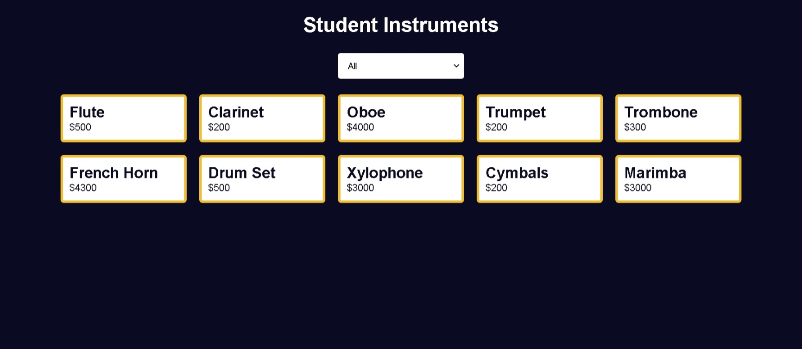

# Build a Music Instrument Filter

<p align="center">
  
  
  
  
  
</p>

> **Milestone:** Workshop setelah mempelajari DOM Manipulation and Events.

## About

Build a Music Instrument Filter adalah project web yang menampilkan daftar alat musik berdasarkan kategori yang dipilih pengguna.

Pengguna dapat memilih kategori `All`, `Woodwinds`, `Brass`, atau `Percussion` melalui dropdown. JavaScript kemudian memfilter data alat musik dan memperbarui daftar produk yang ditampilkan pada halaman.

## Preview



## Konsep Utama

- **Array of Objects** digunakan untuk menyimpan data kategori, nama instrumen, dan harga.
- **Destructuring** digunakan untuk mengambil property dari setiap object.
- **`filter()`** digunakan untuk memilih instrumen berdasarkan kategori.
- **`map()`** digunakan untuk membuat tampilan card dari data instrumen.
- **Template Literal** digunakan untuk membuat HTML card secara dinamis.
- **`join()`** digunakan untuk menggabungkan hasil `map()` menjadi satu string HTML.
- **DOM Selection** digunakan untuk mengambil elemen select dan container produk.
- **Event Listener** digunakan untuk mendeteksi perubahan pilihan kategori.
- **`innerHTML`** digunakan untuk memperbarui daftar card pada halaman.

## Struktur Project

```text
music-instrument-filter/
├── index.html
├── styles.css
└── script.js
```

## Source Code

- [`index.html`](./index.html)
- [`styles.css`](./styles.css)
- [`script.js`](./script.js)

## Pembahasan

### 1. Menyimpan Data Instrumen

Data instrumen disimpan dalam array yang berisi beberapa object.

```js
const instrumentsArr = [
  { category: "woodwinds", instrument: "Flute", price: 500 },
  { category: "woodwinds", instrument: "Clarinet", price: 200 },
  { category: "woodwinds", instrument: "Oboe", price: 4000 },
  { category: "brass", instrument: "Trumpet", price: 200 },
  { category: "brass", instrument: "Trombone", price: 300 },
  { category: "brass", instrument: "French Horn", price: 4300 },
  { category: "percussion", instrument: "Drum Set", price: 500 },
  { category: "percussion", instrument: "Xylophone", price: 3000 },
  { category: "percussion", instrument: "Cymbals", price: 200 },
  { category: "percussion", instrument: "Marimba", price: 3000 }
];
```

Setiap object memiliki tiga property yaitu `category`, `instrument`, dan `price`.

### 2. Mengambil Elemen dari DOM

Program mengambil elemen dropdown dan container produk.

```js
const selectContainer = document.querySelector("select");
const productsContainer = document.querySelector(".products-container");
```

`selectContainer` digunakan untuk membaca kategori yang dipilih pengguna, sedangkan `productsContainer` digunakan untuk menampilkan hasil filter.

### 3. Membuat Fungsi `instrumentCards()`

Fungsi `instrumentCards()` menerima kategori instrumen sebagai parameter.

```js
function instrumentCards(instrumentCategory) {
```

Parameter tersebut digunakan untuk menentukan data yang akan ditampilkan.

### 4. Memilih Data Berdasarkan Kategori

Program menggunakan conditional operator untuk menentukan apakah seluruh instrumen atau hanya kategori tertentu yang ditampilkan.

```js
const instruments =
  instrumentCategory === "all"
    ? instrumentsArr
    : instrumentsArr.filter(
        ({ category }) => category === instrumentCategory
      );
```

Jika kategori yang dipilih adalah `all`, seluruh data digunakan.

Jika kategori lain dipilih, `filter()` hanya mengambil object dengan `category` yang sesuai.

### 5. Menggunakan Destructuring pada Object

Callback `filter()` menggunakan destructuring untuk mengambil property `category`.

```js
({ category }) => category === instrumentCategory
```

Cara ini memungkinkan property `category` digunakan langsung tanpa menulis `instrument.category`.

### 6. Membuat Card dengan `map()`

Setelah data dipilih, `map()` digunakan untuk mengubah setiap object menjadi HTML card.

```js
return instruments
  .map(({ instrument, price }) => {
    return `
      <div class="card">
        <h2>${instrument}</h2>
        <p>$${price}</p>
      </div>
    `;
  });
```

Destructuring digunakan kembali untuk mengambil `instrument` dan `price`.

### 7. Menggunakan Template Literal

Template literal digunakan untuk memasukkan nama instrumen dan harga ke dalam struktur HTML.

```js
`
  <div class="card">
    <h2>${instrument}</h2>
    <p>$${price}</p>
  </div>
`
```

Nilai `${instrument}` dan `${price}` akan diganti dengan data dari object yang sedang diproses.

### 8. Menggabungkan Hasil dengan `join()`

Hasil `map()` berupa array string HTML.

```js
instrumentCards(selectContainer.value).join("")
```

`join("")` menggabungkan seluruh string tersebut tanpa separator sehingga dapat dimasukkan sebagai satu HTML string.

### 9. Menangani Perubahan Dropdown

Program menggunakan event `change` pada dropdown.

```js
selectContainer.addEventListener("change", () => {
  productsContainer.innerHTML =
    instrumentCards(selectContainer.value).join("");
});
```

Ketika pengguna memilih kategori baru, fungsi `instrumentCards()` dijalankan kembali menggunakan nilai pilihan terbaru.

### 10. Memperbarui Tampilan Produk

Hasil filter dimasukkan ke dalam `.products-container` menggunakan `innerHTML`.

```js
productsContainer.innerHTML =
  instrumentCards(selectContainer.value).join("");
```

Dengan cara ini, card produk pada halaman dapat berubah sesuai kategori yang dipilih.

## Method yang Dipakai

- `querySelector()` digunakan untuk mengambil elemen select dan container produk.
- `filter()` digunakan untuk memilih instrumen berdasarkan kategori.
- `map()` digunakan untuk mengubah data instrumen menjadi HTML card.
- `join()` digunakan untuk menggabungkan array string HTML.
- `addEventListener()` digunakan untuk menangani perubahan pada dropdown.

## Ringkasan Cepat

| Konsep | Fungsi |
|---|---|
| Array of Objects | Menyimpan data instrumen |
| Destructuring | Mengambil property dari object |
| `filter()` | Memilih instrumen berdasarkan kategori |
| `map()` | Membuat HTML card dari data |
| Template Literal | Membentuk HTML dengan data dinamis |
| `join()` | Menggabungkan string HTML |
| `querySelector()` | Mengambil elemen dari DOM |
| `addEventListener()` | Menangani perubahan pilihan |
| `innerHTML` | Memperbarui isi container |

## Catatan Belajar

- **Array of Objects** dapat digunakan untuk menyimpan kumpulan data yang memiliki beberapa property.
- **Destructuring** dapat membuat pengambilan property object menjadi lebih ringkas.
- **`filter()`** menghasilkan data baru berdasarkan kondisi yang diberikan.
- **`map()`** dapat mengubah setiap item array menjadi bentuk baru.
- **Template Literal** memudahkan pembuatan string HTML dengan data dinamis.
- **`join()`** dapat menggabungkan elemen array menjadi satu string.
- **Event `change`** dapat digunakan untuk merespons perubahan pilihan pada elemen select.
- **`innerHTML`** dapat digunakan untuk memperbarui isi sebuah elemen pada halaman.

## What I Practiced

```text
DOM Selection
Array of Objects
Object Destructuring
Array filter()
Array map()
Array join()
Template Literals
Event Listeners
Change Events
Dynamic HTML Rendering
innerHTML
```

---

**Platform:** freeCodeCamp  
**Workshop:** Build a Music Instrument Filter  
**Languages:** HTML, CSS & JavaScript  
**Focus:** DOM Manipulation and Events

---

<p align="center">
  <strong>DOM Manipulation and Events Section — Build a Music Instrument Filter Completed</strong><br>
  <sub>Next stop: continue the JavaScript Certification journey.</sub>
</p>
