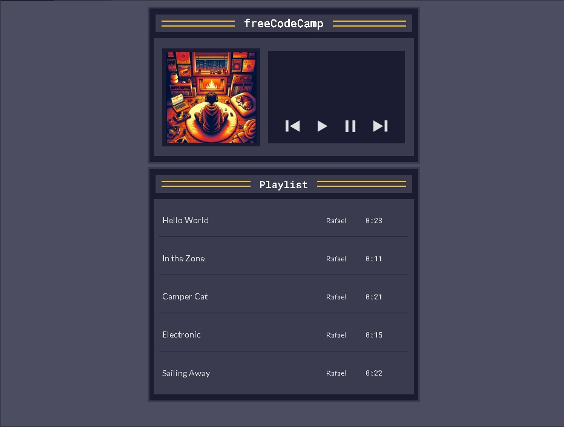

# Build a Music Player

<p align="center">
  
  
  
  
  
</p>

> **Milestone:** Workshop setelah mempelajari Audio and Video Events.

## About

Project ini membuat music player sederhana menggunakan HTML, CSS, dan JavaScript.

Player menampilkan album art, informasi lagu yang sedang diputar, playlist, serta kontrol untuk memutar, menjeda, berpindah ke lagu berikutnya, dan kembali ke lagu sebelumnya.

JavaScript digunakan untuk mengelola data lagu, status lagu yang sedang aktif, posisi pemutaran, interaksi playlist, dan pembaruan tampilan player.

## Preview



## Konsep Utama

- **DOM Selection** digunakan untuk mengambil elemen player dan playlist dari halaman.
- **Array of Objects** digunakan untuk menyimpan data setiap lagu.
- **State Object** digunakan untuk menyimpan playlist, lagu aktif, dan waktu pemutaran.
- **Audio Object** digunakan untuk mengatur pemutaran file audio.
- **Array Methods** digunakan untuk mencari lagu dan menentukan posisi lagu aktif.
- **Arrow Functions** digunakan untuk membuat fungsi-fungsi player.
- **Optional Chaining** digunakan untuk mengakses data yang mungkin belum tersedia.
- **DOM Manipulation** digunakan untuk memperbarui judul dan artis lagu.
- **Event Listeners** digunakan untuk merespons klik tombol dan akhir pemutaran.
- **ARIA Attributes** digunakan untuk membantu memberikan informasi aksesibilitas pada kontrol player.
- **CSS Custom Properties** digunakan untuk mengatur nilai warna dan ukuran secara terpusat.
- **Responsive Design** digunakan untuk menyesuaikan tampilan player pada layar kecil.

## Struktur Project

```text
music-player/
├── index.html
├── styles.css
└── script.js
```

## Source Code

- [`index.html`](./index.html)
- [`styles.css`](./styles.css)
- [`script.js`](./script.js)

## Pembahasan

### 1. Struktur HTML

`index.html` membentuk struktur utama music player dan playlist.

Bagian player terdiri dari album art, informasi lagu, serta tombol previous, play, pause, dan next.

Playlist menggunakan elemen `li` untuk setiap lagu dan `button` sebagai kontrol pemilihan lagu.

### 2. Data Lagu

Array `allSongs` menyimpan data lagu dalam bentuk object.

Setiap object memiliki `id`, `title`, `artist`, `duration`, dan `src`.

```js
{
  id: 0,
  title: "Hello World",
  artist: "Rafael",
  duration: "0:23",
  src: "https://cdn.freecodecamp.org/curriculum/js-music-player/hello-world.mp3",
}
```

### 3. Audio Object

Object `audio` dibuat menggunakan `new Audio()`.

Object tersebut digunakan untuk menetapkan sumber audio, mengatur posisi pemutaran, menjalankan lagu, dan menghentikan lagu.

### 4. State `userData`

Object `userData` menyimpan keadaan player.

```js
const userData = {
  songs: allSongs,
  currentSong: null,
  songCurrentTime: 0,
};
```

`currentSong` menyimpan lagu yang sedang dipilih, sedangkan `songCurrentTime` menyimpan posisi audio ketika lagu dijeda.

### 5. Fungsi `playSong()`

`playSong()` mencari lagu berdasarkan `id`, menetapkan sumber audio, menentukan posisi pemutaran, memperbarui state, memperbarui tampilan, dan menjalankan audio.

Parameter `start` digunakan untuk membedakan pemutaran dari awal dengan melanjutkan posisi lagu sebelumnya.

### 6. Fungsi `pauseSong()`

`pauseSong()` menyimpan posisi audio saat ini ke `userData.songCurrentTime`.

Fungsi tersebut kemudian menghapus class `playing` dan menjalankan `audio.pause()`.

### 7. Navigasi Playlist

`getCurrentSongIndex()` mencari posisi lagu aktif dalam array.

`getNextSong()` mengambil lagu setelah lagu aktif.

`getPreviousSong()` mengambil lagu sebelum lagu aktif.

`playNextSong()` memainkan lagu berikutnya atau menghentikan player ketika playlist sudah mencapai lagu terakhir.

`playPreviousSong()` memainkan lagu sebelumnya atau kembali ke lagu pertama ketika tidak ada lagu sebelumnya.

### 8. Pembaruan Player Display

`setPlayerDisplay()` mengambil judul dan artis dari lagu aktif.

Nilai tersebut kemudian dimasukkan ke elemen `player-song-title` dan `player-song-artist` menggunakan `textContent`.

### 9. Highlight Lagu Aktif

`highlightCurrentSong()` menghapus `aria-current` dari lagu sebelumnya.

Fungsi tersebut kemudian memberikan `aria-current="true"` pada lagu yang sedang diputar.

CSS menggunakan atribut tersebut untuk memberikan tampilan berbeda pada lagu aktif.

### 10. Interaksi Tombol

`addEventListener()` digunakan untuk menghubungkan tombol player dengan fungsi yang sesuai.

Tombol playlist juga memiliki event listener sehingga pengguna dapat memilih lagu secara langsung dari daftar.

### 11. Event `ended`

Event `ended` pada object `audio` menjalankan `playNextSong()`.

Dengan demikian, player dapat berpindah ke lagu berikutnya ketika lagu yang sedang diputar selesai.

## Method yang Dipakai

- `find()` digunakan untuk mencari lagu berdasarkan `id`.
- `indexOf()` digunakan untuk mendapatkan posisi lagu aktif dalam array.
- `getElementById()` digunakan untuk mengambil elemen berdasarkan `id`.
- `querySelector()` digunakan untuk mengambil elemen tertentu di dalam playlist.
- `querySelectorAll()` digunakan untuk mengambil seluruh elemen lagu.
- `setAttribute()` digunakan untuk menetapkan atribut seperti `aria-label` dan `aria-current`.
- `removeAttribute()` digunakan untuk menghapus `aria-current` dari lagu sebelumnya.
- `addEventListener()` digunakan untuk menangani interaksi pengguna dan event audio.
- `classList.add()` digunakan untuk menandai player sebagai sedang diputar.
- `classList.remove()` digunakan untuk menghapus status sedang diputar.
- `play()` digunakan untuk memulai audio.
- `pause()` digunakan untuk menjeda audio.

## Ringkasan Cepat

| Konsep | Fungsi |
|---|---|
| `Array of Objects` | Menyimpan data lagu |
| `find()` | Mencari lagu berdasarkan `id` |
| `indexOf()` | Menentukan posisi lagu aktif |
| `Audio` | Mengontrol pemutaran audio |
| `userData` | Menyimpan state player |
| `currentTime` | Menyimpan posisi pemutaran |
| `addEventListener()` | Menangani interaksi dan event |
| `classList` | Mengatur status visual player |
| `textContent` | Memperbarui informasi lagu |
| `aria-current` | Menandai lagu yang sedang aktif |

## Catatan Belajar

- **Array** digunakan untuk menyimpan kumpulan data lagu.
- **Object** digunakan untuk mengelompokkan informasi setiap lagu.
- **State** digunakan untuk menyimpan keadaan player saat ini.
- **Audio** digunakan untuk mengontrol file audio melalui JavaScript.
- **Event Listener** digunakan untuk membuat tombol merespons tindakan pengguna.
- **DOM Manipulation** digunakan untuk memperbarui tampilan berdasarkan state player.
- **ARIA Attribute** digunakan untuk memberikan informasi tambahan pada elemen interaktif.

## What I Practiced

```text
HTML Structure
CSS Custom Properties
CSS Flexbox
Responsive Design
JavaScript Arrays
JavaScript Objects
Audio Object
DOM Selection
DOM Manipulation
Array find()
Array indexOf()
Arrow Functions
Optional Chaining
Event Listeners
classList
textContent
ARIA Attributes
Audio Playback
Audio Events
State Management
```

---

**Platform:** freeCodeCamp  
**Workshop:** Build a Music Player  
**Languages:** HTML, CSS & JavaScript  
**Focus:** Audio and Video Events

---

<p align="center">
  <strong>Audio and Video Events Section — Build a Music Player Completed</strong><br>
  <sub>Next stop: continue the JavaScript Certification journey.</sub>
</p>
