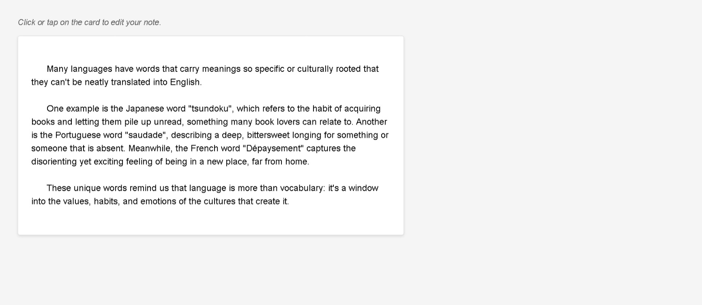

# Build a Note Taking App

<p align="center">
  
  
  
  
  
</p>

> **Milestone:** Workshop setelah mempelajari JavaScript and Accessibility.

## About

Build a Note Taking App adalah project web yang menyediakan sebuah kartu catatan yang dapat diedit langsung oleh pengguna.

Project ini menggunakan elemen `contenteditable` agar isi catatan dapat diubah langsung pada halaman. JavaScript kemudian mendeteksi ketika catatan kehilangan fokus dan menampilkan pesan bahwa catatan berhasil disimpan jika isinya berubah.

## Preview



## Konsep Utama

- **`contenteditable`** membuat elemen catatan dapat diedit langsung oleh pengguna.
- **ARIA Label** menggunakan `aria-label` untuk memberikan label pada area editor.
- **Focus Event** digunakan untuk menghapus pesan status ketika catatan kembali aktif.
- **Blur Event** digunakan untuk memeriksa perubahan setelah pengguna selesai mengedit.
- **`innerHTML`** digunakan untuk mengambil isi terbaru dari elemen catatan.
- **`textContent`** digunakan untuk mengambil isi awal catatan.
- **State Variable** menggunakan `currentContent` untuk menyimpan isi catatan sebelumnya.
- **Strict Equality** digunakan untuk membandingkan isi lama dan isi terbaru.
- **DOM Manipulation** digunakan untuk memperbarui pesan status.
- **`aria-live`** digunakan agar perubahan status dapat dikomunikasikan secara aksesibel.

## Struktur Project

```text
note-taking-app/
├── index.html
├── styles.css
└── script.js
```

## Source Code

- [`index.html`](./index.html)
- [`styles.css`](./styles.css)
- [`script.js`](./script.js)

## Pembahasan

### 1. Membuat Area Catatan yang Dapat Diedit

Elemen `div` digunakan sebagai area untuk menulis dan mengedit catatan.

```html
<div id="note" class="note" contenteditable="true" aria-label="Note editor">
```

Atribut `contenteditable="true"` memungkinkan pengguna mengubah isi elemen secara langsung pada halaman.

Atribut `aria-label` memberikan label yang menjelaskan fungsi elemen tersebut.

### 2. Menyediakan Status untuk Pengguna

Project menyediakan elemen status dengan `aria-live`.

```html
<div id="status" aria-live="polite"></div>
```

Elemen ini digunakan untuk menampilkan pesan setelah perubahan pada catatan disimpan.

Nilai `polite` memungkinkan perubahan status disampaikan tanpa mengganggu aktivitas pengguna secara langsung.

### 3. Mengambil Elemen dari DOM

JavaScript mengambil elemen catatan dan status menggunakan `getElementById()`.

```js
const noteEl = document.getElementById("note");
const statusEl = document.getElementById("status");
```

`noteEl` digunakan untuk mengakses catatan.

`statusEl` digunakan untuk mengakses area pesan status.

### 4. Menyimpan Isi Catatan Sebelumnya

Variable `currentContent` digunakan untuk menyimpan isi catatan yang sedang dianggap sebagai versi sebelumnya.

```js
let currentContent = "";
```

Nilai ini kemudian diisi ketika halaman selesai dimuat.

### 5. Menghapus Pesan Saat Catatan Mendapat Fokus

Project menggunakan event `focus`.

```js
noteEl.addEventListener("focus", () => {
  statusEl.textContent = "";
});
```

Ketika pengguna kembali memilih area catatan, pesan status dikosongkan.

### 6. Memeriksa Perubahan Saat Catatan Kehilangan Fokus

Event `blur` digunakan ketika elemen catatan kehilangan fokus.

```js
noteEl.addEventListener("blur", () => {
  const newContent = noteEl.innerHTML;

  if (currentContent === newContent) {
    return;
  }

  currentContent = newContent;
  console.log(currentContent);

  statusEl.textContent = "Note saved successfully!";
});
```

Program mengambil isi terbaru melalui `innerHTML`.

Kemudian isi terbaru dibandingkan dengan `currentContent`.

Jika keduanya sama, fungsi langsung berhenti menggunakan `return`.

Jika berbeda, `currentContent` diperbarui dengan isi terbaru.

Setelah itu, status diubah menjadi:

```text
Note saved successfully!
```

### 7. Mengambil Isi Awal Saat Halaman Dimuat

Program menggunakan event `DOMContentLoaded`.

```js
window.addEventListener("DOMContentLoaded", () => {
  currentContent = noteEl.textContent;
});
```

Kode tersebut mengambil isi awal catatan menggunakan `textContent` dan menyimpannya ke `currentContent`.

Dengan demikian, program memiliki nilai awal yang dapat dibandingkan ketika catatan kehilangan fokus.

### 8. Menjaga Line Break pada Catatan

CSS menggunakan:

```css
white-space: pre-wrap;
```

Aturan ini diterapkan pada `.note` untuk mempertahankan line break yang terdapat pada isi catatan.

### 9. Memberikan Tampilan pada Editor

CSS memberikan tampilan seperti kartu melalui background, border, padding, dan shadow.

```css
.note {
  background-color: #ffffff;
  border: 1px solid #ddd;
  border-radius: 4px;
  box-shadow: 0 2px 5px rgba(0, 0, 0, 0.1);
}
```

Ketika pointer berada di atas catatan, style `:hover` memberikan perubahan visual tambahan.

## Method yang Dipakai

- `getElementById()` digunakan untuk mengambil elemen berdasarkan ID.
- `addEventListener()` digunakan untuk menangani event `focus`, `blur`, dan `DOMContentLoaded`.

## Ringkasan Cepat

| Konsep | Fungsi |
|---|---|
| `contenteditable` | Membuat elemen dapat diedit langsung |
| `aria-label` | Memberikan label aksesibel pada editor |
| `aria-live` | Menandai area yang dapat berubah secara dinamis |
| `focus` | Menangani saat elemen mendapatkan fokus |
| `blur` | Menangani saat elemen kehilangan fokus |
| `innerHTML` | Mengambil isi HTML dari elemen |
| `textContent` | Mengambil isi teks dari elemen |
| `currentContent` | Menyimpan isi catatan sebelumnya |
| `===` | Membandingkan isi lama dan baru |
| `DOMContentLoaded` | Menjalankan kode setelah DOM selesai dimuat |
| `white-space: pre-wrap` | Mempertahankan line break pada catatan |

## Catatan Belajar

- **`contenteditable`** memungkinkan pengguna mengedit isi elemen langsung pada halaman.
- **`focus` dan `blur`** dapat digunakan untuk merespons perubahan fokus pada elemen.
- **`innerHTML` dan `textContent`** memiliki cara berbeda dalam mengambil isi elemen.
- **`currentContent`** digunakan untuk membandingkan kondisi sebelum dan sesudah perubahan.
- **`aria-live`** dapat digunakan pada area status yang isinya berubah secara dinamis.
- **`DOMContentLoaded`** digunakan untuk mengambil isi awal setelah struktur DOM tersedia.

## What I Practiced

```text
HTML contenteditable
ARIA Label
ARIA Live Regions
DOM Selection
DOM Events
focus Event
blur Event
DOMContentLoaded
innerHTML
textContent
State Tracking
Strict Equality
DOM Manipulation
CSS white-space
```

---

**Platform:** freeCodeCamp  
**Workshop:** Build a Note Taking App  
**Languages:** HTML, CSS & JavaScript  
**Focus:** JavaScript and Accessibility

---

<p align="center">
  <strong>JavaScript and Accessibility Section — Build a Note Taking App Completed</strong><br>
  <sub>Next stop: continue the JavaScript Certification journey.</sub>
</p>
