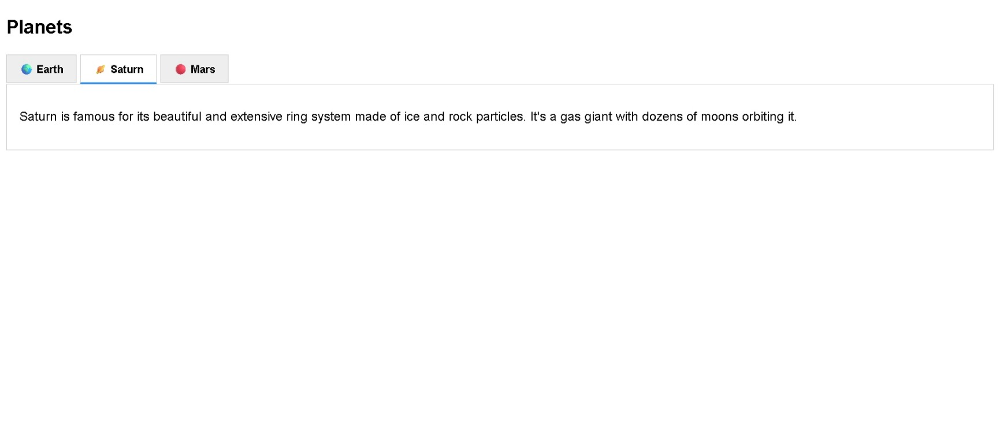

# Build a Planets Tablist

<p align="center">
  
  
  
  
  
</p>

> **Milestone:** Workshop setelah mempelajari JavaScript and Accessibility.

## About

Build a Planets Tablist is a web project that presents information about Earth, Saturn, and Mars using an accessible tab interface.

The project uses HTML accessibility attributes such as `role`, `aria-selected`, `aria-controls`, and `aria-labelledby` to connect tabs with their corresponding content panels. JavaScript controls which tab is selected and which panel is visible.

## Preview



## Konsep Utama

- **HTML Tablist** digunakan untuk mengelompokkan tombol tab dan panel informasi.
- **ARIA Roles** menggunakan `tablist`, `tab`, dan `tabpanel` untuk memberikan struktur semantik pada komponen tab.
- **ARIA Attributes** menggunakan `aria-selected`, `aria-controls`, dan `aria-labelledby` untuk menghubungkan tab dengan panel.
- **Hidden Property** digunakan untuk menyembunyikan dan menampilkan panel yang sesuai.
- **DOM Selection** digunakan untuk mengambil seluruh tab dan panel dari halaman.
- **Event Listener** digunakan untuk merespons klik pada setiap tab.
- **Attribute Manipulation** digunakan untuk memperbarui nilai `aria-selected`.
- **Element Relationship** menggunakan `aria-controls` untuk menentukan panel yang dikendalikan oleh sebuah tab.
- **Iteration** menggunakan `forEach()` untuk memproses seluruh tab dan panel.

## Struktur Project

```text
planet-tablist/
├── index.html
├── styles.css
└── script.js
```

## Source Code

- [`index.html`](./index.html)
- [`styles.css`](./styles.css)
- [`script.js`](./script.js)

## Pembahasan

### 1. Struktur Tablist pada HTML

HTML membuat sebuah container untuk komponen tab.

```html
<div role="tablist" aria-labelledby="tabs-title">
```

`role="tablist"` menunjukkan bahwa elemen tersebut berisi sekumpulan tab.

Setiap tombol menggunakan `role="tab"`.

```html
<button
  role="tab"
  aria-controls="panel-earth"
  aria-selected="true"
  id="tab-earth">
  🌍 Earth
</button>
```

Atribut `aria-controls` menghubungkan tab dengan panel yang dikendalikannya.

Atribut `aria-selected` menunjukkan tab yang sedang dipilih.

### 2. Tab Panel

Setiap informasi planet ditempatkan pada elemen dengan `role="tabpanel"`.

```html
<div
  id="panel-earth"
  role="tabpanel"
  aria-labelledby="tab-earth">
```

`aria-labelledby` menghubungkan panel dengan tab yang menjadi labelnya.

Panel Saturn dan Mars menggunakan atribut `hidden` pada kondisi awal.

```html
<div id="panel-saturn" role="tabpanel" aria-labelledby="tab-saturn" hidden>
```

Dengan demikian, hanya panel Earth yang terlihat ketika halaman pertama kali dibuka.

### 3. Mengambil Tab dan Panel

JavaScript mengambil seluruh elemen tab dan panel menggunakan `querySelectorAll()`.

```js
const tabs = document.querySelectorAll('[role="tab"]');
const panels = document.querySelectorAll('[role="tabpanel"]');
```

`tabs` berisi seluruh tombol yang memiliki `role="tab"`.

`panels` berisi seluruh elemen yang memiliki `role="tabpanel"`.

### 4. Menambahkan Event Listener

Program menggunakan `forEach()` untuk memberikan event listener kepada setiap tab.

```js
tabs.forEach(tab => {
  tab.addEventListener("click", () => {
```

Ketika sebuah tab diklik, fungsi di dalam event listener akan dijalankan.

### 5. Mengatur Status Tab

Sebelum memilih tab baru, seluruh tab dikembalikan ke status tidak terpilih.

```js
tabs.forEach(t => t.setAttribute("aria-selected", "false"));
```

Tab yang diklik kemudian diberi status terpilih.

```js
tab.setAttribute("aria-selected", "true");
```

Dengan cara ini, hanya tab yang sedang aktif yang memiliki nilai `aria-selected="true"`.

### 6. Menyembunyikan Panel

Seluruh panel disembunyikan terlebih dahulu.

```js
panels.forEach(p => p.hidden = true);
```

Setelah itu, program menentukan panel yang berhubungan dengan tab yang diklik.

### 7. Menghubungkan Tab dengan Panel

Program mengambil nilai `aria-controls` dari tab yang diklik.

```js
const associatedPanel = tab.getAttribute("aria-controls");
```

Nilai tersebut kemudian digunakan untuk mencari panel yang sesuai.

```js
const panel = document.getElementById(associatedPanel);
```

Panel yang ditemukan kemudian ditampilkan dengan mengubah property `hidden`.

```js
panel.hidden = false;
```

Dengan mekanisme tersebut, setiap tab menampilkan panel informasinya sendiri.

## Method yang Dipakai

- `querySelectorAll()` digunakan untuk mengambil kumpulan tab dan panel berdasarkan selector.
- `forEach()` digunakan untuk melakukan iterasi terhadap kumpulan elemen.
- `addEventListener()` digunakan untuk menangani aksi klik pada tab.
- `setAttribute()` digunakan untuk mengubah nilai `aria-selected`.
- `getAttribute()` digunakan untuk mengambil nilai `aria-controls`.
- `getElementById()` digunakan untuk mengambil panel berdasarkan ID.
- `hidden` digunakan untuk mengatur visibilitas panel.

## Ringkasan Cepat

| Konsep | Fungsi |
|---|---|
| `role="tablist"` | Menandai kumpulan tab |
| `role="tab"` | Menandai tombol sebagai tab |
| `role="tabpanel"` | Menandai area konten tab |
| `aria-selected` | Menunjukkan tab yang sedang dipilih |
| `aria-controls` | Menghubungkan tab dengan panel |
| `aria-labelledby` | Menghubungkan panel dengan tab sebagai label |
| `hidden` | Menyembunyikan atau menampilkan panel |
| `querySelectorAll()` | Mengambil kumpulan elemen |
| `forEach()` | Melakukan iterasi terhadap elemen |
| `setAttribute()` | Mengubah attribute elemen |
| `getAttribute()` | Mengambil nilai attribute |
| `getElementById()` | Mengambil elemen berdasarkan ID |

## Catatan Belajar

- **Tablist** dapat dibangun menggunakan kombinasi tab dan tabpanel.
- **ARIA attributes** dapat digunakan untuk menjelaskan hubungan antara tab dan panel.
- **`aria-selected`** digunakan untuk menunjukkan tab yang sedang aktif.
- **`aria-controls`** membantu menentukan panel yang dikendalikan oleh sebuah tab.
- **`hidden`** dapat digunakan untuk mengatur panel mana yang sedang ditampilkan.
- **DOM methods** memungkinkan JavaScript mengubah status elemen berdasarkan interaksi pengguna.

## What I Practiced

```text
HTML Semantic Structure
ARIA Roles
ARIA Attributes
Accessible Tablist
DOM Selection
Event Listeners
Element Attributes
DOM Manipulation
forEach()
hidden Property
```

---

**Platform:** freeCodeCamp  
**Workshop:** Build a Planets Tablist  
**Languages:** HTML, CSS & JavaScript  
**Focus:** JavaScript and Accessibility

---

<p align="center">
  <strong>JavaScript and Accessibility Section — Build a Planets Tablist Completed</strong><br>
  <sub>Next stop: continue the JavaScript Certification journey.</sub>
</p>
