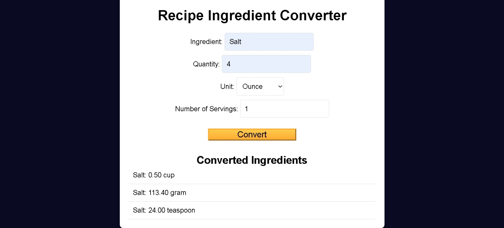
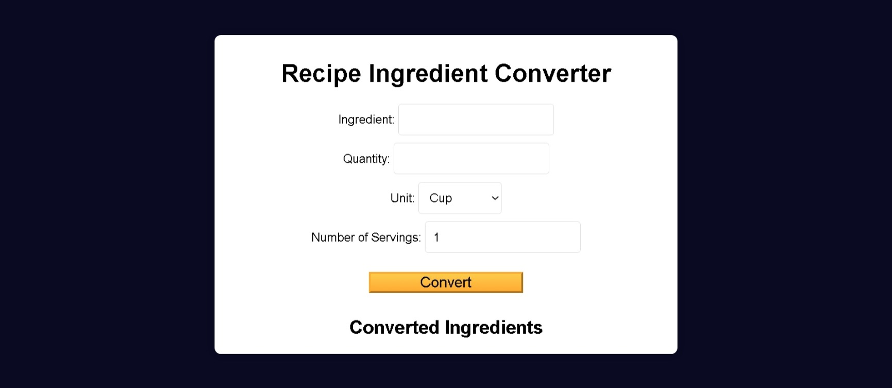

# Build a Recipe Ingredient Converter

<p align="center">
  
  
  
  
  
</p>

> **Milestone:** Workshop setelah mempelajari Functional Programming.

## About

Project ini membuat **Recipe Ingredient Converter** berbasis web untuk mengonversi jumlah bahan resep antara unit `cup`, `gram`, `ounce`, dan `teaspoon`.

Bagian JavaScript menggunakan beberapa function yang disusun secara bertahap. `convertQuantity()` menggunakan bentuk function berantai untuk menerima unit asal, unit tujuan, dan quantity. `adjustForServings()` digunakan untuk menyesuaikan jumlah berdasarkan jumlah serving, sedangkan `processIngredient()` menggabungkan kedua proses tersebut dan mengembalikan hasil dengan dua angka di belakang desimal.

Form HTML digunakan untuk menerima nama bahan, quantity, unit, dan jumlah serving. Setelah form dikirim, JavaScript menghasilkan hasil konversi untuk seluruh unit lain dan menampilkannya pada daftar di halaman.

## Preview





## Konsep Utama

- Functional Programming
- Arrow Function
- Curried Function
- Function Composition
- Object
- Nested Object
- Property Access
- DOM Selection
- `getElementById()`
- Array
- `forEach()`
- Conditional Statement
- `toFixed()`
- Template Literal
- Event Listener
- Form Submission
- `preventDefault()`
- DOM Manipulation
- CSS Custom Properties
- Flexbox
- Pseudo-class

## Struktur Project

```text
recipe-ingredient-converter/
├── index.html
├── styles.css
└── script.js
```

## Source Code

- [`index.html`](./index.html)
- [`styles.css`](./styles.css)
- [`script.js`](./script.js)

## Pembahasan

### 1. Object `conversionTable`

```javascript
const conversionTable = {
  cup: { gram: 240, ounce: 8.0, teaspoon: 48 },
  gram: { cup: 1 / 240, ounce: 0.0353, teaspoon: 0.2 },
  ounce: { cup: 0.125, gram: 28.35, teaspoon: 6 },
  teaspoon: { cup: 1 / 48, gram: 5, ounce: 0.167 },
};
```

`conversionTable` menyimpan conversion rate untuk setiap pasangan unit.

Setiap property utama mewakili unit asal, seperti `cup`, `gram`, `ounce`, dan `teaspoon`.

Value dari masing-masing property berupa object lain yang menyimpan unit tujuan beserta conversion rate-nya.

Contohnya:

```javascript
conversionTable["cup"]["gram"]
```

menghasilkan nilai:

```text
240
```

### 2. Curried Function `convertQuantity()`

```javascript
const convertQuantity = (fromUnit) => (toUnit) => (quantity) => {
  const conversionRate = conversionTable[fromUnit][toUnit];
  return quantity * conversionRate;
};
```

`convertQuantity()` dibentuk sebagai beberapa arrow function yang dikembalikan secara berurutan.

Function pertama menerima:

```javascript
fromUnit
```

Function berikutnya menerima:

```javascript
toUnit
```

dan function terakhir menerima:

```javascript
quantity
```

Conversion rate kemudian diambil dari:

```javascript
conversionTable[fromUnit][toUnit]
```

Hasil akhir diperoleh dengan:

```javascript
quantity * conversionRate
```

### 3. Menjalankan `convertQuantity()`

```javascript
const gramsResult = convertQuantity("cup")("gram")(2);
console.log(gramsResult);
```

Pemanggilan dilakukan secara bertahap:

```javascript
convertQuantity("cup")
```

menentukan unit asal.

```javascript
("gram")
```

menentukan unit tujuan.

```javascript
(2)
```

menentukan quantity yang dikonversi.

Dengan conversion rate `cup` ke `gram` sebesar `240`, quantity `2` dikalikan dengan nilai tersebut.

### 4. Function `adjustForServings()`

```javascript
const adjustForServings = (baseQuantity) => (newServings) =>
  baseQuantity * newServings;
```

`adjustForServings()` juga menggunakan bentuk function berantai.

Function pertama menerima `baseQuantity`.

Function berikutnya menerima `newServings`.

Nilai akhirnya diperoleh dari:

```javascript
baseQuantity * newServings
```

### 5. Menjalankan `adjustForServings()`

```javascript
const servingsResult = adjustForServings(4)(6);
console.log(servingsResult);
```

Nilai `4` digunakan sebagai `baseQuantity`.

Nilai `6` digunakan sebagai `newServings`.

Function kemudian menjalankan perkalian kedua nilai tersebut.

### 6. Function `processIngredient()`

```javascript
const processIngredient = (baseQuantity, baseUnit, newUnit, newServings) => {
```

Function ini menerima empat parameter:

- `baseQuantity`
- `baseUnit`
- `newUnit`
- `newServings`

Function tersebut menggabungkan proses penyesuaian serving dan konversi unit.

### 7. Menyesuaikan Quantity

```javascript
const adjustedQuantity = adjustForServings(baseQuantity)(newServings);
```

`adjustForServings()` dipanggil menggunakan `baseQuantity` dan `newServings`.

Hasilnya disimpan di dalam `adjustedQuantity`.

### 8. Mengonversi Unit

```javascript
const convertedQuantity =
  convertQuantity(baseUnit)(newUnit)(adjustedQuantity);
```

`adjustedQuantity` kemudian diberikan ke `convertQuantity()`.

`baseUnit` menjadi unit asal.

`newUnit` menjadi unit tujuan.

Hasil konversi disimpan di dalam `convertedQuantity`.

### 9. Memformat Hasil

```javascript
return convertedQuantity.toFixed(2);
```

Method `toFixed(2)` digunakan untuk menghasilkan nilai dengan dua angka di belakang desimal.

Nilai tersebut kemudian menjadi return value dari `processIngredient()`.

### 10. Mengambil Elemen dari DOM

```javascript
const ingredientName = document.getElementById("ingredient");
const ingredientQuantity = document.getElementById("quantity");
const unitToConvert = document.getElementById("unit");
const numberOfServings = document.getElementById("servings");
const recipeForm = document.getElementById("recipe-form");
const resultList = document.getElementById("result-list");
```

`document.getElementById()` digunakan untuk mengambil elemen HTML berdasarkan `id`.

Variable-variable tersebut kemudian digunakan untuk membaca input pengguna, menangani form, dan menampilkan hasil.

### 11. Daftar Unit

```javascript
const units = ["cup", "gram", "ounce", "teaspoon"];
```

Array `units` menyimpan seluruh unit yang didukung oleh converter.

Array ini digunakan saat program menghasilkan daftar hasil konversi.

### 12. Function `updateResultsList()`

```javascript
const updateResultsList = () => {
```

Function ini menangani pembentukan hasil konversi yang ditampilkan pada halaman.

### 13. Menghapus Hasil Lama

```javascript
resultList.innerHTML = "";
```

Sebelum hasil baru dibuat, isi `resultList` dikosongkan.

Dengan demikian, hasil dari submit sebelumnya tidak tetap berada di dalam daftar.

### 14. Memproses Setiap Unit

```javascript
units.forEach(unit => {
```

`forEach()` digunakan untuk memproses setiap unit di dalam array `units`.

Parameter `unit` mewakili satu unit pada setiap iterasi.

### 15. Melewati Unit yang Sedang Dipilih

```javascript
if (unit !== unitToConvert.value) {
```

Program hanya melakukan konversi jika `unit` berbeda dari unit yang dipilih pengguna.

Dengan demikian, unit asal tidak ikut ditampilkan sebagai hasil konversi ke dirinya sendiri.

### 16. Memproses Input Ingredient

```javascript
const convertedQuantity = processIngredient(
  ingredientQuantity.value,
  unitToConvert.value,
  unit,
  numberOfServings.value
);
```

`processIngredient()` menerima nilai dari form:

- quantity bahan;
- unit asal;
- unit tujuan yang sedang diproses;
- jumlah serving.

Hasilnya disimpan di dalam `convertedQuantity`.

### 17. Menambahkan Hasil ke Halaman

```javascript
resultList.innerHTML += `<li>${ingredientName.value}: ${convertedQuantity} ${unit}</li>`;
```

Template literal digunakan untuk membuat elemen `<li>`.

Isi daftar menampilkan:

- nama ingredient;
- quantity hasil konversi;
- unit hasil konversi.

String tersebut kemudian ditambahkan ke `resultList.innerHTML`.

### 18. Menangani Submit Form

```javascript
recipeForm.addEventListener("submit", (event) => {
```

`addEventListener()` digunakan untuk menjalankan callback ketika form menghasilkan event `submit`.

Parameter `event` merepresentasikan event tersebut.

### 19. Mencegah Submit Default

```javascript
event.preventDefault();
```

`preventDefault()` mencegah perilaku default form.

Halaman tidak menjalankan submit form secara normal sebelum hasil diproses melalui JavaScript.

### 20. Memperbarui Daftar Hasil

```javascript
updateResultsList();
```

Setelah perilaku default dicegah, `updateResultsList()` dipanggil untuk menghitung dan menampilkan hasil konversi.

### 21. Struktur `index.html`

HTML menyediakan interface utama aplikasi melalui:

```html
<form id="recipe-form">
```

Form memiliki field untuk:

- Ingredient
- Quantity
- Unit
- Number of Servings

Tombol:

```html
<button type="submit">Convert</button>
```

digunakan untuk memicu submit form.

### 22. Input Ingredient

```html
<input type="text" id="ingredient" required />
```

Input ini menerima nama ingredient.

Attribute `required` membuat field harus diisi sebelum form dapat dikirim.

### 23. Input Quantity

```html
<input type="number" id="quantity" step="any" required />
```

Input quantity menggunakan `type="number"`.

`step="any"` mengizinkan nilai yang tidak terbatas pada bilangan bulat.

### 24. Pemilihan Unit

```html
<select id="unit">
  <option value="cup">Cup</option>
  <option value="gram">Gram</option>
  <option value="ounce">Ounce</option>
  <option value="teaspoon">Teaspoon</option>
</select>
```

Elemen `<select>` menyediakan empat unit yang sesuai dengan unit di dalam `conversionTable` dan array `units`.

### 25. Input Number of Servings

```html
<input type="number" id="servings" step="any" value="1" />
```

Input ini menerima jumlah serving.

Nilai awalnya adalah:

```text
1
```

### 26. Tempat Menampilkan Hasil

```html
<ul id="result-list"></ul>
```

Elemen ini awalnya kosong.

JavaScript kemudian menambahkan elemen `<li>` ke dalamnya setelah form diproses.

### 27. Menghubungkan JavaScript

```html
<script src="script.js"></script>
```

`script.js` dimuat pada bagian akhir `<body>`.

File tersebut menangani proses konversi dan interaksi form.

### 28. CSS Reset

```css
*,
*::before,
*::after {
  margin: 0;
  padding: 0;
  box-sizing: border-box;
}
```

Rule ini mengatur `margin`, `padding`, dan `box-sizing` pada elemen serta pseudo-element.

### 29. CSS Custom Properties

```css
:root {
  --dark-grey: #0a0a23;
  --white: #fff;
  --light-grey: #ddd;
  --golden-yellow: #fecc4c;
  --yellow: #ffcc4c;
  --gold: #feac32;
  --orange: #ffac33;
  --dark-orange: #f89808;
}
```

`:root` menyimpan beberapa CSS custom properties yang digunakan kembali dalam stylesheet.

Contohnya:

```css
var(--dark-grey)
```

dan:

```css
var(--gold)
```

### 30. Layout `body`

```css
body {
  font-family: Arial, sans-serif;
  background-color: var(--dark-grey);
  display: flex;
  justify-content: center;
  align-items: center;
  height: 100vh;
}
```

`body` menggunakan Flexbox.

`justify-content: center` dan `align-items: center` digunakan untuk menempatkan konten di tengah area `body`.

### 31. Container Utama

```css
.container {
  text-align: center;
  background: var(--white);
  padding: 20px;
  border-radius: 8px;
  box-shadow: 0 0 10px rgba(0, 0, 0, 0.1);
  width: 100%;
  max-width: 600px;
}
```

`.container` membatasi lebar interface hingga `600px` dan memberikan background, padding, border radius, serta box shadow.

### 32. Styling Input dan Select

```css
input,
select {
  padding: 10px;
  font-size: 16px;
  margin: 5px 0;
  border: 1px solid var(--light-grey);
  border-radius: 4px;
}
```

Rule ini memberikan styling yang sama pada elemen `<input>` dan `<select>`.

### 33. Styling Button

```css
button {
  font-size: 1.2rem;
  cursor: pointer;
  width: 200px;
  margin: 20px 0 30px;
  color: var(--dark-grey);
  background-color: var(--gold);
  background-image: linear-gradient(var(--golden-yellow), var(--orange));
  border-color: var(--gold);
  border-width: 3px;
}
```

Button memiliki ukuran tetap, warna teks, background color, dan linear gradient.

### 34. State `:hover`

```css
button:hover {
  background-image: linear-gradient(var(--yellow), var(--dark-orange));
}
```

Pseudo-class `:hover` mengubah gradient button ketika pointer berada di atas button.

### 35. Styling List

```css
ul {
  list-style-type: none;
  padding: 0;
}
```

Bullet bawaan pada `<ul>` dihilangkan.

### 36. Styling Hasil Konversi

```css
li {
  padding: 10px;
  border-bottom: 1px solid var(--light-grey);
  display: flex;
  justify-content: space-between;
}
```

Setiap `<li>` menggunakan Flexbox dan `justify-content: space-between`.

Rule ini juga menambahkan padding serta border di bagian bawah setiap item hasil.

## Method yang Dipakai

- `document.getElementById()` digunakan untuk mengambil elemen HTML berdasarkan `id`.
- `forEach()` digunakan untuk memproses seluruh unit konversi.
- `toFixed()` digunakan untuk memformat hasil menjadi dua angka di belakang desimal.
- `addEventListener()` digunakan untuk menangani event `submit`.
- `preventDefault()` digunakan untuk mencegah perilaku default form.

## Ringkasan Cepat

| Konsep | Fungsi |
|---|---|
| `conversionTable` | Menyimpan conversion rate antar unit |
| `convertQuantity()` | Mengonversi quantity menggunakan function berantai |
| `adjustForServings()` | Mengalikan base quantity dengan jumlah serving |
| `processIngredient()` | Menggabungkan penyesuaian serving dan konversi unit |
| `toFixed(2)` | Memformat hasil menjadi dua angka di belakang desimal |
| `getElementById()` | Mengambil elemen dari DOM |
| `units` | Menyimpan unit yang didukung |
| `forEach()` | Memproses setiap unit |
| `innerHTML` | Menghapus dan menambahkan hasil pada halaman |
| `addEventListener()` | Menangani submit form |
| `preventDefault()` | Mencegah perilaku default submit |
| CSS custom properties | Menyimpan value CSS yang digunakan kembali |
| Flexbox | Mengatur layout `body` dan item hasil |
| `:hover` | Mengubah style button berdasarkan state pointer |

## Catatan Belajar

- **`conversionTable`** menyimpan conversion rate di dalam nested object.
- **`convertQuantity()`** menerima `fromUnit`, `toUnit`, dan `quantity` melalui function yang dikembalikan secara berurutan.
- **`adjustForServings()`** juga menggunakan bentuk function berantai.
- **`processIngredient()`** menggunakan hasil satu function sebagai input untuk proses berikutnya.
- **`toFixed(2)`** membuat hasil akhir memiliki dua angka di belakang desimal.
- **DOM element** diambil menggunakan `document.getElementById()`.
- **`units`** menentukan unit-unit tujuan yang diproses oleh `updateResultsList()`.
- **Unit asal** dilewati menggunakan kondisi `unit !== unitToConvert.value`.
- **`innerHTML`** dikosongkan sebelum daftar hasil baru dibuat.
- **Event `submit`** digunakan untuk menjalankan converter.
- **`preventDefault()`** mencegah form menjalankan perilaku submit default.
- **HTML form** menyediakan seluruh input yang dibaca oleh JavaScript.
- **CSS custom properties** menyimpan warna yang digunakan kembali.
- **Flexbox** digunakan untuk memusatkan container dan mengatur item pada hasil konversi.
- **`:hover`** mengubah gradient button ketika pointer berada di atasnya.

## What I Practiced

```text
Functional Programming
JavaScript Arrow Functions
Curried Functions
Function Composition
Nested Objects
Property Access
Arrays
Array forEach()
DOM Selection
DOM Manipulation
Template Literals
Event Listeners
Form Events
preventDefault()
HTML Forms
HTML Inputs
HTML Select Elements
CSS Custom Properties
Flexbox
CSS Gradients
Pseudo-classes
```

---

**Platform:** freeCodeCamp  
**Workshop:** Build a Recipe Ingredient Converter  
**Languages:** HTML, CSS & JavaScript  
**Focus:** Functional Programming

---

<p align="center">
  <strong>Functional Programming Section — Build a Recipe Ingredient Converter Completed</strong><br>
  <sub>Next stop: continue the JavaScript Certification journey.</sub>
</p>
