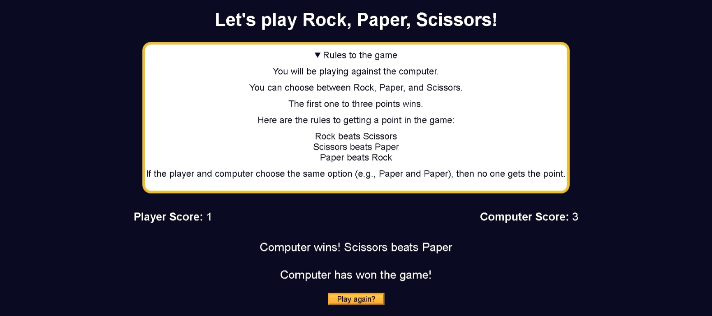

# Build a Rock, Paper, Scissors Game

<p align="center">
  
  
  
  
  
</p>

> **Milestone:** Workshop setelah mempelajari DOM Manipulation and Events.

## About

Build a Rock, Paper, Scissors Game adalah project web yang membuat permainan Rock, Paper, Scissors melawan komputer.

Pengguna memilih Rock, Paper, atau Scissors. Komputer memilih pilihan secara acak, kemudian JavaScript menentukan hasil ronde dan memperbarui skor. Pemain atau komputer menjadi pemenang setelah mencapai tiga poin.

## Preview



## Konsep Utama

- **Array** digunakan untuk menyimpan pilihan Rock, Paper, dan Scissors.
- **`Math.random()`** digunakan untuk menghasilkan pilihan komputer secara acak.
- **`Math.floor()`** digunakan untuk menghasilkan indeks array berupa bilangan bulat.
- **Function** digunakan untuk memisahkan proses pemilihan komputer dan penentuan hasil ronde.
- **Conditional Statement** digunakan untuk menentukan pemenang setiap ronde.
- **DOM Selection** digunakan untuk mengambil elemen skor, pesan hasil, dan tombol.
- **Event Listener** digunakan untuk menangani klik tombol pilihan pemain.
- **DOM Manipulation** digunakan untuk memperbarui skor dan pesan permainan.
- **CSS Display Manipulation** digunakan untuk menyembunyikan pilihan ketika permainan selesai.
- **Game State** digunakan untuk menyimpan skor pemain dan komputer.

## Struktur Project

```text
rock-paper-scissors-game/
├── index.html
├── styles.css
└── script.js
```

## Source Code

- [`index.html`](./index.html)
- [`styles.css`](./styles.css)
- [`script.js`](./script.js)

## Pembahasan

### 1. Menyimpan Pilihan Permainan

Pilihan permainan disimpan dalam sebuah array.

```js
const options = ["Rock", "Paper", "Scissors"];
```

Array ini digunakan sebagai sumber pilihan untuk komputer.

### 2. Membuat Pilihan Komputer Secara Acak

Function `getRandomComputerResult()` memilih salah satu item dari array secara acak.

```js
function getRandomComputerResult() {
  const randomIndex = Math.floor(Math.random() * options.length);
  return options[randomIndex];
}
```

`Math.random()` menghasilkan angka acak antara 0 dan kurang dari 1.

Nilai tersebut dikalikan dengan jumlah pilihan dan dibulatkan ke bawah menggunakan `Math.floor()`.

Hasil akhirnya digunakan sebagai indeks array.

### 3. Menentukan Kemenangan Pemain

Function `hasPlayerWonTheRound()` memeriksa kombinasi yang membuat pemain menang.

```js
function hasPlayerWonTheRound(playerChoice, computerChoice) {
  return (
    (playerChoice === "Rock" && computerChoice === "Scissors") ||
    (playerChoice === "Scissors" && computerChoice === "Paper") ||
    (playerChoice === "Paper" && computerChoice === "Rock")
  );
}
```

Pemain menang jika:

```text
Rock mengalahkan Scissors
Scissors mengalahkan Paper
Paper mengalahkan Rock
```

Function mengembalikan nilai boolean.

### 4. Menyimpan Skor

Skor pemain dan komputer disimpan menggunakan dua variable.

```js
let playerScore = 0;
let computerScore = 0;
```

Nilainya bertambah ketika salah satu pihak memenangkan ronde.

### 5. Menentukan Hasil Ronde

Function `getRoundResults()` mengambil pilihan pemain dan menghasilkan pilihan komputer.

```js
const computerResult = getRandomComputerResult();
```

Hasil ronde kemudian ditentukan menggunakan conditional statement.

```js
if (hasPlayerWonTheRound(userOption, computerResult)) {
  playerScore++;
  return `Player wins! ${userOption} beats ${computerResult}`;
} else if (computerResult === userOption) {
  return `It's a tie! Both chose ${userOption}`;
} else {
  computerScore++;
  return `Computer wins! ${computerResult} beats ${userOption}`;
}
```

Jika pemain menang, `playerScore` bertambah.

Jika kedua pilihan sama, ronde berakhir seri.

Jika pemain tidak menang dan bukan seri, skor komputer bertambah.

### 6. Mengambil Elemen dari DOM

Elemen skor, pesan hasil, container pilihan, dan tombol reset diambil menggunakan DOM Selection.

```js
const playerScoreSpanElement = document.getElementById("player-score");
const computerScoreSpanElement = document.getElementById("computer-score");
const roundResultsMsg = document.getElementById("results-msg");
const winnerMsgElement = document.getElementById("winner-msg");
const optionsContainer = document.querySelector(".options-container");
const resetGameBtn = document.getElementById("reset-game-btn");
```

Elemen-elemen tersebut digunakan untuk memperbarui tampilan permainan.

### 7. Menampilkan Hasil Permainan

Function `showResults()` menjalankan hasil ronde dan memperbarui skor pada halaman.

```js
function showResults(userOption) {
  roundResultsMsg.innerText = getRoundResults(userOption);
  computerScoreSpanElement.innerText = computerScore;
  playerScoreSpanElement.innerText = playerScore;
```

Pesan hasil ronde ditampilkan melalui `innerText`.

Skor pemain dan komputer juga diperbarui setelah setiap ronde.

### 8. Menentukan Pemenang Permainan

Permainan berakhir ketika salah satu pihak mencapai tiga poin.

```js
if (playerScore === 3 || computerScore === 3) {
  winnerMsgElement.innerText = `${
    playerScore === 3 ? "Player" : "Computer"
  } has won the game!`;

  resetGameBtn.style.display = "block";
  optionsContainer.style.display = "none";
}
```

Ketika permainan selesai, pilihan Rock, Paper, dan Scissors disembunyikan.

Tombol `Play again?` kemudian ditampilkan.

### 9. Mereset Permainan

Function `resetGame()` mengembalikan permainan ke kondisi awal.

```js
function resetGame() {
  playerScore = 0;
  computerScore = 0;
  playerScoreSpanElement.textContent = playerScore;
  computerScoreSpanElement.textContent = computerScore;
  resetGameBtn.style.display = "none";
  optionsContainer.style.display = "block";
  winnerMsgElement.textContent = "";
  roundResultsMsg.textContent = "";
}
```

Skor kembali menjadi `0`.

Pesan hasil dan pesan pemenang juga dikosongkan.

Pilihan permainan kembali ditampilkan.

### 10. Menangani Klik Tombol

Setiap tombol pilihan pemain memiliki event listener.

```js
rockBtn.addEventListener("click", function () {
  showResults("Rock");
});

paperBtn.addEventListener("click", function () {
  showResults("Paper");
});

scissorsBtn.addEventListener("click", function () {
  showResults("Scissors");
});
```

Ketika tombol diklik, pilihan pemain dikirim ke `showResults()`.

Tombol reset juga memiliki event listener.

```js
resetGameBtn.addEventListener("click", resetGame);
```

Ketika tombol tersebut diklik, permainan dimulai kembali dari skor awal.

## Method yang Dipakai

- `Math.random()` digunakan untuk menghasilkan pilihan komputer secara acak.
- `Math.floor()` digunakan untuk mendapatkan indeks array berupa bilangan bulat.
- `getElementById()` digunakan untuk mengambil elemen berdasarkan ID.
- `querySelector()` digunakan untuk mengambil elemen berdasarkan selector CSS.
- `addEventListener()` digunakan untuk menangani klik tombol.
- `innerText` digunakan untuk memperbarui teks hasil permainan.
- `textContent` digunakan untuk memperbarui skor dan pesan.
- `style.display` digunakan untuk menampilkan atau menyembunyikan elemen.

## Ringkasan Cepat

| Konsep | Fungsi |
|---|---|
| Array | Menyimpan pilihan permainan |
| `Math.random()` | Menghasilkan nilai acak |
| `Math.floor()` | Membulatkan angka ke bawah |
| Function | Memisahkan logika permainan |
| Conditional Statement | Menentukan hasil ronde |
| DOM Selection | Mengambil elemen HTML |
| `addEventListener()` | Menangani klik tombol |
| `innerText` | Mengubah teks elemen |
| `textContent` | Mengubah isi teks elemen |
| `style.display` | Mengatur tampilan elemen |
| Game State | Menyimpan skor permainan |

## Catatan Belajar

- **Array** dapat digunakan sebagai sumber pilihan yang kemudian dipilih secara acak.
- **`Math.random()`** dapat menghasilkan nilai yang berbeda untuk setiap pemilihan komputer.
- **`Math.floor()`** dapat mengubah hasil perkalian menjadi indeks array yang valid.
- **Function** membantu memisahkan logika permainan menjadi bagian yang lebih mudah dipahami.
- **Conditional Statement** dapat digunakan untuk menentukan hubungan antara pilihan pemain dan komputer.
- **DOM Manipulation** memungkinkan hasil permainan dan skor diperbarui langsung pada halaman.
- **Event Listener** membuat tombol dapat menjalankan function ketika pengguna melakukan klik.
- **Game State** dapat disimpan dalam variable untuk mempertahankan skor selama permainan berlangsung.

## What I Practiced

```text
JavaScript Arrays
Math.random()
Math.floor()
Functions
Conditional Statements
Boolean Logic
Game State
DOM Selection
DOM Manipulation
Event Listeners
innerText
textContent
style.display
Button Events
```

---

**Platform:** freeCodeCamp  
**Workshop:** Build a Rock, Paper, Scissors Game  
**Languages:** HTML, CSS & JavaScript  
**Focus:** DOM Manipulation and Events

---

<p align="center">
  <strong>DOM Manipulation and Events Section — Build a Rock, Paper, Scissors Game Completed</strong><br>
  <sub>Next stop: continue the JavaScript Certification journey.</sub>
</p>
