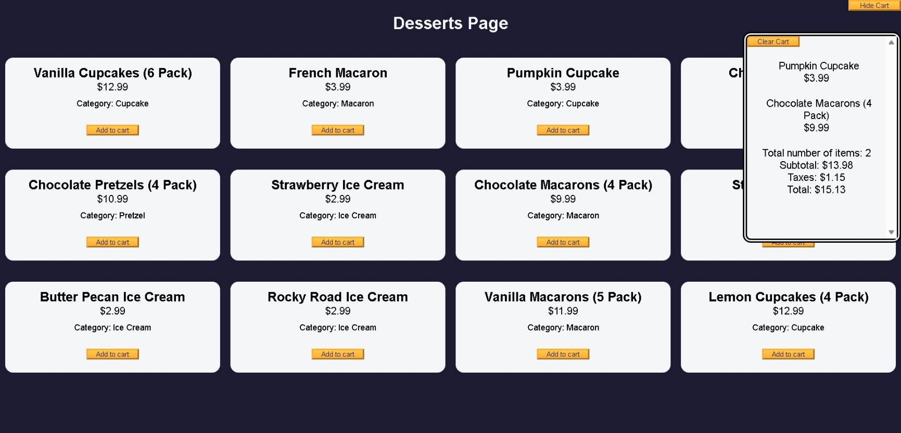

# Build a Shopping Cart

<p align="center">
  
  
  
  
  
</p>

> **Milestone:** Workshop setelah mempelajari Classes.

## About

Project ini merupakan workshop **freeCodeCamp "Build a Shopping Cart"**.

Project membuat halaman daftar dessert yang dapat dimasukkan ke shopping cart.

Data produk disimpan dalam array dan dibuat menggunakan class `Dessert`, sedangkan pengelolaan isi cart dilakukan menggunakan class `ShoppingCart`.

Shopping cart dapat menampilkan jumlah item, subtotal, pajak, dan total harga.

## Preview



## Konsep Utama

- **Classes** digunakan untuk membuat object `Dessert` dan `ShoppingCart`.
- **Objects** digunakan untuk menyimpan data setiap produk dan status cart.
- **Arrays** digunakan untuk menyimpan daftar produk dan item dalam cart.
- **Array Methods** digunakan untuk mencari, menghitung, dan mengelola data.
- **DOM Manipulation** digunakan untuk menampilkan produk dan memperbarui cart.
- **Event Handling** digunakan untuk menangani tombol cart dan penambahan produk.
- **Destructuring** digunakan untuk mengambil property dari object produk.
- **Binding** digunakan untuk mempertahankan context `this` pada method cart.

## Struktur Project

```text
shopping-cart/
├── index.html
├── styles.css
└── script.js
```

## Source Code

- [`index.html`](./index.html)
- [`styles.css`](./styles.css)
- [`script.js`](./script.js)

## Pembahasan

### 1. Class `Dessert`

Class `Dessert` digunakan sebagai template untuk membuat object produk.

```js
class Dessert {
  constructor(id, name, price, category) {
    this.id = id;
    this.name = name;
    this.price = price;
    this.category = category;
  }
}
```

Setiap object dessert memiliki `id`, `name`, `price`, dan `category`.

Object tersebut kemudian digunakan sebagai data produk dalam array `products`.

### 2. Array `products`

Daftar dessert dibuat menggunakan instance dari class `Dessert`.

```js
const products = [
  new Dessert(1, "Vanilla Cupcakes (6 Pack)", 12.99, "Cupcake"),
  new Dessert(2, "French Macaron", 3.99, "Macaron"),
  new Dessert(3, "Pumpkin Cupcake", 3.99, "Cupcake"),
];
```

Setiap produk menyimpan informasi yang diperlukan untuk ditampilkan dan dimasukkan ke cart.

### 3. Menampilkan Produk ke Halaman

Produk ditampilkan menggunakan `forEach()` dan template literal.

```js
products.forEach(
  ({ name, id, price, category }) => {
    dessertCards.innerHTML += `
      <div class="dessert-card">
        <h2>${name}</h2>
        <p class="dessert-price">$${price}</p>
        <p class="product-category">Category: ${category}</p>
      </div>
    `;
  }
);
```

Destructuring digunakan untuk mengambil `name`, `id`, `price`, dan `category` dari setiap object produk.

### 4. Class `ShoppingCart`

Class `ShoppingCart` menangani data dan operasi pada shopping cart.

```js
class ShoppingCart {
  constructor() {
    this.items = [];
    this.total = 0;
    this.taxRate = 8.25;
  }
}
```

Property `items` menyimpan produk yang dimasukkan ke cart.

Property `total` menyimpan total harga setelah pajak.

Property `taxRate` menetapkan pajak sebesar `8.25%`.

### 5. Method `addItem()`

Method `addItem()` mencari produk berdasarkan ID kemudian memasukkannya ke dalam array `items`.

```js
const product = products.find((item) => item.id === id);
this.items.push(product);
```

`find()` digunakan untuk mendapatkan produk yang sesuai dengan ID.

`push()` menambahkan produk tersebut ke cart.

Jumlah setiap produk kemudian dihitung berdasarkan ID menggunakan object `totalCountPerProduct`.

### 6. Method `calculateTotal()`

Method `calculateTotal()` menghitung subtotal, pajak, dan total akhir.

```js
const subTotal = this.items.reduce(
  (total, item) => total + item.price,
  0
);

const tax = this.calculateTaxes(subTotal);
this.total = subTotal + tax;
```

`reduce()` menjumlahkan harga seluruh item dalam cart.

Pajak dihitung menggunakan method `calculateTaxes()`.

Hasil akhirnya ditampilkan pada bagian subtotal, taxes, dan total.

### 7. Method `clearCart()`

Method `clearCart()` mengosongkan seluruh isi shopping cart setelah pengguna memberikan konfirmasi.

```js
if (isCartCleared) {
  this.items = [];
  this.total = 0;
  productsContainer.innerHTML = "";
}
```

Method ini juga mengembalikan jumlah item dan nilai harga pada tampilan menjadi nol.

### 8. Event Handling

Setiap tombol `Add to cart` diberi event listener.

```js
btn.addEventListener("click", (event) => {
  cart.addItem(Number(event.target.id), products);
  totalNumberOfItems.textContent = cart.getCounts();
  cart.calculateTotal();
});
```

Ketika tombol ditekan, produk ditambahkan ke cart kemudian jumlah item dan total harga diperbarui.

Tombol cart juga menggunakan event listener untuk menampilkan atau menyembunyikan cart.

### 9. `bind()` pada `clearCart()`

Method `clearCart()` dipasang sebagai event handler menggunakan `bind()`.

```js
clearCartBtn.addEventListener(
  "click",
  cart.clearCart.bind(cart)
);
```

`bind(cart)` memastikan `this` di dalam `clearCart()` tetap mengarah ke object `cart`.

## Method yang Dipakai

- `forEach()` digunakan untuk memproses setiap produk dan tombol cart.
- `find()` digunakan untuk mencari produk berdasarkan ID.
- `push()` digunakan untuk menambahkan produk ke array `items`.
- `reduce()` digunakan untuk menghitung subtotal seluruh item.
- `toFixed()` digunakan untuk membatasi angka harga menjadi dua angka desimal.
- `parseFloat()` digunakan untuk mengubah hasil perhitungan pajak menjadi number.
- `bind()` digunakan untuk mempertahankan context `this` pada method `clearCart()`.

## Ringkasan Cepat

| Konsep | Fungsi |
|---|---|
| `class Dessert` | Membuat object produk dessert. |
| `class ShoppingCart` | Mengelola item dan perhitungan cart. |
| `find()` | Mencari produk berdasarkan ID. |
| `reduce()` | Menghitung subtotal harga. |
| `DOM Manipulation` | Memperbarui tampilan produk dan cart. |
| `Event Handling` | Menangani interaksi pengguna. |
| `bind()` | Mempertahankan context `this`. |

## Catatan Belajar

- **Classes** digunakan untuk membuat struktur object yang dapat digunakan kembali.
- **Arrays** dapat menyimpan daftar produk dan item yang sedang berada di cart.
- **`find()`** mengambil satu produk yang sesuai dengan kondisi pencarian.
- **`reduce()`** dapat digunakan untuk menghasilkan satu nilai dari seluruh item array.
- **DOM Manipulation** memungkinkan data JavaScript ditampilkan langsung pada halaman.
- **`bind()`** membantu mempertahankan nilai `this` ketika method digunakan sebagai callback.

## What I Practiced

```text
JavaScript Classes
Object Creation
Arrays
Array Methods
Destructuring
DOM Manipulation
Event Handling
Template Literals
Number Calculation
this Context
bind()
```

---

**Platform:** freeCodeCamp  
**Workshop:** Build a Shopping Cart  
**Language:** HTML, CSS & JavaScript  
**Focus:** Classes

---

<p align="center">
  <strong>Classes Section — Build a Shopping Cart Completed</strong><br>
  <sub>Next stop: continue the JavaScript Certification journey.</sub>
</p>
