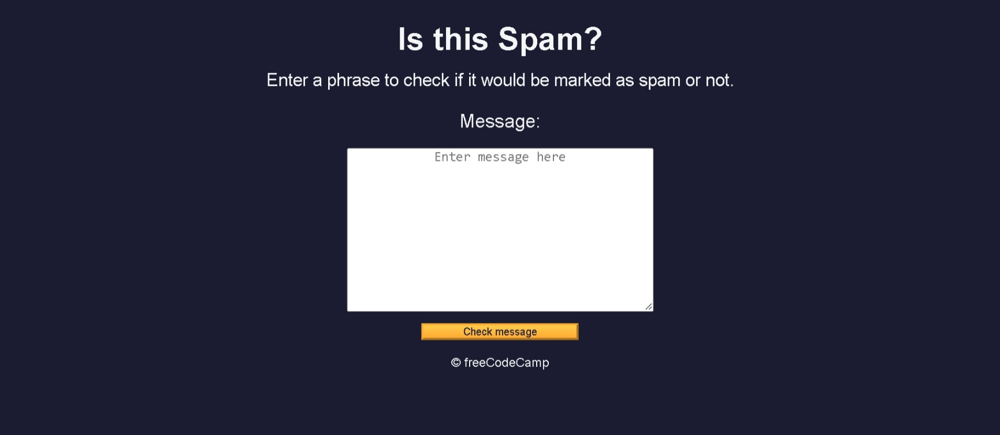

# Build a Spam Filter

<p align="center">
  
  
  
  
  
</p>

> **Milestone:** Workshop setelah mempelajari Basic Regex.

## About

Build a Spam Filter is a small web application that checks whether a message contains patterns commonly associated with spam.

The project uses regular expressions to compare the entered message against a deny list and then displays whether the message appears to be spam.

## Preview



## Konsep Utama

- **Regular Expressions** digunakan untuk mencari pola tertentu di dalam pesan.
- **Regex Flags** menggunakan flag `i` agar pencarian tidak membedakan huruf besar dan kecil.
- **Character Classes** digunakan untuk menerima beberapa variasi karakter dalam pola spam.
- **Alternation** menggunakan `|` untuk mencocokkan salah satu dari beberapa pilihan pola.
- **Non-Capturing Groups** menggunakan `(?:...)` untuk mengelompokkan pola tanpa membuat capture group.
- **Anchors** menggunakan `^` dan `$` untuk membatasi posisi pola pada awal atau akhir pesan.
- **Quantifiers** menggunakan `+`, `*`, dan `?` untuk menentukan jumlah karakter yang dapat dicocokkan.
- **Array** digunakan untuk menyimpan kumpulan regular expression dalam `denyList`.
- **`some()`** digunakan untuk memeriksa apakah salah satu regular expression menemukan kecocokan.
- **DOM Manipulation** digunakan untuk mengambil elemen dan memperbarui isi halaman.
- **Event Listener** digunakan untuk menjalankan pemeriksaan saat tombol diklik.
- **Conditional Operator** digunakan untuk menentukan pesan hasil berdasarkan nilai `isSpam`.

## Struktur Project

```text
spam-filter/
├── index.html
├── styles.css
└── script.js
```

## Source Code

- **HTML:** [`index.html`](./index.html)
- **CSS:** [`styles.css`](./styles.css)
- **JavaScript:** [`script.js`](./script.js)

## Pembahasan

### 1. Struktur `index.html`

File `index.html` menyediakan tampilan utama aplikasi.

Elemen `<textarea>` digunakan untuk menerima pesan dari pengguna, sedangkan tombol `Check message` digunakan untuk menjalankan pemeriksaan.

Elemen dengan ID `result-message` menjadi tempat untuk menampilkan hasil pemeriksaan.

### 2. Styling `styles.css`

File `styles.css` mengatur tampilan halaman dengan latar belakang gelap dan warna teks terang.

Variabel CSS pada `:root` menyimpan warna yang digunakan kembali pada halaman.

Tombol menggunakan gradient dan memiliki efek perubahan tampilan ketika pengguna mengarahkan kursor ke tombol.

### 3. Referensi Elemen DOM

`script.js` mengambil tiga elemen utama menggunakan `document.getElementById()`.

```js
const messageInput = document.getElementById("message-input");
const result = document.getElementById("result-message");
const checkMessageButton = document.getElementById("check-message-btn");
```

`messageInput` digunakan untuk membaca pesan, `result` digunakan untuk menampilkan hasil, dan `checkMessageButton` digunakan untuk menangani klik tombol.

### 4. Regular Expression untuk Spam

Beberapa regular expression dibuat untuk mengenali pola pesan yang dianggap spam.

```js
const helpRegex = /please help|assist me/i;
const dollarRegex = /[0-9]+\s*(?:hundred|thousand|million|billion)?\s+dollars/i;
```

`helpRegex` mencari dua frasa bantuan tertentu, sedangkan `dollarRegex` mencari pola angka yang diikuti kata jumlah dan `dollars`.

Pola lainnya menggunakan character class dan variasi karakter untuk mengenali bentuk tulisan seperti leetspeak.

```js
const freeRegex = /(?:^|\s)fr[e3][e3] m[o0]n[e3]y(?:$|\s)/i;
```

Pola tersebut memungkinkan beberapa karakter memiliki alternatif seperti `e` atau `3` dan `o` atau `0`.

### 5. `denyList` dan `isSpam()`

Semua regular expression dikumpulkan ke dalam satu array.

```js
const denyList = [helpRegex, dollarRegex, freeRegex, stockRegex, dearRegex];
```

Fungsi `isSpam()` kemudian menggunakan `some()` untuk memeriksa setiap pola.

```js
const isSpam = (msg) => denyList.some((regex) => regex.test(msg));
```

Fungsi menghasilkan `true` ketika setidaknya satu regular expression cocok dengan pesan.

### 6. Pemeriksaan Pesan

Event listener dipasang pada tombol pemeriksaan.

```js
checkMessageButton.addEventListener("click", () => {
```

Jika textarea kosong, program menampilkan alert dan menghentikan proses.

```js
if (messageInput.value === "") {
  alert("Please enter a message.");
  return;
}
```

Jika pesan tidak kosong, fungsi `isSpam()` menentukan hasil yang akan ditampilkan.

### 7. Menampilkan Hasil

Operator kondisional memilih salah satu dari dua pesan.

```js
result.textContent = isSpam(messageInput.value)
  ? "Oh no! This looks like a spam message."
  : "This message does not seem to contain any spam.";
```

Setelah hasil ditampilkan, textarea dikosongkan kembali.

```js
messageInput.value = "";
```

## Method yang Dipakai

- **`getElementById()`** digunakan untuk mengambil elemen HTML berdasarkan ID.
- **`addEventListener()`** digunakan untuk menjalankan fungsi ketika tombol diklik.
- **`some()`** digunakan untuk memeriksa apakah setidaknya satu elemen array memenuhi kondisi.
- **`test()`** digunakan untuk menguji kecocokan regular expression terhadap pesan.
- **`alert()`** digunakan untuk menampilkan peringatan ketika pesan belum dimasukkan.

## Ringkasan Cepat

| Konsep | Fungsi |
|---|---|
| Regular Expression | Mencari pola tertentu dalam pesan |
| Character Class | Mencocokkan beberapa kemungkinan karakter |
| Alternation `\|` | Memilih salah satu dari beberapa pola |
| Anchors `^` dan `$` | Membatasi posisi pola |
| `denyList` | Menyimpan kumpulan pola spam |
| `some()` | Mencari kecocokan dari kumpulan regex |
| `test()` | Menguji regex terhadap pesan |
| `addEventListener()` | Menangani klik tombol |
| `textContent` | Menampilkan hasil ke halaman |

## Catatan Belajar

- **Regular Expression** dapat digunakan untuk mencari pola teks tanpa harus membandingkan seluruh pesan secara langsung.
- **Character Class** membantu membuat pola yang menerima beberapa variasi karakter.
- **Anchors** membantu memastikan pola berada pada batas tertentu dalam sebuah string.
- **`some()`** cocok digunakan ketika hanya perlu mengetahui apakah ada setidaknya satu pola yang cocok.
- **DOM Manipulation** menghubungkan logika JavaScript dengan elemen yang tampil di halaman.
- **Event Listener** membuat program dapat merespons tindakan pengguna.

## What I Practiced

```text
Regular Expression Syntax
Regex Flags
Character Classes
Alternation
Non-Capturing Groups
Regex Anchors
Regex Quantifiers
JavaScript Arrays
Array some()
RegExp test()
DOM Selection
DOM Manipulation
Event Listeners
Conditional Operator
```

---

**Platform:** freeCodeCamp  
**Workshop:** Build a Spam Filter  
**Languages:** HTML, CSS & JavaScript  
**Focus:** Basic Regex

---

<p align="center">
  <strong>Basic Regex Section — Build a Spam Filter Completed</strong><br>
  <sub>Next stop: continue the JavaScript Certification journey.</sub>
</p>
