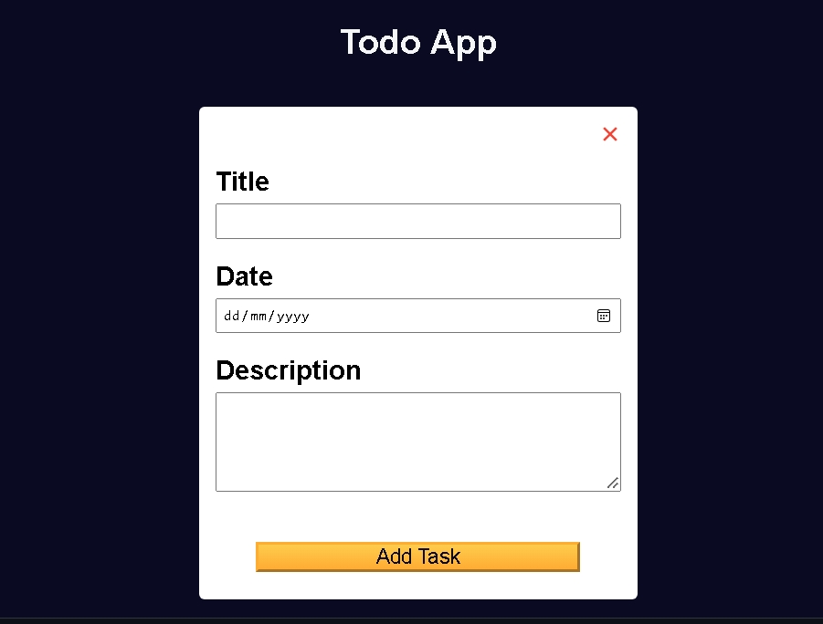

# Build a Todo App using Local Storage

<p align="center">
  
  
  
  
  
</p>

> **Milestone:** Workshop setelah mempelajari localStorage and CRUD Operations.

## About

Project ini membuat aplikasi Todo yang memungkinkan pengguna menambahkan, mengubah, dan menghapus task.

Data task disimpan di `localStorage` sehingga data dapat dimuat kembali ketika aplikasi dibuka.

Project ini digunakan untuk mempraktikkan penggunaan `localStorage` dan operasi CRUD melalui JavaScript.

## Preview



## Konsep Utama

- **DOM Manipulation** digunakan untuk mengambil dan memperbarui elemen halaman.
- **localStorage** digunakan untuk menyimpan data task.
- **JSON** digunakan untuk mengubah data antara object JavaScript dan string.
- **Array** digunakan untuk menyimpan kumpulan task.
- **Array Methods** digunakan untuk mencari dan mengubah data task.
- **Object** digunakan untuk menyimpan informasi setiap task.
- **Regular Expression** digunakan untuk membersihkan karakter tertentu dari judul task.
- **Event Handling** digunakan untuk menangani interaksi pengguna.
- **HTML Dialog** digunakan untuk konfirmasi ketika perubahan form akan dibuang.
- **Template Literal** digunakan untuk membuat tampilan task secara dinamis.

## Struktur Project

```text
todo-app-using-localstorage/
├── index.html
├── styles.css
├── script.js
└── preview.jpeg
```

## Source Code

- [`index.html`](./index.html)
- [`styles.css`](./styles.css)
- [`script.js`](./script.js)

## Pembahasan

### 1. Mengambil Elemen DOM

Elemen HTML diambil menggunakan `getElementById()`.

```js
const taskForm = document.getElementById("task-form");
const tasksContainer = document.getElementById("tasks-container");
const titleInput = document.getElementById("title-input");
const dateInput = document.getElementById("date-input");
const descriptionInput = document.getElementById("description-input");
```

Referensi tersebut digunakan untuk membaca input dan memperbarui tampilan aplikasi.

### 2. Mengambil Data dari `localStorage`

Data task diambil ketika script dijalankan.

```js
const taskData = JSON.parse(localStorage.getItem("data")) || [];
```

`getItem()` mengambil data dengan key `data`, sedangkan `JSON.parse()` mengubah string JSON menjadi array JavaScript.

Jika tidak ada data yang tersimpan, digunakan array kosong.

### 3. Membersihkan Judul Task

Function `removeSpecialChars()` membersihkan karakter tertentu dari judul task.

```js
const removeSpecialChars = (val) => {
  return val.trim().replace(/[^A-Za-z0-9\-\s]/g, "");
};
```

`trim()` menghapus spasi di awal dan akhir string.

`replace()` dengan regular expression menghapus karakter selain huruf, angka, tanda hubung, dan spasi.

Hasilnya digunakan sebagai bagian dari `id` task.

### 4. Menambahkan dan Memperbarui Task

Function `addOrUpdateTask()` membuat object task baru.

```js
const taskObj = {
  id: `${removeSpecialChars(titleInput.value).toLowerCase().split(" ").join("-")}-${Date.now()}`,
  title: titleInput.value,
  date: dateInput.value,
  description: descriptionInput.value,
};
```

Task memiliki `id`, `title`, `date`, dan `description`.

`findIndex()` digunakan untuk menentukan apakah task sedang ditambahkan atau diperbarui.

```js
const dataArrIndex = taskData.findIndex(
  (item) => item.id === currentTask.id
);
```

Jika task belum ditemukan, object dimasukkan ke awal array menggunakan `unshift()`.

Jika task sudah ditemukan, data pada index tersebut diperbarui.

### 5. Menyimpan Task ke `localStorage`

Setelah task ditambahkan atau diperbarui, data disimpan kembali.

```js
localStorage.setItem("data", JSON.stringify(taskData));
```

`JSON.stringify()` mengubah array JavaScript menjadi string JSON sebelum disimpan.

### 6. Menampilkan Task

Function `updateTaskContainer()` menghapus tampilan task sebelumnya lalu membuat tampilan berdasarkan isi `taskData`.

```js
tasksContainer.innerHTML = "";

taskData.forEach(({id, title, date, description}) => {
  tasksContainer.innerHTML += `
    <div class="task" id="${id}">
      <p><strong>Title:</strong> ${title}</p>
      <p><strong>Date:</strong> ${date}</p>
      <p><strong>Description:</strong> ${description}</p>
      <button onclick="editTask(this)" type="button" class="btn">Edit</button>
      <button onclick="deleteTask(this)" type="button" class="btn">Delete</button>
    </div>
  `;
});
```

`forEach()` digunakan untuk memproses setiap task.

Template literal digunakan untuk membentuk HTML berdasarkan data task.

### 7. Menghapus Task

Function `deleteTask()` mencari task berdasarkan `id` elemen yang dipilih.

```js
const dataArrIndex = taskData.findIndex(
  (item) => item.id === buttonEl.parentElement.id
);
```

Task kemudian dihapus dari array menggunakan `splice()`.

```js
taskData.splice(dataArrIndex, 1);
```

Data terbaru disimpan kembali ke `localStorage`.

### 8. Mengedit Task

Function `editTask()` mengambil task yang dipilih dan memasukkan datanya kembali ke form.

```js
currentTask = taskData[dataArrIndex];

titleInput.value = currentTask.title;
dateInput.value = currentTask.date;
descriptionInput.value = currentTask.description;
```

Button kemudian diubah menjadi `"Update Task"` dan form ditampilkan.

### 9. Reset Form

Function `reset()` mengembalikan form ke kondisi awal.

```js
const reset = () => {
  addOrUpdateTaskBtn.innerText = "Add Task";
  titleInput.value = "";
  dateInput.value = "";
  descriptionInput.value = "";
  taskForm.classList.toggle("hidden");
  currentTask = {};
};
```

Function ini digunakan setelah task berhasil ditambahkan, diperbarui, atau ketika perubahan form dibuang.

### 10. Konfirmasi Perubahan Form

Ketika pengguna menutup form yang masih memiliki perubahan, aplikasi menampilkan dialog konfirmasi.

```js
confirmCloseDialog.showModal();
```

Pengguna dapat membatalkan proses atau membuang perubahan.

```js
cancelBtn.addEventListener("click", () => confirmCloseDialog.close());

discardBtn.addEventListener("click", () => {
  confirmCloseDialog.close();
  reset();
});
```

### 11. Menangani Submit Form

Form menggunakan event `submit`.

```js
taskForm.addEventListener("submit", (e) => {
  e.preventDefault();

  addOrUpdateTask();
});
```

`preventDefault()` mencegah form melakukan submit bawaan browser sehingga proses dapat ditangani oleh JavaScript.

## Method yang Dipakai

- `getElementById()` digunakan untuk mengambil elemen berdasarkan ID.
- `getItem()` digunakan untuk mengambil data dari `localStorage`.
- `JSON.parse()` digunakan untuk mengubah JSON string menjadi data JavaScript.
- `trim()` digunakan untuk menghapus spasi di awal dan akhir string.
- `replace()` digunakan untuk mengganti karakter berdasarkan regular expression.
- `toLowerCase()` digunakan untuk mengubah string menjadi huruf kecil.
- `split()` digunakan untuk memecah string berdasarkan spasi.
- `join()` digunakan untuk menggabungkan array menjadi string.
- `findIndex()` digunakan untuk mencari posisi task dalam array.
- `unshift()` digunakan untuk menambahkan task ke awal array.
- `forEach()` digunakan untuk memproses setiap task.
- `setItem()` digunakan untuk menyimpan data ke `localStorage`.
- `JSON.stringify()` digunakan untuk mengubah data JavaScript menjadi JSON string.
- `splice()` digunakan untuk menghapus task dari array.
- `remove()` digunakan untuk menghapus elemen task dari DOM.
- `toggle()` digunakan untuk menampilkan atau menyembunyikan form.
- `showModal()` digunakan untuk menampilkan dialog.
- `close()` digunakan untuk menutup dialog.
- `addEventListener()` digunakan untuk menangani event pengguna.
- `preventDefault()` digunakan untuk mencegah perilaku submit bawaan browser.

## Ringkasan Cepat

| Konsep | Fungsi |
|---|---|
| `localStorage` | Menyimpan data task di browser. |
| `JSON.parse()` | Mengubah JSON string menjadi data JavaScript. |
| `JSON.stringify()` | Mengubah data JavaScript menjadi JSON string. |
| `findIndex()` | Mencari posisi task dalam array. |
| `unshift()` | Menambahkan task ke awal array. |
| `splice()` | Menghapus task dari array. |
| `forEach()` | Memproses setiap task. |
| `showModal()` | Menampilkan dialog konfirmasi. |
| `preventDefault()` | Mencegah submit bawaan form. |

## Catatan Belajar

- **localStorage** dapat digunakan untuk menyimpan data task di browser.
- **JSON.parse()** digunakan untuk membaca data JSON sebagai data JavaScript.
- **JSON.stringify()** digunakan sebelum data JavaScript disimpan ke `localStorage`.
- **findIndex()** dapat digunakan untuk menemukan posisi object dalam array.
- **unshift()** menambahkan item ke bagian awal array.
- **splice()** dapat digunakan untuk menghapus item dari array.
- **Object** dapat digunakan untuk menyimpan beberapa informasi dalam satu task.
- **Event Listener** digunakan untuk menjalankan function berdasarkan interaksi pengguna.
- **Dialog** dapat digunakan untuk meminta konfirmasi sebelum perubahan dibuang.

## What I Practiced

```text
DOM Manipulation
localStorage
JSON.parse()
JSON.stringify()
Array Methods
Objects
Regular Expression
Template Literals
Event Handling
HTML Dialog
Form Handling
CRUD Operations
```

---

**Platform:** freeCodeCamp  
**Workshop:** Build a Todo App using Local Storage  
**Languages:** HTML, CSS & JavaScript  
**Focus:** localStorage and CRUD Operations

---

<p align="center">
  <strong>localStorage and CRUD Operations Section — Build a Todo App using Local Storage Completed</strong><br>
  <sub>Next stop: continue the JavaScript Certification journey.</sub>
</p>
