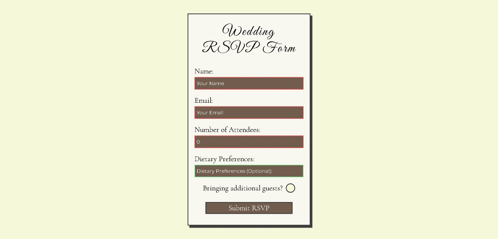

# Build an Event RSVP

<p align="center">
  
  
  
  
  
  
</p>

> **Milestone:** Lab setelah mempelajari React State, Hooks, and Routing.

## About

Build an Event RSVP adalah lab freeCodeCamp untuk membuat formulir konfirmasi kehadiran menggunakan React. Pada implementasi ini, formulir bertajuk `Wedding RSVP Form` dan menerima nama, email, jumlah peserta, preferensi makanan, serta pilihan apakah pengguna membawa tamu tambahan.

Nilai input dikelola dengan `useState`. Saat formulir dikirim, function `handleSubmit` mencegah perilaku submit bawaan browser dan mengubah `isSubmitted` menjadi `true`, sehingga ringkasan RSVP ditampilkan pada halaman yang sama. Source code ini tidak memperlihatkan pengiriman data ke server atau penyimpanan RSVP dalam database.

## Preview



## Konsep Utama

- React function component `EventRSVPForm` dan JSX
- Hook `useState` untuk enam nilai state formulir
- Controlled inputs melalui `value` dan `onChange`
- Checkbox terkontrol melalui `checked` dan `e.target.checked`
- Event handler `handleGuestCheckbox` dan `handleSubmit`
- Form validation melalui `required`, `type='email'`, dan `min='1'`
- `e.preventDefault()` untuk menghentikan perilaku submit bawaan
- Conditional rendering menggunakan `isSubmitted && (...)`
- Logical OR `dietPref || 'None'` dan ternary operator untuk ringkasan
- CSS pseudo-class `:valid`, `:invalid`, `:checked`, `:hover`, dan `:active`
- CSS `:has()` untuk mengatur posisi label checkbox

## Struktur Project

```text
.
├── index.html
├── index.jsx
├── styles.css
└── preview.jpeg
```

## Source Code

- [`index.html`](./index.html)
- [`index.jsx`](./index.jsx)
- [`styles.css`](./styles.css)

## Pembahasan

### 1. Component `EventRSVPForm` dan enam state

Baris `const { useState } = React;` mengambil Hook `useState` dari object `React`. Function `EventRSVPForm` diekspor dengan `export function EventRSVPForm()` dan mengembalikan JSX berupa judul, formulir, serta bagian ringkasan hasil pengisian.

Enam state yang digunakan adalah `name` dan `email` dengan nilai awal `''`, `totalAttendees` dengan nilai awal `0`, `dietPref` dengan nilai awal `''`, serta `guestCheckbox` dan `isSubmitted` dengan nilai awal `false`. Setiap state memiliki setter masing-masing agar perubahan nilai dapat ditampilkan kembali dalam component.

### 2. Controlled inputs untuk nama dan email

Kolom nama menggunakan `type='text'`, `value={name}`, `onChange={e => setName(e.target.value)}`, dan `required`. Ketika pengguna mengetik, `setName` memperbarui state `name`; nilai yang ditampilkan input mengikuti state tersebut.

Kolom email menggunakan `type='email'`, `value={email}`, `onChange={e => setEmail(e.target.value)}`, dan `required`. Atribut `type='email'` mengaktifkan pemeriksaan format email bawaan browser saat validasi form dilakukan.

### 3. Jumlah peserta dan preferensi makanan

Kolom jumlah peserta menggunakan `type='number'`, `value={totalAttendees}`, `onChange={e => setTotalAttendees(e.target.value)}`, `min='1'`, dan `required`. Nilai awal state adalah angka `0`, padahal input meminta nilai paling sedikit `1`. Setelah pengguna mengetik, `e.target.value` memberikan nilai string yang kemudian disimpan oleh `setTotalAttendees` sesuai kode yang ada.

Kolom preferensi makanan memakai `type='text'`, `value={dietPref}`, dan `onChange={e => setDietPref(e.target.value)}`. Kolom ini tidak memiliki `required`, sehingga boleh dikosongkan. Saat ringkasan ditampilkan, nilai kosong akan diganti teks `None` oleh ekspresi `dietPref || 'None'`.

### 4. Checkbox tamu tambahan dan `handleGuestCheckbox`

State `guestCheckbox` menyimpan nilai boolean yang menentukan apakah checkbox sedang dicentang. Atribut `checked={guestCheckbox}` membuat status tampilannya mengikuti state React.

Function `handleGuestCheckbox` membaca `e.target.checked` dan meneruskannya ke `setGuestCheckbox`. Jika dicentang, nilai menjadi `true`; jika tidak, menjadi `false`. Teks ringkasan memakai ternary operator `guestCheckbox ? 'Yes' : 'No'` untuk menampilkan jawabannya.

### 5. Submit RSVP dengan `handleSubmit`

Elemen `<form onSubmit={handleSubmit}>` memanggil `handleSubmit` ketika formulir dikirim. Pemanggilan `e.preventDefault()` mencegah perilaku submit bawaan browser, kemudian `setIsSubmitted(true)` mengaktifkan tampilan ringkasan.

Kode ini tidak memiliki pemanggilan `fetch()`, tujuan pengiriman melalui `action`, atau mekanisme penyimpanan eksternal. Jadi, hasil submit yang terlihat adalah konfirmasi pada antarmuka, bukan bukti bahwa data sudah dikirim ke layanan lain.

### 6. Conditional rendering untuk ringkasan RSVP

Ekspresi `isSubmitted && (...)` hanya menampilkan elemen ringkasan setelah `isSubmitted` bernilai `true`. Bagian tersebut memuat `RSVP Submitted`, nilai `name`, `email`, `totalAttendees`, `dietPref`, serta jawaban checkbox.

Setelah submit pertama, `isSubmitted` tidak diubah kembali ke `false`. Karena isi ringkasan membaca state yang sama dengan form, perubahan input selanjutnya juga akan mengubah teks ringkasan yang masih terlihat. Teks `Bringin Additional Guests:` dipertahankan sebagaimana tercantum pada source code, tanpa perbaikan diam-diam.

### 7. Catatan isi `index.html` yang diberikan

Bagian yang diberi nama `index.html` dalam sumber yang dikirim berisi pengulangan kode JSX `EventRSVPForm`, bukan struktur dokumen HTML dengan elemen root dan script pemuatan React. Karena itu, dari teks tersebut **belum dapat dipastikan bahwa `index.html` dapat menjalankan aplikasi** jika langsung disimpan sebagai file HTML.

README tetap mencatat nama file `index.html` sesuai informasi project, tetapi tidak mengarang isi HTML atau mengklaim pemanggilan `ReactDOM.createRoot()` yang tidak ada dalam sumber yang dikirim. Isi `index.html` perlu dicek kembali pada project asli sebelum digunakan untuk menjalankan versi lokal.

### 8. Styling form pada `styles.css`

Selector `body` memakai Flexbox untuk menempatkan panel di tengah layar, dengan latar `#f6f8da`. Selector `.container` membentuk panel lebar `350px`, latar `#f8f8f1`, border `3px solid #3d3d3d`, dan `box-shadow: 6px 7px 0 0.1px #3d3d3d`.

File CSS memuat `Great Vibes` untuk judul, `Cormorant Garamond` untuk label dan tombol, serta `Montserrat` untuk input melalui `@import`. Input teks, email, dan angka menggunakan warna latar `#715c4d` serta warna tulisan `#fefefe`.

Pseudo-class `:valid` dan `:invalid` memberi warna border berbeda sesuai validitas input. Selector `label:has(input[type='checkbox'])` mengatur susunan label dengan Flexbox. Checkbox dibuat bulat menggunakan `border-radius: 50%` dan mengubah warna latar melalui `:checked`; tombol memiliki perubahan visual pada `:hover` dan `:active`.

## Method yang Dipakai

- `e.preventDefault()` mencegah perilaku pengiriman form bawaan browser dalam `handleSubmit`.

## Eksperimen Tambahan

Saya membuat desain tampilan form sendiri melalui `styles.css`, sesuai eksperimen yang saya lakukan pada project ini. Penyesuaian yang terlihat pada source code mencakup palet warna krem dan cokelat, panel dengan border dan bayangan, serta kombinasi font `Great Vibes`, `Cormorant Garamond`, dan `Montserrat`.

Saya juga mengatur tampilan status validasi input melalui `:valid` dan `:invalid`, membuat checkbox berbentuk lingkaran dengan warna berbeda ketika dipilih, serta menambahkan efek interaksi tombol melalui `:hover` dan `:active`. Bagian ini mendokumentasikan desain yang memang terdapat pada CSS, tanpa mengklaim adanya fitur tambahan di luar source code.

## Ringkasan Cepat

| Konsep | Fungsi |
|---|---|
| `EventRSVPForm` | Component React yang menampilkan form RSVP dan ringkasannya. |
| `useState` | Menyimpan enam nilai yang dipakai dalam form dan tampilan hasil. |
| `name` dan `email` | Menyimpan nilai kolom nama serta email. |
| `totalAttendees` | Menyimpan isi input jumlah peserta. |
| `dietPref` | Menyimpan preferensi makanan yang bersifat opsional. |
| `guestCheckbox` | Menyimpan status checkbox tamu tambahan. |
| `isSubmitted` | Menentukan apakah ringkasan RSVP ditampilkan. |
| `value` dan `onChange` | Menghubungkan input teks dan angka dengan state React. |
| `checked` | Menghubungkan checkbox dengan state boolean. |
| `required`, `type='email'`, `min='1'` | Mengatur persyaratan validasi input pada browser. |
| `e.preventDefault()` | Menghentikan perilaku submit bawaan browser. |
| `isSubmitted && (...)` | Menampilkan ringkasan secara kondisional. |
| `dietPref || 'None'` | Memberikan teks pengganti jika preferensi makanan kosong. |
| Ternary operator | Menampilkan `Yes` atau `No` dari nilai checkbox. |
| CSS pseudo-class | Mengatur tampilan input dan tombol berdasarkan keadaan elemen. |

## Catatan Belajar

- **`useState`** mengelola enam nilai yang saling digunakan oleh form dan ringkasan hasil.
- **Controlled inputs** membaca nilai dari state dan memperbaruinya melalui `onChange`.
- **Checkbox** memakai `checked` dan `e.target.checked` untuk menyimpan pilihan dalam bentuk boolean.
- **Validasi bawaan browser** menggunakan `required`, `type='email'`, dan `min='1'` pada kolom yang sesuai.
- **`handleSubmit`** memanggil `e.preventDefault()` dan menetapkan `isSubmitted` menjadi `true`.
- **Conditional rendering** menggunakan `isSubmitted && (...)` agar ringkasan baru muncul setelah submit.
- **`dietPref || 'None'`** menampilkan `None` saat input preferensi makanan kosong.
- **Ternary operator** mengubah nilai checkbox menjadi jawaban teks `Yes` atau `No`.
- **Perubahan setelah submit** masih tampak di ringkasan karena ringkasan membaca state yang sama dengan input.
- **`index.html`** yang dikirim perlu diverifikasi karena isinya berupa JSX, bukan dokumen HTML untuk memuat React.

## What I Practiced

```text
React Functional Components
React useState Hook
Controlled Text and Email Inputs
Controlled Number Input
Controlled Checkbox
React onChange Events
Form Submission with onSubmit
Preventing Default Form Submission
HTML Form Validation Attributes
Conditional Rendering
Logical OR and Ternary Operator
CSS Flexbox and Custom Form Styling
CSS Validation Pseudo-classes
CSS Checkbox and Button States
```

---

**Platform:** freeCodeCamp  
**Lab:** Build an Event RSVP  
**Languages:** HTML, CSS & JavaScript  
**Focus:** React State, Hooks, and Routing

---

<p align="center">
  <strong>React State, Hooks, and Routing Section — Build an Event RSVP Completed</strong><br>
  <sub>Next stop: continue the Front-End Development Libraries journey.</sub>
</p>
