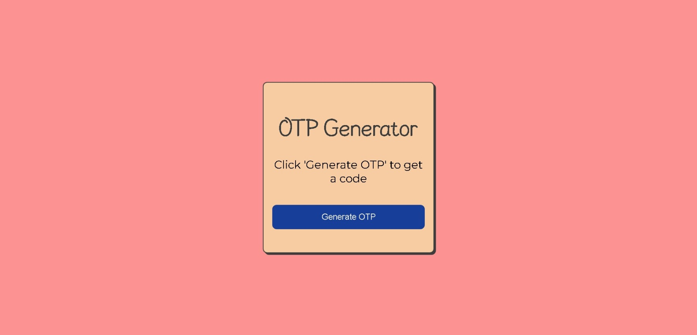

# Build a One-Time Password Generator

<p align="center">
  
  
  
  
  
  
</p>

> **Milestone:** Lab setelah mempelajari React State, Hooks, and Routing.

## About

Build a One-Time Password Generator adalah lab freeCodeCamp untuk membuat aplikasi pembangkit kode OTP enam digit menggunakan React. Saat pengguna menekan tombol `Generate OTP`, aplikasi menampilkan kode yang baru dibuat dan memulai hitung mundur selama lima detik.

Selama countdown berlangsung, tombol dinonaktifkan. Ketika waktu mencapai nol, aplikasi menampilkan pesan kedaluwarsa dan tombol dapat digunakan lagi untuk membuat kode baru. Project ini mempraktikkan pengelolaan state dengan `useState`, penyimpanan referensi timer dengan `useRef`, serta pengaturan interval dan cleanup melalui `useEffect`.

## Preview



## Konsep Utama

- React functional component `OTPGenerator` dan JSX
- React Hooks `useState`, `useEffect`, dan `useRef`
- State `otp`, `timeLeft`, dan `hasGenerated`
- Penyimpanan interval ID menggunakan `timeRef.current`
- Pembuatan string enam digit dengan `for`, `Math.random()`, dan `Math.floor()`
- Event `onClick` pada tombol dan function `generateOTP`
- Timer menggunakan `setInterval()` dengan jeda 1000 milidetik
- Functional state update melalui `setTimeLeft((prev) => prev - 1)`
- Dependency array `[timeLeft]` dan cleanup `clearInterval()`
- Conditional rendering pada teks OTP dan pesan timer
- Pengaturan tombol melalui `disabled={timeLeft > 0}`
- Attribute `aria-live="polite"` untuk pesan timer
- React DOM melalui `createRoot()` dan `render()`
- Styling dengan CSS Flexbox, custom font, pseudo-class `:hover` dan `:active`

## Struktur Project

```text
.
├── index.html
├── index.jsx
├── styles.css
└── preview.jpeg
```

## Source Code

- [`index.html`](./index.html)
- [`index.jsx`](./index.jsx)
- [`styles.css`](./styles.css)

## Pembahasan

### 1. Struktur HTML dan pemuatan React di `index.html`

File `index.html` menetapkan judul halaman `OTP Generator` dan menyediakan `<div id="root"></div>` sebagai tempat komponen React ditampilkan. File ini memuat `styles.css`, React versi `18.3.1`, ReactDOM versi `18.3.1`, dan Babel Standalone versi `7.26.5`.

Script dengan `type="text/babel"` memuat `index.jsx`. Script berikutnya mengimpor `OTPGenerator` dari `./index.jsx`, lalu `ReactDOM.createRoot(document.getElementById('root')).render(<OTPGenerator />)` merender komponen ke elemen `root`.

### 2. Component `OTPGenerator` dan inisialisasi state

Baris `const { useState, useEffect, useRef } = React;` mengambil tiga Hook dari object `React`. Component diekspor melalui `export const OTPGenerator = () => { ... }` dan mengembalikan JSX yang berisi judul, tampilan kode, pesan timer, serta tombol.

`useState("")` membuat state `otp` dengan nilai awal string kosong. `useState(0)` membuat state `timeLeft` dengan nilai awal nol. `useState(false)` membuat state `hasGenerated` untuk mencatat apakah sebuah OTP pernah dibuat. Ketiga state diperbarui melalui `setOtp`, `setTimeLeft`, dan `setHasGenerated`.

`const timeRef = useRef(null);` menyiapkan ref untuk menyimpan ID interval pada `timeRef.current`. Nilai ini dapat digunakan kembali ketika interval perlu dihentikan.

### 3. Pembuatan OTP dalam function `generateOTP`

Function `generateOTP` mendefinisikan string `digits = "0123456789"` sebagai kumpulan karakter angka dan `result = ""` sebagai tempat menyusun kode. Perulangan `for (let i = 0; i < 6; i++)` berjalan enam kali, satu kali untuk setiap digit OTP.

Di setiap iterasi, `Math.random() * digits.length` menghasilkan nilai acak dalam rentang indeks string, sedangkan `Math.floor()` mengubahnya menjadi indeks bilangan bulat. `result += digits[randomIndex]` menambahkan satu karakter angka ke string hasil. Karena digit dipilih sebagai karakter, kode tetap mempunyai enam karakter meskipun karakter pertamanya adalah `0`.

Setelah perulangan selesai, `setOtp(result)` menyimpan kode, `setTimeLeft(5)` menetapkan hitung mundur awal lima detik, dan `setHasGenerated(true)` menandai bahwa OTP sudah pernah dibuat.

### 4. Countdown melalui `useEffect` dan pengelolaan interval

`useEffect` memiliki dependency array `[timeLeft]`. Ketika nilai `timeLeft` berubah, React membersihkan effect sebelumnya sebelum menjalankan effect baru sesuai siklus effect. Jika `timeLeft <= 0`, kode memanggil `clearInterval(timeRef.current)` jika referensi interval tersedia, lalu keluar tanpa membuat interval baru.

Jika `timeLeft > 0`, `setInterval()` membuat interval dengan jeda `1000` milidetik. ID interval disimpan dalam `timeRef.current`. Setiap callback interval menjalankan `setTimeLeft((prev) => prev - 1)`, sehingga hitung mundur berkurang satu berdasarkan nilai state sebelumnya.

Effect mengembalikan cleanup `() => clearInterval(timeRef.current)` untuk menghentikan interval ketika effect dibersihkan. Dengan demikian, interval lama tidak terus berjalan bersamaan dengan interval yang dibuat pada siklus effect berikutnya. Ketika `timeLeft` mencapai nol, tidak ada interval countdown baru yang dibuat.

### 5. Pesan timer melalui function `getTimerMessage`

Function `getTimerMessage` menentukan teks pada elemen `otp-timer`. Sebelum OTP pertama dibuat, `hasGenerated` masih bernilai `false`, sehingga function mengembalikan string kosong dan paragraf timer tidak menampilkan pesan.

Setelah OTP dibuat, jika `timeLeft > 0`, function mengembalikan teks `Expires in: ${timeLeft} seconds`. Saat hitung mundur mencapai nol, function mengembalikan pesan persis `OTP expired. Click the button to generate a new OTP.`. Fungsi ini mengubah pesan timer, tetapi tidak menghapus nilai state `otp` yang sudah ditampilkan.

### 6. Tampilan OTP dan conditional rendering di JSX

Elemen `<div className="container">` menjadi container utama. Di dalamnya terdapat `<h1 id="otp-title">OTP Generator</h1>` serta elemen `<h2 id="otp-display">` untuk menampilkan kode OTP.

Ekspresi `{otp ? otp : "Click 'Generate OTP' to get a code"}` menampilkan instruksi awal jika `otp` masih kosong. Setelah `setOtp(result)` dijalankan, elemen `h2` menampilkan kode enam digit yang dihasilkan. Kode terakhir tetap terlihat setelah timer habis sampai tombol digunakan lagi.

Elemen `<p id="otp-timer" aria-live="polite">` menampilkan hasil `getTimerMessage()`. Nilai `aria-live="polite"` menandai area pesan yang dapat diperbarui dan diumumkan oleh teknologi bantu tanpa memaksa interupsi langsung.

### 7. Event tombol dan kondisi `disabled`

Tombol dengan `id="generate-otp-button"` menggunakan `onClick={generateOTP}` untuk membuat kode ketika ditekan. Attribute `disabled={timeLeft > 0}` bernilai `true` selama sisa waktu lebih dari nol, sehingga tombol tidak dapat digunakan untuk membuat OTP baru pada saat countdown berjalan.

Ketika `timeLeft` mencapai `0`, ekspresi tersebut kembali bernilai `false` dan tombol aktif lagi. Penanganan ini menggunakan nilai state `timeLeft` yang sama dengan pesan hitung mundur sehingga status tombol mengikuti kondisi timer.

### 8. Pengaturan tampilan melalui `styles.css`

File `styles.css` mengimpor font `Agrave Pro` dan `Montserrat` dari Google Fonts. Selector `body` memakai Flexbox dengan `justify-content: center` dan `align-items: center`, tinggi `100vh`, serta warna latar `#fc9292` untuk menempatkan antarmuka di tengah halaman.

Selector `.container` mengatur panel berukuran `350px` × `350px`, `padding: 20px`, `flex-direction: column`, latar `#f8cca2`, border `2px solid #3d3d3d`, sudut membulat, serta bayangan bergeser. Selector `#otp-title`, `#otp-display`, dan `#otp-timer` mengatur perataan dan margin teks; judul memakai `Agrave Pro`, sedangkan kode dan timer memakai `Montserrat`.

Selector `#generate-otp-button` mengatur padding, border, warna, serta transisi border. Pseudo-class `:hover` mengubah warna border, sementara `:active` mengubah warna latar dan posisi tombol melalui `transform: translate(2px, 4px)` ketika ditekan.

## Method yang Dipakai

- `document.getElementById()` memperoleh elemen HTML dengan ID `root`.
- `ReactDOM.createRoot()` membuat root React pada elemen HTML tersebut.
- `render()` menampilkan component `OTPGenerator` melalui root React.
- `Math.random()` menghasilkan nilai acak yang digunakan untuk memilih indeks digit.
- `Math.floor()` membulatkan nilai ke bawah untuk memperoleh indeks bilangan bulat.

## Eksperimen Tambahan

Di luar 17 requirement fungsional lab yang dicantumkan, source code juga memuat pengaturan tampilan di `styles.css`. Bagian tambahan yang dapat diamati meliputi penggunaan font `Agrave Pro` dan `Montserrat`, kombinasi latar `#fc9292` dengan panel `#f8cca2`, border serta bayangan bergeser pada `.container`, dan perubahan tampilan tombol melalui `:hover`, `:active`, serta `transition`.

Pengaturan tersebut didokumentasikan sebagai penyesuaian visual yang ada di source code, bukan sebagai requirement pengujian OTP dari freeCodeCamp.

## Ringkasan Cepat

| Konsep | Fungsi |
|---|---|
| `OTPGenerator` | Component React untuk menampilkan OTP, timer, dan tombol. |
| `useState("")` | Menyimpan kode OTP yang dihasilkan. |
| `useState(0)` | Menyimpan jumlah detik countdown yang tersisa. |
| `useState(false)` | Menentukan apakah OTP pernah dibuat. |
| `useRef(null)` | Menyimpan referensi ID interval pada `timeRef.current`. |
| `generateOTP` | Menyusun enam digit dan mengaktifkan countdown lima detik. |
| `Math.random()` dan `Math.floor()` | Memilih indeks digit acak dari string `digits`. |
| `setInterval(..., 1000)` | Menjadwalkan pengurangan countdown setiap detik. |
| `setTimeLeft((prev) => prev - 1)` | Mengurangi nilai countdown berdasarkan state sebelumnya. |
| `useEffect(..., [timeLeft])` | Mengelola interval mengikuti perubahan nilai `timeLeft`. |
| `clearInterval()` | Menghentikan interval pada cleanup atau ketika waktu habis. |
| `getTimerMessage()` | Memilih pesan awal, countdown, atau kedaluwarsa. |
| `disabled={timeLeft > 0}` | Menonaktifkan tombol selama countdown aktif. |
| `aria-live="polite"` | Memberi penanda pembaruan pesan untuk teknologi bantu. |
| CSS Flexbox dan pseudo-class | Mengatur penempatan panel dan respons visual tombol. |

## Catatan Belajar

- **`useState`** digunakan untuk mengelola tiga nilai yang memiliki fungsi berbeda: kode OTP, sisa waktu, dan status pernah dibuat.
- **`useRef`** menyimpan ID interval di `timeRef.current` agar callback dan cleanup dapat mengaksesnya.
- **Pembuatan OTP** memakai enam iterasi untuk memilih karakter angka dari string `digits`; nilai awal `0` tetap dapat menjadi bagian dari kode enam karakter.
- **`useEffect`** dijalankan berdasarkan `[timeLeft]` dan mengembalikan cleanup untuk menghentikan interval sebelumnya.
- **Functional state update** pada `setTimeLeft((prev) => prev - 1)` menggunakan nilai countdown sebelumnya saat mengurangi satu detik.
- **Countdown** dimulai dari lima detik, diperbarui setiap 1000 milidetik, dan berhenti ketika mencapai nol.
- **Conditional rendering** mengatur instruksi awal, tampilan kode, pesan hitung mundur, dan pesan kedaluwarsa berdasarkan state.
- **Status tombol** menggunakan `timeLeft > 0`, sehingga tombol baru aktif ketika countdown selesai.
- **OTP kedaluwarsa** ditunjukkan melalui pesan; kode terakhir tidak otomatis dihapus dari elemen `otp-display`.
- **Styling CSS** menempatkan aplikasi di tengah halaman dan memberi tampilan visual berbeda pada tombol ketika di-hover atau ditekan.

## What I Practiced

```text
React Functional Components
JSX and Conditional Rendering
React useState Hook
React useEffect Hook
React useRef Hook
React Event Handling
Random Six-Digit Code Generation
Interval Timers and Effect Cleanup
Functional State Updates
Button Disabled State
ARIA Live Regions
CSS Flexbox and Button Pseudo-classes
```

---

**Platform:** freeCodeCamp  
**Lab:** Build a One-Time Password Generator  
**Languages:** HTML, CSS & JavaScript  
**Focus:** React State, Hooks, and Routing

---

<p align="center">
  <strong>React State, Hooks, and Routing Section — Build a One-Time Password Generator Completed</strong><br>
  <sub>Next stop: continue the Front-End Development Libraries journey.</sub>
</p>
