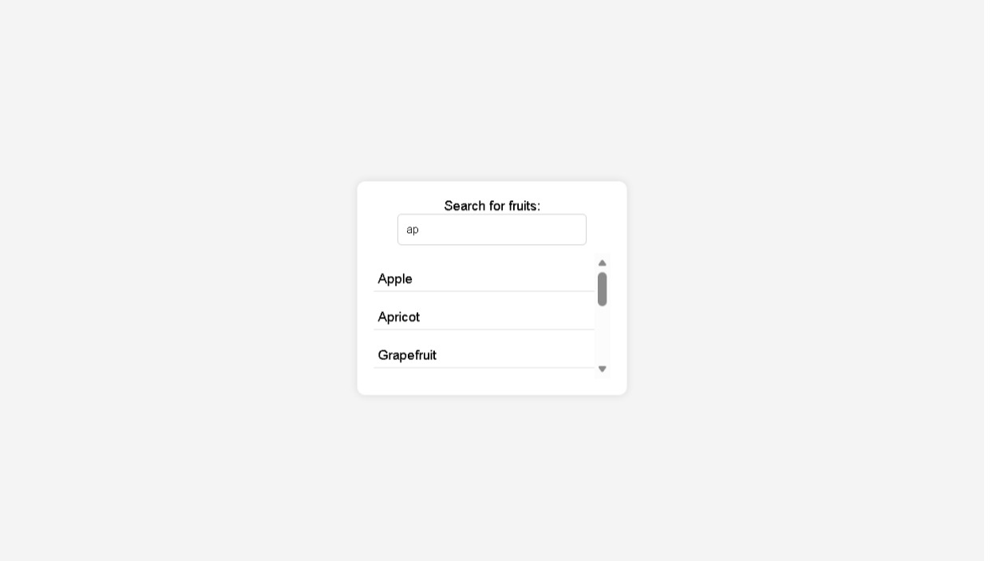

# Build a Fruit Search App

<p align="center">
  
  
  
  
  
  
</p>

> **Milestone:** Workshop setelah mempelajari React State, Hooks, and Routing.

## About

Build a Fruit Search App adalah workshop freeCodeCamp untuk membuat aplikasi pencarian nama buah menggunakan React. Pengguna mengetik kata pencarian pada input, lalu aplikasi meminta data buah yang sesuai melalui API dan menampilkan nama buah hasil pencarian.

Project ini mempraktikkan `useState` untuk menyimpan input dan hasil pencarian, `useEffect` untuk menjalankan pencarian saat input berubah, serta penggunaan timer untuk menunda permintaan selama 700 milidetik. Hasil dari API ditampilkan melalui conditional rendering JSX. HTML menyiapkan tempat render React, sedangkan CSS mengatur tampilan formulir dan area hasil.

## Preview



## Konsep Utama

- React functional component `FruitsSearch` dan JSX
- React Hooks `useState` dan `useEffect`
- State `query` dan `results` beserta setter-nya
- Event `onSubmit`, `onChange`, dan `preventDefault()`
- Controlled search input melalui `value={query}`
- Dependency array `[query]` pada `useEffect`
- Penanganan input kosong melalui `trim()`
- Penundaan pencarian dengan `setTimeout()` dan cleanup `clearTimeout()`
- Permintaan data menggunakan `fetch()`, `async`/`await`, dan `response.json()`
- Transformasi array hasil dengan `map()`
- Conditional rendering dan `key` pada daftar hasil JSX
- Penanganan error melalui `try`/`catch` dan `console.error()`
- React DOM melalui `createRoot()` dan `render()`
- CSS Flexbox dan scroll pada area hasil

## Struktur Project

```text
.
├── index.html
├── index.jsx
├── styles.css
└── preview.jpeg
```

## Source Code

- [`index.html`](./index.html)
- [`index.jsx`](./index.jsx)
- [`styles.css`](./styles.css)

## Pembahasan

### 1. Struktur HTML dan pemuatan React di `index.html`

File `index.html` mendefinisikan judul halaman `Fruits Search` dan menyediakan `<div id="root"></div>` sebagai tempat komponen React ditampilkan. File ini memuat React `18.3.1`, ReactDOM `18.3.1`, Babel Standalone `7.26.5`, dan stylesheet `styles.css`.

Script dengan `type="text/babel"` memuat `index.jsx`. Script berikutnya mengimpor `FruitsSearch` dari `./index.jsx`, kemudian `ReactDOM.createRoot(document.getElementById('root')).render(<FruitsSearch />)` menampilkan komponen pada elemen `root`.

### 2. Component `FruitsSearch` dan dua state di `index.jsx`

Baris `const { useState, useEffect } = React;` mengambil kedua Hook dari object `React`. Function `FruitsSearch` diekspor sebagai komponen yang mengembalikan JSX untuk formulir pencarian dan area hasil.

`const [query, setQuery] = useState('');` membuat state `query` dengan nilai awal string kosong. `const [results, setResults] = useState([]);` membuat state `results` dengan nilai awal array kosong. `query` menyimpan teks pencarian, sedangkan `results` menyimpan daftar nama buah yang akan ditampilkan.

### 3. Formulir pencarian dan event handler

Formulir menggunakan `onSubmit={handleSubmit}`. Di dalam function `handleSubmit(e)`, pemanggilan `e.preventDefault()` mencegah perilaku submit bawaan browser sehingga halaman tidak dikirim ulang oleh formulir.

Elemen `<label>` terhubung dengan input melalui `htmlFor="search-input"` dan `id="search-input"`. Input menggunakan `type="search"`, `value={query}`, serta `onChange={(e) => setQuery(e.target.value)}`. Ketika pengguna mengubah teks, nilai input disimpan ke state `query`; nilai yang ditampilkan input juga mengikuti state tersebut.

### 4. `useEffect` dan pemeriksaan query kosong

`useEffect` memiliki dependency array `[query]`, sehingga effect dijalankan ketika nilai `query` berubah. Pada awal effect, kondisi `query.trim() === ''` memeriksa apakah input kosong atau hanya berisi spasi. Jika benar, `setResults([])` mengosongkan hasil dan `return` menghentikan effect sebelum timer pencarian dibuat.

Pemeriksaan ini memastikan tidak ada timer pencarian baru yang dibuat untuk query kosong. Karena `results` berupa array kosong, bagian hasil akan menampilkan pesan `No results found`.

### 5. Penundaan request dan cleanup timer

Untuk query yang tidak kosong, `setTimeout(async () => { ... }, 700)` menjadwalkan proses pengambilan data setelah 700 milidetik. ID timer disimpan dalam `timeoutId` agar bisa dibersihkan.

Effect mengembalikan `() => clearTimeout(timeoutId)`. Cleanup ini membatalkan timer yang belum dijalankan ketika effect perlu dibersihkan, misalnya saat `query` berubah lagi. Dengan begitu, pengetikan beruntun tidak langsung menjadwalkan setiap request untuk dieksekusi. Cleanup timer ini tidak membatalkan request `fetch()` yang sudah terlanjur dimulai.

### 6. Mengambil dan memproses data buah dari API

Di dalam callback `setTimeout`, kode memanggil `fetch()` dengan URL `https://fruit-search.freecodecamp.rocks/api/fruits?q=${query}`. Template literal `${query}` memasukkan nilai state `query` ke parameter pencarian `q` pada URL.

`const response = await fetch(...)` menunggu respons dari API, lalu `const data = await response.json()` membaca isi respons sebagai data JSON. `setResults(data.map(fruit => fruit.name))` mengambil property `name` dari setiap object buah dan menyimpan array nama tersebut ke state `results`.

Pemanggilan request berada di dalam blok `try`. Jika terjadi error yang ditangkap oleh `catch`, kode menjalankan `console.error("Error fetching data:", error)` untuk mencatat error pada console. Blok `catch` tidak secara langsung mengubah state `results`.

### 7. Conditional rendering hasil pencarian

Area `<div id="results">` memeriksa `results.length > 0` menggunakan conditional operator. Jika ada nama buah dalam array, `results.map(item => (...))` menghasilkan elemen `<p>` untuk setiap nama buah, dengan `key={item}` dan `className="result-item"`.

Jika array hasil kosong, komponen menampilkan `<p>No results found</p>`. Pesan yang sama juga tampil pada kondisi awal sebelum ada hasil pencarian, karena nilai awal `results` adalah array kosong.

### 8. Tampilan halaman dan area hasil melalui `styles.css`

Selector `body` menggunakan font `Arial, sans-serif` dan Flexbox (`display: flex`, `justify-content: center`, `align-items: center`) untuk menempatkan aplikasi di tengah halaman dengan tinggi `100vh`. Warna latar halaman diatur menjadi `#f4f4f4`.

Selector `#search-container` mengatur perataan teks di tengah, latar putih, `padding: 20px`, sudut membulat, dan bayangan. Selector `#search-input` mengatur jarak dalam, lebar `80%`, border, sudut, serta jarak bawah input.

Selector `#results` memakai `text-align: left`, `max-height: 150px`, dan `overflow-y: auto`, sehingga daftar hasil dapat digulir secara vertikal ketika isinya melebihi tinggi maksimal. Selector `.result-item` menambahkan padding dan garis pemisah bawah pada setiap hasil.

## Method yang Dipakai

- `document.getElementById()` mengambil elemen HTML dengan ID `root`.
- `ReactDOM.createRoot()` membuat root React pada elemen yang dipilih.
- `render()` menampilkan component `FruitsSearch` melalui root React.
- `e.preventDefault()` mencegah perilaku submit bawaan formulir.
- `query.trim()` menghapus spasi pada awal dan akhir string untuk pemeriksaan query kosong.
- `response.json()` membaca body respons sebagai data JSON.
- `data.map()` membuat array nama buah dari array object hasil API.
- `results.map()` membuat elemen JSX untuk setiap nama buah dalam hasil pencarian.
- `console.error()` menuliskan error ke console apabila blok `catch` dijalankan.

## Ringkasan Cepat

| Konsep | Fungsi |
|---|---|
| `FruitsSearch` | Component React yang menampilkan formulir dan hasil pencarian buah. |
| `useState('')` | Membuat state `query` dengan nilai awal kosong. |
| `useState([])` | Membuat state `results` dengan nilai awal array kosong. |
| `onChange` | Memperbarui `query` saat teks input berubah. |
| `preventDefault()` | Mencegah submit formulir dengan perilaku bawaan browser. |
| `useEffect(..., [query])` | Menjalankan effect berdasarkan perubahan state `query`. |
| `trim()` | Memeriksa query kosong termasuk yang hanya berisi spasi. |
| `setTimeout(..., 700)` | Menunda permintaan pencarian selama 700 milidetik. |
| `clearTimeout(timeoutId)` | Membatalkan timer yang belum berjalan saat cleanup effect. |
| `fetch()` dan `await` | Meminta data buah dan menunggu respons API. |
| `response.json()` | Membaca respons API dalam format JSON. |
| `data.map()` | Mengubah data buah menjadi array nama buah. |
| `results.length > 0` | Menentukan apakah daftar hasil atau pesan kosong yang ditampilkan. |
| `results.map()` | Merender setiap nama buah sebagai elemen `<p>`. |
| `try`/`catch` | Menangani error saat proses pengambilan data. |
| CSS Flexbox dan `overflow-y: auto` | Mengatur posisi aplikasi serta scroll pada daftar hasil. |

## Catatan Belajar

- **`useState`** menyimpan teks pencarian dan array hasil dalam dua state yang terpisah.
- **Controlled input** menggunakan `value={query}` dan `onChange` agar nilai input mengikuti state React.
- **`useEffect`** memakai `[query]` sebagai dependency untuk menjalankan logic pencarian berdasarkan teks terbaru.
- **Query kosong** diperiksa melalui `trim()`; jika kosong, array hasil dikosongkan sebelum membuat timer baru.
- **Penundaan 700 milidetik** dilakukan dengan `setTimeout()` sehingga pengambilan data tidak langsung dimulai pada setiap perubahan input.
- **Cleanup** melalui `clearTimeout(timeoutId)` membatalkan timer yang masih tertunda; cleanup ini tidak membatalkan `fetch()` yang sudah dimulai.
- **`fetch()` dan `response.json()`** digunakan untuk mengambil dan membaca data buah dari API.
- **`data.map(fruit => fruit.name)`** mengubah array object buah menjadi daftar nama yang disimpan di state.
- **Conditional rendering** menampilkan hasil pencarian atau teks `No results found` berdasarkan panjang array `results`.
- **`try`/`catch`** mencatat error ke console tanpa menambahkan tampilan error khusus di halaman.

## What I Practiced

```text
React Functional Components
JSX
React useState Hook
React useEffect Hook
Controlled Search Inputs
React Event Handling
Effect Dependencies and Cleanup
Delayed API Requests with Timers
Fetch API and Async/Await
Array Mapping
Conditional Rendering
CSS Flexbox and Scrollable Results
```

---

**Platform:** freeCodeCamp  
**Workshop:** Build a Fruit Search App  
**Languages:** HTML, CSS & JavaScript  
**Focus:** React State, Hooks, and Routing

---

<p align="center">
  <strong>React State, Hooks, and Routing Section — Build a Fruit Search App Completed</strong><br>
  <sub>Next stop: continue the Front-End Development Libraries journey.</sub>
</p>
