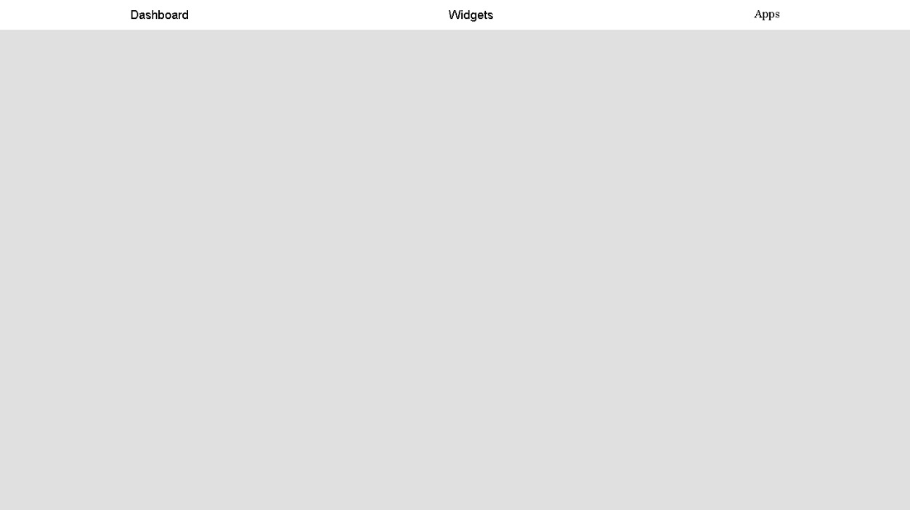
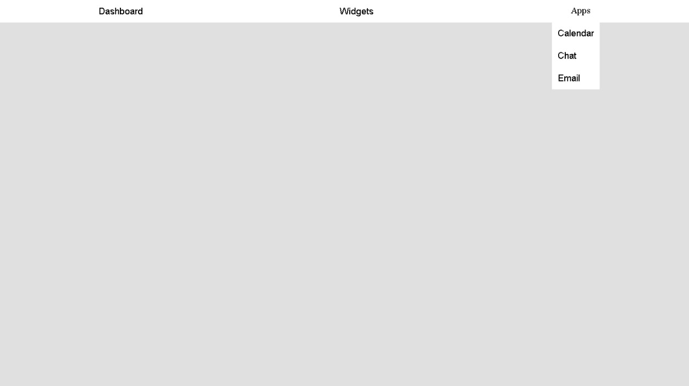

# Build a Reusable Mega Navbar

<p align="center">
  
  
  
  
  
  
</p>

> **Milestone:** Workshop setelah mempelajari React Fundamentals.

## About

Project ini membuat navigation bar menggunakan component `Navbar` yang ditulis dengan React dan JSX. Navigation bar menampilkan tautan Dashboard, Widgets, serta tombol Apps yang dapat membuka dan menutup submenu berisi Calendar, Chat, dan Email.

Submenu dikendalikan oleh state `isVisible` melalui hook `useState`. Styling menggunakan CSS, termasuk efek hover, transisi opacity saat submenu dibuka atau ditutup, serta perubahan posisi submenu pada ukuran layar tertentu.

## Preview





## Konsep Utama

- React functional component dan named export `Navbar`.
- JSX untuk menyusun navigation bar dan submenu.
- Hook `useState` untuk menentukan apakah submenu ditampilkan.
- React event handler `onClick` untuk mengubah state.
- Conditional expression untuk `aria-expanded` dan `className` submenu.
- CSS Flexbox, pseudo-class `:hover`, serta state visual menggunakan `visibility` dan `opacity`.
- CSS media queries untuk menyesuaikan posisi submenu.
- React dan ReactDOM dari CDN, dengan Babel Standalone untuk menjalankan JSX di browser.

## Struktur Project

```text
reusable-mega-navbar/
├── index.html
├── index.jsx
└── styles.css
```

## Source Code

- [`index.html`](index.html)
- [`index.jsx`](index.jsx)
- [`styles.css`](styles.css)

## Pembahasan

### 1. Memuat React, ReactDOM, Babel, dan CSS pada `index.html`

`index.html` memuat React 18.3.1 dan ReactDOM 18.3.1 melalui CDN, lalu memuat Babel Standalone 7.26.3 agar kode JSX dapat diproses oleh browser. File `styles.css` dihubungkan menggunakan elemen `<link>`.

Elemen `<div id="root"></div>` menjadi tempat React menampilkan component. Pada script terakhir, `Navbar` diimpor dari `./index.jsx`, kemudian `ReactDOM.createRoot(document.getElementById("root")).render(<Navbar />)` digunakan untuk merender component tersebut.

### 2. Membuat Component `Navbar` pada `index.jsx`

`Navbar` adalah functional component yang diekspor menggunakan `export const Navbar`. Component ini mengembalikan elemen `<nav>` dengan daftar `<ul>` yang berisi Dashboard, Widgets, dan Apps.

Dashboard dan Widgets adalah tautan langsung menggunakan elemen `<a>`. Apps menggunakan elemen `<button>` karena berfungsi mengubah tampilan submenu, bukan langsung membuka sebuah alamat halaman.

### 3. Mengelola Submenu dengan `useState` dan `onClick`

Baris `const { useState } = React;` mengambil hook `useState` dari objek React yang telah dimuat melalui CDN. Dalam component, `const [isVisible, setIsVisible] = useState(false);` menetapkan nilai awal `false`, sehingga submenu berada dalam keadaan tertutup.

Ketika tombol Apps diklik, handler `onClick={() => setIsVisible(!isVisible)}` mengubah state ke nilai kebalikannya. Jika state berubah menjadi `true`, class submenu menjadi `sub-menu sub-menu--open`; jika `false`, class yang digunakan kembali menjadi `sub-menu`.

Atribut `aria-expanded` juga mengikuti state: nilainya berupa string `"true"` ketika submenu terbuka dan `"false"` ketika tertutup. Elemen daftar submenu diberi `aria-label="Apps"`.

### 4. Menata Navigation Bar dengan `styles.css`

Selector universal mengatur `box-sizing: border-box`, `margin: 0`, dan `padding: 0`. Variabel CSS pada `:root` menyimpan warna putih, abu-abu muda, ungu tua, dan hitam.

`.navbar ul` menggunakan `display: flex` dan `justify-content: space-around` untuk memberi jarak pada item utama. Tautan dan tombol menerima perubahan background menjadi ungu tua serta teks putih saat di-hover.

Submenu menggunakan `position: absolute` dengan `right: 5%`, `visibility: hidden`, dan `opacity: 0` saat tertutup. Ketika class `sub-menu--open` diterapkan, `visibility` menjadi `visible` dan `opacity` menjadi `1`. Property `transition: opacity 0.5s ease` mengatur perubahan opacity selama setengah detik.

Media query pada lebar minimum `768px` mengubah `right` submenu menjadi `15%`, sedangkan pada lebar minimum `1024px` menjadi `13%`.

## Method yang Dipakai

- `document.getElementById("root")` mencari elemen HTML dengan `id="root"`.
- `ReactDOM.createRoot()` membuat React root pada elemen tersebut.
- `.render(<Navbar />)` menampilkan component `Navbar` di dalam React root.

## Ringkasan Cepat

| Konsep | Fungsi |
|---|---|
| `Navbar` | Component React yang menampilkan navigation bar dan submenu Apps. |
| `useState(false)` | Menyimpan kondisi awal submenu sebagai tertutup. |
| `setIsVisible(!isVisible)` | Mengubah kondisi submenu ketika tombol Apps diklik. |
| `aria-expanded` | Menyatakan kondisi terbuka atau tertutup sesuai state. |
| `className` | Memilih class submenu berdasarkan `isVisible`. |
| `.sub-menu--open` | Mengubah submenu menjadi terlihat. |
| `transition: opacity 0.5s ease` | Membuat perubahan opacity berlangsung selama 0,5 detik. |
| `@media` | Mengubah posisi submenu pada breakpoint tertentu. |

## Catatan Belajar

- **React state** menentukan class yang dipakai submenu, bukan mengubah CSS secara langsung melalui event handler.
- **Conditional rendering atribut** pada contoh ini diterapkan pada `className` dan `aria-expanded` berdasarkan `isVisible`; elemen submenu tetap berada dalam JSX.
- **Aksesibilitas** pada tombol Apps mencakup nilai `aria-expanded` yang mengikuti kondisi submenu.
- **CSS** mengendalikan tampilan submenu melalui kombinasi `visibility` dan `opacity`.
- **Tautan sementara** pada source code menggunakan `href="#"`, sehingga belum mengarah ke halaman aplikasi yang berbeda.

## What I Practiced

```text
React Functional Components
JSX
Named Exports and Imports
React useState Hook
React onClick Event Handling
Conditional Expressions in JSX
ARIA Attributes
CSS Flexbox
CSS Hover Styles
CSS Visibility and Opacity Transitions
CSS Media Queries
ReactDOM Root Rendering
```

---

**Platform:** freeCodeCamp  
**Workshop:** Build a Reusable Mega Navbar  
**Languages:** HTML, CSS & JavaScript  
**Focus:** React Fundamentals

---

<p align="center">
  <strong>React Fundamentals Section — Build a Reusable Mega Navbar Completed</strong><br>
  <sub>Next stop: continue the Front-End Development Libraries Certification journey.</sub>
</p>
