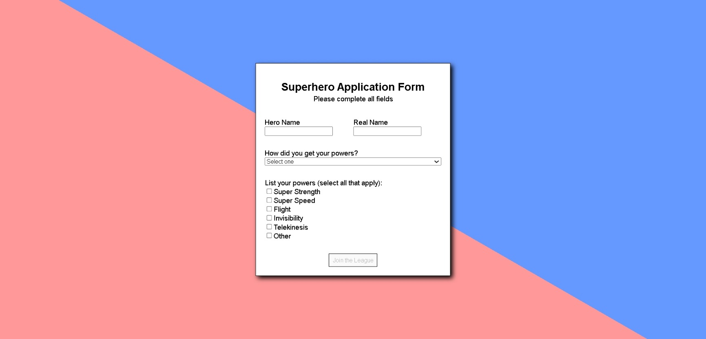

# Build a Superhero Application Form

<p align="center">
  
  
  
  
  
  
</p>

> **Milestone:** Workshop setelah mempelajari React State, Hooks, and Routing.

## About

Build a Superhero Application Form adalah workshop freeCodeCamp untuk membuat formulir pendaftaran superhero menggunakan React. Formulir ini berisi kolom nama superhero, nama asli, pilihan asal kekuatan, serta beberapa pilihan kekuatan yang dapat dicentang.

Project ini menggunakan `useState` untuk menyimpan nilai input, `onChange` untuk memperbarui nilai ketika pengguna berinteraksi dengan form, dan kondisi `disabled` agar tombol `Join the League` baru dapat ditekan setelah seluruh kelompok input memiliki pilihan atau isi. Formulir mempunyai `method='post'` dan `action` menuju alamat yang ditentukan pada source code.

## Preview



## Konsep Utama

- React functional component `SuperheroForm` dan JSX
- React Hook `useState` untuk mengelola empat nilai form
- Array `powerSourceOptions` dan `powersOptions` sebagai pilihan formulir
- State `heroName`, `realName`, `powerSource`, dan `powers`
- Controlled inputs melalui `value`, `checked`, dan `onChange`
- Event handler `handlePowersChange` untuk perubahan checkbox
- Object destructuring pada `const { value, checked } = e.target`
- Spread syntax `[...powers, value]` dan ternary operator
- Method `map()`, `filter()`, dan `includes()` pada array
- Conditional disabling tombol dengan operator `||`
- Attribute form `method='post'` dan `action`
- React DOM melalui `createRoot()` dan `render()`
- CSS Flexbox, gradient background, box shadow, dan pseudo-class tombol

## Struktur Project

```text
.
├── index.html
├── index.jsx
├── styles.css
└── preview.jpeg
```

## Source Code

- [`index.html`](./index.html)
- [`index.jsx`](./index.jsx)
- [`styles.css`](./styles.css)

## Pembahasan

### 1. Struktur HTML dan pemuatan React di `index.html`

File `index.html` menetapkan judul halaman `Superhero Application Form` dan menyediakan elemen `<div id="root"></div>` sebagai tempat React menampilkan antarmuka. File ini memuat React dan ReactDOM versi `18.3.1`, Babel Standalone versi `7.26.3`, serta `styles.css`.

Script dengan `type="text/babel"` memuat `index.jsx`. Script berikutnya mengimpor `SuperheroForm` dari `./index.jsx`, kemudian `ReactDOM.createRoot(document.getElementById('root')).render(<SuperheroForm />)` menampilkan component pada elemen `root`.

### 2. Component `SuperheroForm` dan daftar pilihan

Baris `const { useState } = React;` mengambil Hook `useState` dari object `React`. Component didefinisikan dan diekspor melalui `export const SuperheroForm = () => { ... }`, lalu mengembalikan JSX untuk menampilkan formulir.

Array `powerSourceOptions` berisi enam opsi asal kekuatan, mulai dari `Bitten by a strange creature` hingga `Other`. Array `powersOptions` berisi enam opsi kekuatan, mulai dari `Super Strength` hingga `Other`. Kedua array digunakan untuk membentuk pilihan yang terlihat di form.

### 3. Pengelolaan empat state menggunakan `useState`

`heroName`, `realName`, dan `powerSource` dimulai dari string kosong `''`, sedangkan `powers` dimulai dari array kosong `[]`. Nilai-nilai tersebut dikelola melalui pasangan setter masing-masing: `setHeroName`, `setRealName`, `setPowerSource`, dan `setPowers`.

State menyimpan perubahan pilihan pengguna sehingga nilai input yang ditampilkan selalu mengacu pada state React. `powers` menggunakan array karena pengguna dapat mencentang lebih dari satu kekuatan sekaligus.

### 4. Function `handlePowersChange` untuk checkbox

Function `handlePowersChange` menerima object event melalui parameter `e`. Baris `const { value, checked } = e.target;` mengambil nilai opsi yang dipilih dan status apakah checkbox sedang dicentang.

Ekspresi `checked ? [...powers, value] : powers.filter(p => p !== value)` mempunyai dua kondisi. Jika dicentang, spread syntax mempertahankan seluruh isi array `powers` dan menambahkan `value`. Jika centang dihapus, `filter()` membuat array baru tanpa opsi tersebut. Hasilnya diteruskan ke `setPowers` untuk memperbarui state.

### 5. Input nama superhero dan nama asli

Elemen input `Hero Name` memakai `type='text'`, `value={heroName}`, dan `onChange={e => setHeroName(e.target.value)}`. Setiap perubahan input memperbarui state `heroName` berdasarkan nilai yang diketik.

Elemen input `Real Name` memakai `type='password'`, `value={realName}`, dan `onChange={e => setRealName(e.target.value)}`. Tipe `password` menyamarkan karakter yang terlihat pada kolom, sedangkan nilainya tetap disimpan dalam state `realName`.

### 6. Dropdown asal kekuatan dengan `map()`

Elemen `<select>` menggunakan `value={powerSource}` dan `onChange={e => setPowerSource(e.target.value)}`. Opsi pertama mempunyai `value=''` dan teks `Select one`, sehingga pilihan awal belum mengisi `powerSource`.

Ekspresi `powerSourceOptions.map(source => (...))` membuat satu elemen `<option>` untuk setiap item array. Masing-masing elemen memakai `key={source}`, `value={source}`, dan teks `{source}`. Setelah pengguna memilih salah satu opsi, state `powerSource` diperbarui.

### 7. Checkbox daftar kekuatan dengan `map()` dan `includes()`

Ekspresi `powersOptions.map(power => (...))` membuat checkbox untuk setiap opsi kekuatan. Tiap checkbox memiliki `value={power}`, `checked={powers.includes(power)}`, dan `onChange={handlePowersChange}`.

`includes(power)` memeriksa apakah suatu pilihan sudah terdapat pada array `powers`. Jika sudah ada, `checked` bernilai `true`. Ketika pilihan dicentang atau dibatalkan, `handlePowersChange` memperbarui array sehingga status checkbox mengikuti state terbaru.

### 8. Form submission dan kondisi tombol `Join the League`

Elemen `<form>` menggunakan `method='post'` dan `action='https://superhero-application-form.freecodecamp.org'`. Tombol `Join the League` memiliki `type='submit'`, sehingga digunakan untuk mengirim form ketika tombol sudah dapat ditekan.

Ekspresi `disabled={!heroName || !realName || !powerSource || powers.length === 0}` menonaktifkan tombol jika salah satu dari tiga nilai teks/pilihan masih kosong atau jika belum ada satu pun kekuatan yang dicentang. Kondisi ini memeriksa keterisian berdasarkan nilai state, bukan validasi khusus atas isi teks.

**Catatan kode:** Input dan `<select>` dalam source code ini tidak memakai attribute `name`. Karena itu, pada pengiriman form HTML biasa, nilai-nilai yang disimpan oleh React tersebut belum mempunyai nama field untuk dimasukkan ke data form. Hal ini tidak diubah dalam dokumentasi; README hanya menjelaskan implementasi yang dikirimkan.

### 9. Styling tampilan di `styles.css`

Selector `body` menggunakan Flexbox dengan `justify-content: center` dan `align-items: center` untuk menempatkan form di tengah halaman. Latar dibuat menggunakan `linear-gradient(30deg, #ff9999 50%, #6699ff 50%)`.

Selector `.form-wrap` membuat panel putih dengan lebar `400px`, `padding: 20px`, border hitam, dan `box-shadow: 5px 5px 10px black`. Selector `.section` mengatur kelompok input dengan Flexbox dan `margin-bottom: 30px`, sedangkan `.column` mengubah arah susunan menjadi vertikal.

Selector `.submit-btn` mengatur tampilan tombol. Pseudo-class `:hover` mengubah warna latar saat pointer berada di atas tombol, sedangkan `:disabled` memakai `cursor: not-allowed` ketika tombol tidak dapat ditekan. Selector `.submit-wrap` juga tertulis dalam CSS, tetapi tidak digunakan oleh elemen pada JSX yang diberikan.

## Method yang Dipakai

- `document.getElementById()` mencari elemen HTML dengan ID `root`.
- `ReactDOM.createRoot()` membuat root React pada elemen tersebut.
- `render()` menampilkan component `SuperheroForm` melalui root React.
- `map()` mengubah setiap item array opsi menjadi elemen `<option>` atau checkbox dalam JSX.
- `includes()` memeriksa apakah suatu kekuatan sudah ada dalam array `powers`.
- `filter()` menghasilkan array kekuatan baru tanpa opsi yang dibatalkan centangnya.

## Ringkasan Cepat

| Konsep | Fungsi |
|---|---|
| `SuperheroForm` | Component React yang menampilkan seluruh formulir. |
| `useState` | Menyimpan nilai input dan pilihan pengguna. |
| `powerSourceOptions` | Daftar opsi asal kekuatan pada dropdown. |
| `powersOptions` | Daftar opsi kekuatan pada checkbox. |
| `heroName` dan `realName` | State untuk dua kolom nama. |
| `powerSource` | State untuk satu opsi asal kekuatan. |
| `powers` | Array state untuk beberapa kekuatan yang dipilih. |
| `onChange` | Menjalankan pembaruan state saat nilai input berubah. |
| `handlePowersChange` | Menambahkan atau menghapus kekuatan berdasarkan status centang. |
| `map()` | Membuat elemen pilihan dari array. |
| `includes()` | Menentukan nilai `checked` berdasarkan isi array state. |
| `filter()` | Menghapus pilihan kekuatan dari array baru. |
| `disabled={...}` | Mengatur apakah tombol submit bisa digunakan. |
| `method='post'` dan `action` | Menentukan metode dan tujuan pengiriman form HTML. |
| CSS Flexbox | Mengatur posisi panel dan susunan input. |

## Catatan Belajar

- **Controlled inputs** menggunakan `value` atau `checked` yang terhubung ke state dan diperbarui dengan `onChange`.
- **`useState`** mengelola tiga nilai string dan satu array pada form yang sama.
- **`map()`** membentuk opsi dropdown dan checkbox dari dua array pilihan.
- **`handlePowersChange`** memakai `checked` untuk menentukan apakah satu kekuatan ditambahkan atau dihapus.
- **Spread syntax** pada `[...powers, value]` membuat array baru yang berisi pilihan lama dan pilihan baru.
- **`filter()`** menghapus satu pilihan tanpa mengubah array state secara langsung.
- **`includes()`** menghubungkan isi array `powers` dengan kondisi `checked` setiap checkbox.
- **Tombol submit** hanya aktif ketika state nama, asal kekuatan, dan daftar kekuatan memenuhi ekspresi `disabled` yang ditentukan.
- **Atribut `name`** tidak ada pada input yang diberikan, sehingga pengiriman form HTML biasa tidak otomatis menyertakan nilai field tersebut.

## What I Practiced

```text
React Functional Components
React useState Hook
Controlled Form Inputs
React onChange Events
State Management for Text Inputs
Select and Checkbox Controls
Array Mapping and Filtering
Array Includes and Spread Syntax
Conditional Button Disabled State
HTML Form Submission Attributes
CSS Flexbox and Form Styling
```

---

**Platform:** freeCodeCamp  
**Workshop:** Build a Superhero Application Form  
**Languages:** HTML, CSS & JavaScript  
**Focus:** React State, Hooks, and Routing

---

<p align="center">
  <strong>React State, Hooks, and Routing Section — Build a Superhero Application Form Completed</strong><br>
  <sub>Next stop: continue the Front-End Development Libraries journey.</sub>
</p>
