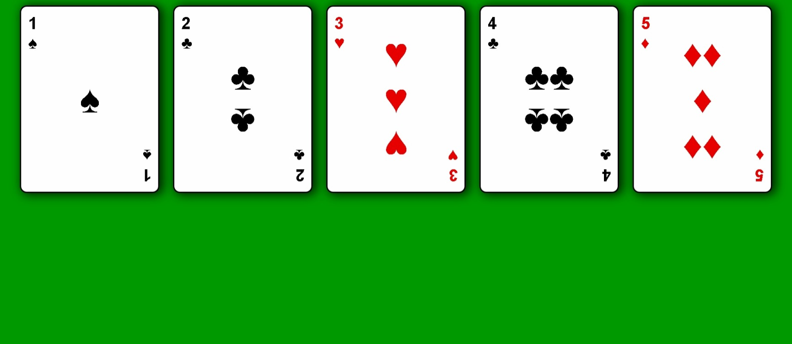

# Build a Page of Playing Cards

<p align="center">
  
  
  
</p>

> **Milestone:** Certification Project setelah mempelajari Flexbox.

## About

Project ini membuat halaman berisi lima playing cards menggunakan HTML dan CSS.

Struktur setiap kartu dibagi menjadi tiga bagian utama: `.left`, `.middle`, dan `.right`. Flexbox digunakan untuk menyusun kumpulan kartu, mengatur posisi content di dalam kartu, dan menempatkan simbol kartu pada posisi yang berbeda.

## Preview



## Konsep Utama

- Flexbox
- `display: flex`
- `justify-content`
- `flex-wrap`
- `gap`
- `align-self`
- `flex-direction`
- `:hover`
- `:nth-of-type()`
- `transform: scale()`
- `transform: rotate()`
- `transition`
- `box-shadow`
- Nested Flexbox

## Struktur Project

```text
page-of-playing-cards/
├── index.html
└── styles.css
```

## Source Code

- [`index.html`](./index.html)
- [`styles.css`](./styles.css)

## Pembahasan

### 1. Container `#playing-cards`

Seluruh kartu berada di dalam elemen `main` dengan id `playing-cards`.

```html
<main id="playing-cards">
  ...
</main>
```

Container tersebut menggunakan Flexbox:

```css
#playing-cards {
  display: flex;
  justify-content: center;
  flex-wrap: wrap;
  gap: 20px;
}
```

`display: flex` membuat setiap `.card` menjadi flex item.

`justify-content: center` memusatkan kartu pada main axis.

`flex-wrap: wrap` mengizinkan kartu berpindah ke baris berikutnya ketika ruang horizontal tidak cukup.

`gap: 20px` memberikan jarak antar-kartu.

### 2. Struktur Dasar `.card`

Setiap kartu memiliki tiga direct child:

```html
<div class="left">...</div>
<div class="middle">...</div>
<div class="right">...</div>
```

Class `.card` menggunakan Flexbox dan `justify-content: space-between`.

```css
.card {
  display: flex;
  justify-content: space-between;
}
```

Dengan struktur tersebut, bagian kiri, tengah, dan kanan dapat ditempatkan pada area berbeda di dalam kartu.

### 3. Posisi `.left`, `.middle`, dan `.right`

Ketiga bagian kartu menggunakan `align-self` dengan nilai yang berbeda.

```css
.left {
  align-self: flex-start;
}

.middle {
  align-self: center;
}

.right {
  align-self: flex-end;
}
```

`.left` ditempatkan pada awal cross axis.

`.middle` ditempatkan di tengah cross axis.

`.right` ditempatkan pada akhir cross axis.

### 4. Flexbox di Bagian Tengah

Bagian `.middle` juga menjadi flex container.

```css
.middle {
  align-self: center;
  display: flex;
  flex-direction: column;
}
```

`flex-direction: column` membuat simbol-simbol di bagian tengah tersusun secara vertikal.

Pada kartu tertentu, source juga menggunakan `.middle-section`:

```css
.middle-section {
  display: flex;
  flex-direction: row;
  justify-content: center;
}
```

Class tersebut membuat kelompok simbol tertentu tersusun secara horizontal di dalam area tengah.

### 5. Ukuran dan Tampilan Kartu

Setiap kartu memiliki ukuran tetap:

```css
height: 250px;
width: 180px;
```

Source juga menambahkan:

```css
border: 2px solid black;
border-radius: 10px;
background-color: #fefefe;
box-shadow: 4px 1px 15px 1px #000000CC;
```

Aturan tersebut membentuk tampilan visual kartu dengan background terang, border, sudut membulat, dan shadow.

### 6. Hover pada Kartu

Setiap kartu memiliki transition:

```css
transition: transform 0.2s ease;
```

Saat pointer berada di atas kartu:

```css
.card:hover {
  transform: scale(1.04);
}
```

`scale(1.04)` memperbesar kartu dari ukuran normalnya selama hover.

### 7. Warna Merah pada Kartu Tertentu

Source menggunakan selector:

```css
.card:nth-of-type(3), .card:nth-of-type(5) {
  color: rgb(230, 0, 0);
}
```

Selector tersebut memberikan warna merah pada kartu ketiga dan kelima.

Pada HTML project, kartu ketiga menggunakan simbol hati dan kartu kelima menggunakan simbol wajik.

### 8. Memutar Simbol dengan `.flipped`

Source terbaru menggunakan:

```css
.flipped {
  transform: rotate(180deg);
}
```

Class `.flipped` digunakan pada simbol dan angka yang perlu ditampilkan terbalik.

Contohnya:

```html
<div class="right">
  <div class="flipped">♣</div>
  <div class="flipped">2</div>
</div>
```

`rotate(180deg)` memutar elemen sebesar 180 derajat.

## Eksperimen Tambahan

Selain requirement dari user stories freeCodeCamp, project ini memiliki modifikasi tambahan yang sudah dikonfirmasi pengguna.

- **Jumlah kartu** dibuat lima, meskipun requirement hanya meminta setidaknya tiga `.card`.
- **Background halaman** menggunakan warna hijau melalui `body { background-color: #009900; }`.
- **Card styling** menambahkan border radius, background putih, shadow, padding, dan ukuran visual kartu.
- **Hover effect** menggunakan `transition` dan `transform: scale(1.04)`.
- **Warna suit** menggunakan `:nth-of-type()` untuk memberi warna merah pada kartu ketiga dan kelima.
- **Typography kartu** menggunakan ukuran dan ketebalan font berbeda untuk bagian kiri/kanan dan bagian tengah.
- **Nested Flexbox** melalui `.middle-section` digunakan untuk menyusun simbol tertentu secara horizontal.
- **Rotasi simbol** melalui `.flipped { transform: rotate(180deg); }` digunakan pada simbol dan angka yang tampil terbalik.

## Ringkasan Cepat

| Konsep | Fungsi |
|---|---|
| `display: flex` | Membuat elemen menjadi flex container |
| `justify-content: center` | Memusatkan kartu pada main axis |
| `flex-wrap: wrap` | Mengizinkan kartu berpindah ke baris berikutnya |
| `gap` | Memberikan jarak antar-kartu |
| `justify-content: space-between` | Membagi ruang di antara tiga bagian utama kartu |
| `align-self` | Mengatur posisi masing-masing flex item pada cross axis |
| `flex-direction: column` | Menyusun simbol bagian tengah secara vertikal |
| `flex-direction: row` | Menyusun simbol dalam `.middle-section` secara horizontal |
| `:hover` | Mengaktifkan styling ketika pointer berada di atas kartu |
| `:nth-of-type()` | Memilih kartu berdasarkan urutan tipenya |
| `scale()` | Mengubah skala visual kartu |
| `rotate()` | Memutar elemen |
| `transition` | Mengatur perubahan transform agar berlangsung bertahap |

## Catatan Belajar

- **Flex container** mengatur direct children sebagai flex items.
- **`justify-content`** mengatur posisi atau distribusi flex items pada main axis.
- **`align-self`** memungkinkan satu flex item memiliki alignment sendiri pada cross axis.
- **Nested Flexbox** terjadi ketika sebuah flex item juga dijadikan flex container.
- **`flex-direction`** menentukan arah main axis sebuah flex container.
- **`:nth-of-type()`** memilih elemen berdasarkan urutan tipe elemen dalam parent.
- **`scale()`** mengubah ukuran visual elemen tanpa mengubah nilai width dan height di source.
- **`rotate(180deg)`** memutar elemen sebesar 180 derajat.

## What I Practiced

```text
HTML Playing Card Structure
CSS Flexbox
Flex Wrapping
Main Axis Alignment
Cross Axis Alignment
Align Self
Nested Flexbox
Flex Direction
CSS Pseudo-classes
CSS Transforms
CSS Transitions
Card Styling
```

---

**Platform:** freeCodeCamp  
**Certification Project:** Build a Page of Playing Cards  
**Languages:** HTML & CSS

---

<p align="center">
  <strong>Certification Project — Build a Page of Playing Cards Completed</strong><br>
  <sub>Next stop: continue the Responsive Web Design Certification journey.</sub>
</p>
