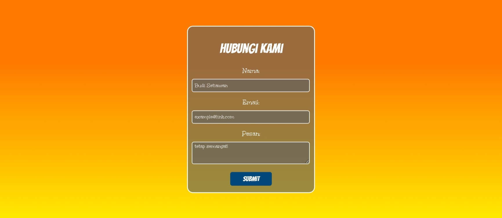

# Design a Contact Form

<p align="center">
  
  
  
  
</p>

> **Milestone:** Lab setelah mempelajari Styling Forms.

## About

Project lab ini mempraktikkan cara membangun dan menata gaya sebuah formulir kontak menggunakan HTML dan CSS.

Fokus utama lab adalah menerapkan form validation, memusatkan layout dengan Flexbox, memberikan background berupa `linear-gradient()`, serta menata gaya pada state elemen form seperti `:focus`, `:hover`, dan `::placeholder`.

Di luar requirement utama freeCodeCamp, project ini juga dikembangkan dengan mengimpor custom typography dari Google Fonts dan menggunakan outline tersembunyi pada elemen input.

## Preview



## Konsep Utama

- HTML Forms
- Form Validation
- CSS Flexbox
- `background-image: linear-gradient()`
- `@import`
- `:focus`, `:hover`, & `:active`
- `::placeholder`
- Hex Colors dengan Alpha

## Struktur Project

```text
contact-form/
├── index.html
├── preview.jpeg
└── styles.css
```

## Source Code

- [`index.html`](./index.html)
- [`styles.css`](./styles.css)

## Pembahasan

### 1. Struktur HTML Form

Formulir dibangun menggunakan tag `<form>` dengan beberapa jenis input. Setiap elemen input dikaitkan dengan `<label>` menggunakan atribut `for` dan `id`. Contoh:

```html
<label for="email" class="unkempt-regular">Email:</label>
<input type="email" id="email" name="email" placeholder="example@link.com" required/>
```

Atribut `required` mencegah form dikirim jika input tersebut kosong, dan `type="email"` memvalidasi format surel secara otomatis melalui peramban.

### 2. Memusatkan Layout dengan Flexbox

Seluruh form diletakkan tepat di tengah layar menggunakan pola Flexbox pada elemen `body`:

```css
body {
  width: 100%;
  height: 100vh;
  margin: 0;
  display: flex;
  justify-content: center;
  align-items: center;
}
```

Tinggi `100vh` memastikan elemen `body` memiliki tinggi minimal seukuran layar secara penuh, dan kedua aturan alignment menempatkan `.form-container` persis di tengah secara vertikal maupun horizontal.

### 3. Background Linear Gradient

Elemen `body` diberi latar belakang gradien menggunakan fungsi `linear-gradient()`:

```css
body {
  background-image: linear-gradient(to bottom, 
  #ff7b00 30%, 
  #ff8800, 
  /* ... */ 
  #ffea00);
}
```

Pengaturan ini menciptakan pergeseran rona yang mulus dari jingga hingga warna kuning menyala menuju ke arah bawah layar.

### 4. Background Semi-Transparan (Alpha Channel)

Kontainer form serta elemen input menggunakan latar abu-abu dengan efek sedikit tembus pandang:

```css
.form-container {
  background-color: #626262a0;
}
```

Format hex 8-digit digunakan di sini, di mana dua karakter terakhir `a0` menentukan nilai opacity, sehingga gradien berwarna jingga di baliknya tetap terlihat sedikit menembus *container* form.

### 5. Styling Pseudo-elements (Placeholder)

Teks petunjuk (placeholder) di dalam input diberi gaya khusus menggunakan pseudo-element `::placeholder`:

```css
input::placeholder,
textarea::placeholder {
  padding: 0 5px;
  font-family: "Unkempt", cursive;
  color: #ffffff;
  opacity: 0.9;
}
```

Ini memungkinkan kita untuk mengontrol warna, perataan, serta font teks bayangan yang muncul saat input masih kosong.

### 6. Styling Pseudo-classes (Focus, Hover, Active)

Elemen form memberikan umpan balik interaktif saat pengguna menekannya melalui state `:focus`. Pada state ini, efek highlight standar browser sengaja disembunyikan:

```css
input:focus,
textarea:focus {
  padding: 2px 5px;
  outline: none !important;
}
```

Selain itu, tombol Submit (yang dideklarasikan lewat tag `<button type="submit">`) bereaksi terhadap kursor menggunakan efek transisi `:hover` (gelap saat disorot) dan `:active` (putih terang saat tombol ditekan).

### 7. Custom Typography

Tiga jenis keluarga huruf (font) diimpor dari eksternal menggunakan tag `@import`:

```css
@import url('[https://fonts.googleapis.com/css2?family=Bangers&family=Shadows+Into+Light+Two&family=Unkempt:wght@400;700&display=swap](https://fonts.googleapis.com/css2?family=Bangers&family=Shadows+Into+Light+Two&family=Unkempt:wght@400;700&display=swap)');
```

Font tersebut kemudian diaplikasikan menggunakan utility classes bawaan, seperti `.bangers-regular` dan `.unkempt-regular`. Elemen interaktif `<input>` dan `<textarea>` tidak mewarisi font dari `body` secara default, karenanya font-family mereka harus ditentukan ulang di aturan CSS.

## Eksperimen Tambahan

Selain requirement utama freeCodeCamp, saya menambahkan beberapa eksperimen pada project ini:

- Import font dari eksternal melalui Google Fonts.
- Properti `background-image` dengan value `linear-gradient()` yang memiliki rentang banyak poin heksadesimal.
- Pengaplikasian properti `outline: hidden;` (secara kode ditulis `outline: none !important;`) pada elemen input dan textarea saat terkena interaksi `:focus` agar tidak bentrok dengan desain UI yang dirancang.

## Ringkasan Cepat

| Konsep | Fungsi |
|---|---|
| `<form>` | Kontainer yang membungkus kumpulan input data yang dikirimkan oleh user |
| `linear-gradient()` | Fungsi untuk membangun pergeseran warna visual bergradasi pada background |
| `@import` | Perintah untuk memuat *stylesheet* eksternal seperti Google Fonts |
| `:focus` | Aturan gaya (pseudo-class) bagi elemen form yang sedang aktif atau disorot input keyboard |
| `::placeholder` | Menata teks bayangan yang muncul sementara ketika kolom teks field kosong |
| `outline: none` | Mengatasi *border highlight* kebiruan yang muncul otomatis oleh beberapa tipe web browser |

## Catatan Belajar

- **Form Validation Bawaan:** Penggunaan tag seperti `type="email"` dan `required` mempermudah penguncian proses validasi sebelum data diformat tanpa melibatkan bahasa pemrograman tambahan.
- **Centering Flexbox Modern:** Memusatkan layout form menggunakan aturan induk container `display: flex`, `justify-content: center`, `align-items: center` dengan tinggi 100vh adalah pilar layout yang rapi tanpa perlu memperhitungkan sisa jarak pinggir/margin.
- **Warna Transparan Hexadesimal:** Menggunakan penambahan digit ekstra (*alpha*) pada belakang kode Hex warna (seperti penambahan 'a0' pada `#626262`) mengizinkan lapisan di bawah (seperti background linear) menembus permukaan warna blok elemen form secara indah.
- **Batas Pewarisan Font:** Elemen-elemen input form dalam HTML memiliki perlindungan struktur dari sistem operasi; akibatnya atribut dari class text typography tidak secara instan mewarisi CSS `font-family` dari tag induk (`body`), sehingga butuh ditargetkan secara langsung.

## What I Practiced

```text
HTML Semantic Form
Form Validations
CSS Flexbox Centering
CSS Linear Gradient Backgrounds
CSS Hex Colors with Alpha Channel
:focus
:hover
:active
::placeholder
@import
Overriding Default Browser Outline
```

---

**Platform:** freeCodeCamp  
**Lab:** Design a Contact Form  
**Languages:** HTML & CSS  
**Focus:** Styling Forms

---

<p align="center">
  <strong>Styling Forms Section — Design a Contact Form Completed</strong><br>
  <sub>Next stop: continue the Responsive Web Design Certification journey.</sub>
</p>
