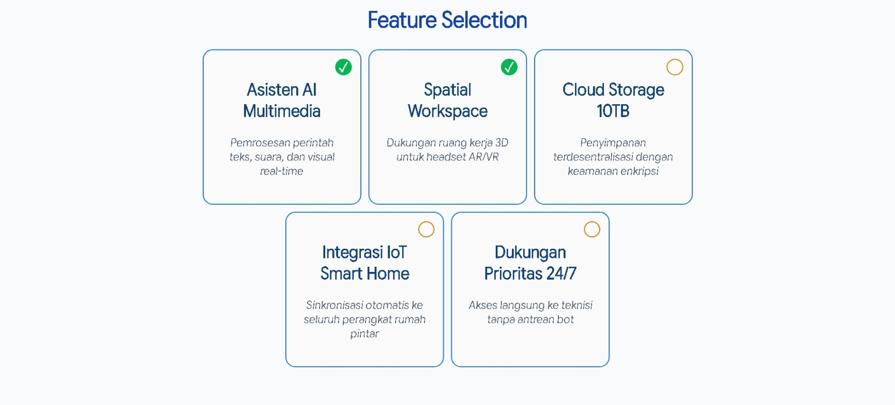

# Design a Feature Selection Page

<p align="center">
  
  
  
  
</p>

> **Milestone:** Lab setelah mempelajari Styling Forms.

## About

Project lab ini mempraktikkan cara membangun antarmuka pemilihan fitur kustom menggunakan elemen form HTML dan CSS.

Fokus utama lab ini adalah memanipulasi *checkbox* bawaan peramban (browser) dengan menghapus gaya dasarnya melalui `appearance: none`, kemudian membangun ulang tampilan *checkbox* interaktif menggunakan pseudo-classes `:checked` dan pseudo-elements `::after`.

Di luar requirement utama freeCodeCamp, project ini juga dikembangkan dengan tema "Modul Workspace AI" yang realistis, menggunakan tata letak Flexbox yang responsif, serta menerapkan palet warna antarmuka dan tipografi modern.

## Preview



## Konsep Utama

- HTML Forms
- Form Attributes (`type="checkbox"`, `id`, `for`, `name`, `value`)
- CSS `appearance` Property
- CSS Positioning (`position: relative`, `position: absolute`)
- CSS Pseudo-classes (`:checked`)
- CSS Pseudo-elements (`::after`, `content`)
- CSS Flexbox (`flex-wrap`)
- Custom UI Styling

## Struktur Project

```text
feature-selection-page/
├── index.html
├── preview.jpeg
└── styles.css
```

## Source Code

- [`index.html`](./index.html)
- [`styles.css`](./styles.css)

## Pembahasan

### 1. Struktur Kartu Fitur (Semantic HTML)
Setiap kartu fitur dibangun menggunakan tag `<label>` yang membungkus keseluruhan konten, termasuk teks dan elemen `<input>` itu sendiri.
```html
<label for="ai-assistant" class="feature-card">
  <h3>Asisten AI Multimodal</h3>
  <p>Pemrosesan perintah teks, suara, dan visual real-time</p>
  <input type="checkbox" id="ai-assistant" name="fitur_tambahan" value="ai"/>
</label>
```
Dengan meletakkan `input` di dalam `<label>` dan menghubungkannya melalui `id` dan `for`, area mana pun di dalam kartu yang diklik oleh pengguna akan secara otomatis mengaktifkan atau menonaktifkan *checkbox* tersebut.

### 2. Layout Responsif dengan Flexbox
Kontainer utama menggunakan pola Flexbox untuk menyusun kartu-kartu fitur:
```css
.feature-card-container {
  display: flex;
  flex-wrap: wrap;
  justify-content: center;
  gap: 10px;
}
```
Properti `flex-wrap: wrap` memungkinkan kartu-kartu tersebut turun ke baris berikutnya jika lebar layar menyempit. Selain itu, pada level kartu individual, digunakan aturan:
```css
.feature-card {
  flex: 1 1 165px;
}
```
Ini berarti setiap kartu dapat menyusut dan tumbuh untuk mengisi ruang kosong, namun memiliki basis ukuran ideal sebesar `165px`.

### 3. Mereset Gaya Bawaan Checkbox
Poin terpenting dari lab ini adalah menghilangkan bentuk *checkbox* kaku bawaan sistem operasi agar bisa dimodifikasi sebebas mungkin:
```css
input[type="checkbox"] {
  appearance: none;
  height: 23px;
  width: 23px;
  border-radius: 50px;
  /* ... */
}
```
Aturan `appearance: none;` menghapus visual standar *checkbox*. Setelah itu, elemen diubah menjadi lingkaran (`border-radius: 50px`) dengan tinggi dan lebar kustom, serta diposisikan secara absolut (`position: absolute; top: 9px; right: 9px;`) di sudut kanan atas kartu.

### 4. Interaksi State `:checked`
Ketika *checkbox* dicentang, CSS merespons interaksi tersebut menggunakan pseudo-class `:checked` untuk mengubah warna *background* dan garis tepi menjadi warna hijau aksen:
```css
input[type="checkbox"]:checked {
  background-color: #01b750;
  border-color: #01b750;
}
```

### 5. Membangun Checkmark dengan Pseudo-element
Karena kotak bawaan sudah dihilangkan, tanda centang (✓) dimunculkan secara dinamis menggunakan pseudo-element `::after` yang hanya muncul saat elemen dalam keadaan `:checked`:
```css
input[type="checkbox"]:checked::after {
  content: "✓";
  display: block;
  text-align: center;
  font-weight: bold;
  font-size: 1.15rem;
  color: white;
  line-height: 22.5px;
}
```
Metode `content: "✓"` menyisipkan karakter Unicode centang tanpa perlu menambahkan teks ke dalam HTML. Properti `line-height` diatur persis menyamai tinggi *checkbox* agar tanda centang tersebut benar-benar berada di tengah secara vertikal.

## Eksperimen Tambahan

Selain requirement utama freeCodeCamp, saya menambahkan beberapa eksperimen pada project ini:
- **Kustomisasi Tema (Modul Workspace AI):** Mengubah *copywriting* fiktif standar menjadi tema *virtual workspace* yang realistis beserta atribut `name` dan `value` yang koheren.
- **Tipografi Kustom:** Menggunakan tipografi dinamis Google Sans Flex yang dimuat melalui `@import`.
- **Sistem Grid Flexbox Adaptif:** Mengeksplorasi penggunaan `display: flex; flex-wrap: wrap;` pada kontainer serta `flex: 1 1 165px;` pada *children* untuk menciptakan tata letak fluid.
- **Penyesuaian Palet Warna UI:** Menerapkan hierarki warna profesional seperti *background* halaman bernada *light-grayish blue* (`#F8FAFC`) dan judul utama bernada *dark navy* (`#0F172A`) agar tampak selaras dengan desain *checkbox* yang telah dimodifikasi.

## Ringkasan Cepat

| Konsep | Fungsi |
|---|---|
| `appearance: none` | Menghilangkan tata gaya visual *default* (bawaan) dari elemen UI sistem operasi |
| `position: absolute` | Mengeluarkan elemen dari alur dokumen normal untuk diposisikan secara spesifik terhadap elemen induknya |
| `:checked` | Pseudo-class yang menargetkan elemen radio atau checkbox saat dalam keadaan aktif/terpilih |
| `::after` | Pseudo-element yang menyisipkan konten virtual persis setelah isi asli sebuah elemen |
| `content` | Digunakan bersama pseudo-elements untuk menghasilkan atau memasukkan *string* teks/karakter |
| `flex-wrap: wrap` | Mengizinkan item di dalam kontainer Flexbox untuk turun ke baris baru jika ruang tidak cukup |

## Catatan Belajar

- **Manipulasi Input Asli:** Menggunakan `appearance: none` adalah teknik yang sangat kuat (dan ramah aksesibilitas) untuk membuat *checkbox* atau tombol radio buatan (kustom) tanpa harus menggunakan elemen tiruan seperti `<div>` kosong dan JavaScript.
- **Trik Konten Pseudo-element:** Karakter centang (✓) bukan bagian dari dokumen HTML asli, melainkan injeksi visual murni dari CSS menggunakan `content`. Ini memisahkan struktur data (HTML) dari struktur hiasan visual (CSS) dengan sempurna.
- **Flexbox Flex-basis:** Kombinasi `flex: 1 1 165px;` memberikan instruksi elegan kepada browser: *Item ini idealnya berukuran 165px, boleh menyusut sedikit jika terpaksa, dan boleh membesar untuk mengambil sisa ruang yang menganggur di barisnya.*
- **Sensitivitas Animasi Transisi:** Penguji otomatis (*test suite*) dalam pembelajaran seringkali mengambil nilai instan. Jika properti seperti warna menggunakan jeda dari `transition: all 0.3s;`, mesin penguji dapat gagal membaca warna baru, meskipun secara logika di layar warna tersebut berubah.

## What I Practiced

```text
HTML Form Elements
Checkbox Inputs
CSS Flexbox Layout
Flex Wrap and Flex Basis
CSS appearance Property
CSS :checked Pseudo-class
CSS ::after Pseudo-element
Absolute Positioning
Custom Typography
UI Color Palettes
```

---

**Platform:** freeCodeCamp  
**Lab:** Design a Feature Selection Page  
**Languages:** HTML & CSS  
**Focus:** Styling Forms

---

<p align="center">
  <strong>Styling Forms Section — Design a Feature Selection Page Completed</strong><br>
  <sub>Next stop: continue the Responsive Web Design Certification journey.</sub>
</p>
