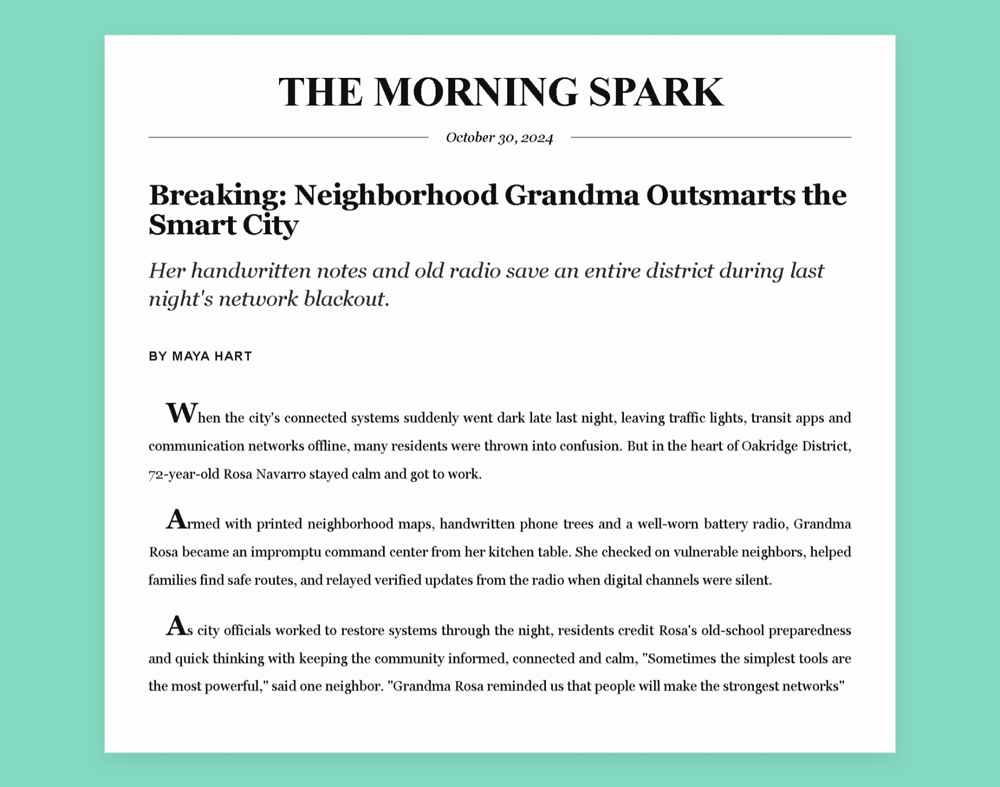

# Build a Newspaper Article

<p align="center">
  
  
  
  
</p>

> **Milestone:** Lab setelah mempelajari Typography.

## About

Project ini membuat halaman artikel koran sederhana bernama **The Morning Spark** menggunakan HTML dan CSS. Halaman menampilkan nama koran, tanggal, headline, sub-headline, nama penulis, dan tiga paragraf artikel.

Project ini menjadi latihan untuk menerapkan materi **Typography**, terutama dalam mengatur jenis huruf, ukuran teks, ketebalan, jarak antarbaris, perataan teks, dan tampilan huruf pertama pada paragraf.

## Preview



## Konsep Utama

- Struktur dokumen HTML menggunakan elemen heading dan paragraf.
- External stylesheet untuk memisahkan struktur HTML dan aturan CSS.
- Class selector untuk memberi style pada bagian-bagian koran.
- Properti typography seperti `font-size`, `font-family`, `font-weight`, `font-style`, `text-transform`, `letter-spacing`, dan `line-height`.
- Satuan CSS `px`, `rem`, `em`, dan `%` untuk mengatur ukuran serta lebar elemen.
- CSS box model melalui `margin`, `padding`, `width`, `max-width`, dan `box-sizing`.
- Flexbox untuk menyusun tanggal dan garis dekoratif secara horizontal.
- Pseudo-element `::before` dan `::after` untuk membuat garis di sisi tanggal.
- Pseudo-element `::first-letter` untuk memberi gaya khusus pada huruf pertama paragraf.
- Pengaturan teks menggunakan `text-indent`, `text-align`, dan `white-space`.
- Warna latar dan `box-shadow` untuk membentuk tampilan seperti lembar koran.

## Struktur Project

```text
newspaper-article/
├── index.html
└── styles.css
```

## Source Code

- [`index.html`](./index.html)
- [`styles.css`](./styles.css)

## Pembahasan

### 1. Struktur HTML

Elemen `<head>` berisi pengaturan karakter, viewport, judul dokumen, dan tautan menuju `styles.css`. Seluruh konten koran ditempatkan di dalam elemen `<div class="newspaper">`.

Urutan kontennya terdiri dari nama koran (`h1.name`), tanggal (`p.date`), headline (`h2.headline`), sub-headline (`p.sub-headline`), nama penulis (`p.author`), dan tiga paragraf artikel (`p.text`).

### 2. Dasar Ukuran dan Tampilan Halaman

Elemen `html` menggunakan `font-size: 24px` sebagai ukuran dasar untuk satuan relatif `rem`. Elemen `body` mengatur jarak luar, padding, warna latar hijau mint, dan warna teks utama.

### 3. Container Koran

Class `.newspaper` membentuk area putih sebagai lembar koran. Lebarnya menggunakan `85%` dengan batas maksimal `1050px`, lalu diposisikan di tengah menggunakan `margin: 0 auto`.

Properti `padding` memberi ruang di dalam container, sedangkan `box-sizing: border-box` membuat ukuran padding ikut diperhitungkan dalam lebar elemen. `box-shadow` menambahkan bayangan tipis di sekitar lembar koran.

### 4. Nama Koran dan Tanggal

Class `.name` mengatur nama koran agar tampil di tengah, menggunakan huruf kapital, font Times New Roman, dan jarak huruf yang lebih rapat.

Class `.date` memakai `display: flex`, `align-items: center`, dan `gap` untuk menyusun tanggal bersama elemen dekoratif. Pseudo-element `.date::before` dan `.date::after` membuat garis horizontal di kedua sisi tanggal.

### 5. Headline, Sub-headline, dan Penulis

Class `.headline` menggunakan font Georgia, ukuran teks lebih besar, dan `line-height` yang rapat agar judul utama terlihat tegas.

Class `.sub-headline` memakai gaya italic, ukuran lebih kecil daripada headline, dan warna teks yang sedikit lebih lembut. Class `.author` membuat nama penulis menjadi huruf kapital, tebal, dan memiliki jarak huruf.

### 6. Paragraf Artikel

Class `.text` mengatur indentasi baris pertama dengan `text-indent`, jarak antarbaris dengan `line-height`, serta perataan kanan-kiri menggunakan `text-align: justify`. Margin bawah memberi jarak antarparagraf.

### 7. Huruf Pertama Paragraf

Selector `.text::first-letter` memberi style khusus hanya pada huruf pertama setiap paragraf. Ukuran huruf diperbesar menjadi `2em`, dibuat tebal, dan menggunakan font Georgia dengan `line-height: 1` sehingga tampil seperti drop cap pada artikel koran.

## Eksperimen Tambahan

Selain memenuhi user stories, project ini menambahkan beberapa sentuhan desain editorial:

- Container koran dibuat seperti lembar kertas putih dengan lebar terbatas, posisi di tengah, dan bayangan.
- Latar halaman menggunakan warna hijau mint agar lembar koran terlihat menonjol.
- Tanggal diberi garis horizontal di sisi kiri dan kanan menggunakan Flexbox serta pseudo-element.
- Huruf pertama setiap paragraf diperbesar menggunakan `::first-letter` untuk menghasilkan tampilan drop cap.
- Tipografi dibuat lebih editorial dengan kombinasi font serif, italic, uppercase, letter spacing, dan pengaturan line-height.

## Ringkasan Cepat

| Konsep | Fungsi |
|---|---|
| `font-size` | Mengatur ukuran teks dengan satuan tetap atau relatif. |
| `font-family` | Menentukan jenis huruf yang digunakan. |
| `line-height` | Mengatur jarak vertikal antarbaris teks. |
| `letter-spacing` | Mengatur jarak antarhuruf. |
| `text-align: justify` | Meratakan teks pada sisi kiri dan kanan. |
| `display: flex` | Menyusun tanggal dan garis dekoratif dalam satu baris. |
| `::before` dan `::after` | Membuat elemen dekoratif tanpa menambah elemen HTML. |
| `::first-letter` | Memberi style khusus pada huruf pertama paragraf. |
| `box-sizing: border-box` | Memasukkan padding dan border ke dalam perhitungan ukuran elemen. |

## Catatan Belajar

- **Typography** tidak hanya mengatur ukuran huruf, tetapi juga jenis, ketebalan, gaya, jarak, dan keterbacaan teks.
- **Satuan relatif** seperti `rem` dan `em` membantu mengatur ukuran berdasarkan ukuran font acuan.
- **`line-height`** berpengaruh pada kenyamanan membaca paragraf.
- **Flexbox** dapat digunakan untuk menyusun elemen dekoratif dan teks dalam satu baris.
- **Pseudo-element** seperti `::before`, `::after`, dan `::first-letter` dapat menambahkan detail visual tanpa menambah elemen baru di HTML.
- **`text-align: justify`** membuat tepi paragraf tampak rata pada sisi kiri dan kanan.

## What I Practiced

```text
HTML Document Structure
External CSS Stylesheet
CSS Class Selectors
CSS Typography Properties
CSS Font and Text Formatting
CSS Units: px, rem, em, and %
CSS Box Model
Centered Layout with margin: auto
Flexbox Alignment
CSS Pseudo-elements
Drop Cap Styling
Text Indentation and Justification
``` 

---

**Platform:** freeCodeCamp  
**Lab:** Build a Newspaper Article  
**Languages:** HTML & CSS  
**Focus:** Typography

---

<p align="center">
  <strong>Typography Section — Build a Newspaper Article Completed</strong><br>
  <sub>Next stop: continue the Responsive Web Design Certification journey.</sub>
</p>
