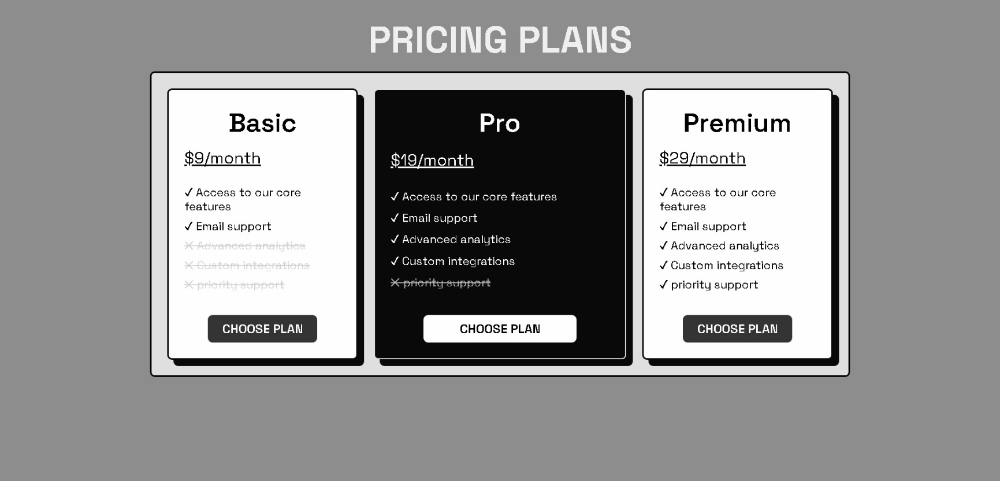

# Design a Pricing Plans Layout Page

<p align="center">
  
  
  
  
</p>

> **Milestone:** Lab setelah mempelajari Flexbox.

## About

Project ini membuat halaman pricing plans dengan tiga pilihan paket: Basic, Pro, dan Premium.

Fokus lab adalah menggunakan Flexbox untuk menyusun pricing cards, mengatur urutan card dengan `order`, membuat content setiap card tersusun vertikal, menjaga jarak antar-content dengan `justify-content: space-between`, serta membuat paket Pro dapat mengambil ruang lebih besar menggunakan `flex-grow`.

## Preview



## Konsep Utama

- Flexbox
- `display: flex`
- `flex-wrap`
- `flex-direction`
- `justify-content`
- `flex`
- `flex-grow`
- `order`
- Pseudo-elements `::before`
- Pseudo-classes `:hover`
- `transition`
- `transform`
- Child combinator `>`
- `:first-of-type`
- `:last-of-type`

## Struktur Project

```text
pricing-plans-layout/
├── index.html
└── styles.css
```

## Source Code

- [`index.html`](./index.html)
- [`styles.css`](./styles.css)

## Pembahasan

### 1. Struktur Pricing Plans

Halaman memiliki `h1` dengan teks `Pricing Plans`, lalu satu container utama dengan class `pricing-container`.

Di dalam container tersebut terdapat tiga pricing card:

```html
<div class="pricing-card basic-plan">
  ...
</div>

<div class="pricing-card pro-plan">
  ...
</div>

<div class="pricing-card premium-plan">
  ...
</div>
```

Setiap card menggunakan class umum `pricing-card` untuk layout dasar dan class tambahan untuk aturan khusus masing-masing paket.

### 2. Membuat Pricing Container dengan Flexbox

Container utama menggunakan:

```css
.pricing-container {
  display: flex;
  flex-wrap: wrap;
}
```

`display: flex` membuat tiga pricing card menjadi flex items.

`flex-wrap: wrap` mengizinkan card berpindah ke baris berikutnya ketika ruang horizontal tidak cukup.

Source juga menggunakan:

```css
justify-content: center;
gap: 20px;
```

`justify-content: center` memusatkan flex items pada main axis, sedangkan `gap` memberikan jarak antar-card.

### 3. Menyusun Isi Card Secara Vertikal

Setiap `.pricing-card` menggunakan:

```css
.pricing-card {
  flex-direction: column;
  justify-content: space-between;
  display: flex;
  flex: 0 0 200px;
}
```

`display: flex` membuat card menjadi flex container.

`flex-direction: column` menyusun child di dalam card dari atas ke bawah.

`justify-content: space-between` membagi ruang kosong di antara child sehingga content card dapat tersebar dari bagian atas sampai bawah.

### 4. Menetapkan Ukuran Dasar dengan `flex`

Project menggunakan:

```css
flex: 0 0 200px;
```

Shorthand tersebut mengatur:

- `flex-grow` menjadi `0`.
- `flex-shrink` menjadi `0`.
- `flex-basis` menjadi `200px`.

Artinya, ukuran dasar card ditetapkan pada `200px` dan secara default card tidak tumbuh atau menyusut melalui shorthand tersebut.

### 5. Mengatur Urutan Pricing Card

Setiap paket memiliki nilai `order`:

```css
.basic-plan {
  order: 0;
}

.pro-plan {
  order: 1;
}

.premium-plan {
  order: 2;
}
```

Nilai tersebut membuat Basic muncul lebih dahulu, Pro berada setelah Basic, dan Premium berada terakhir dalam urutan visual Flexbox.

### 6. Membuat Pro Plan Menggunakan Ruang Lebih Besar

Paket Pro menggunakan:

```css
.pro-plan {
  flex-grow: 2;
}
```

`flex-grow` menentukan kemampuan flex item untuk menggunakan ruang kosong yang tersedia.

Nilai `2` membuat Pro memiliki faktor pertumbuhan lebih besar dibanding card yang tidak diberi `flex-grow`.

### 7. Struktur Informasi di Dalam Card

Setiap card memiliki:

- Nama paket melalui `h2`.
- Harga bulanan melalui `p`.
- Daftar fitur yang tersedia.
- Daftar fitur yang belum tersedia.
- Tombol `Choose Plan`.

Class `included` digunakan pada fitur yang tersedia, sedangkan class `not` digunakan pada fitur yang tidak tersedia.

### 8. Menandai Fitur dengan Pseudo-element

Source menggunakan:

```css
.included::before {
  content: "✓   ";
  font-weight: bolder;
}

.not::before {
  content: "✕  ";
  font-weight: bolder;
}
```

Pseudo-element `::before` menambahkan simbol sebelum content asli tanpa menambahkan elemen baru ke HTML.

Fitur yang tidak tersedia juga menggunakan:

```css
.not {
  opacity: 0.7;
  text-decoration: line-through;
}
```

Hasilnya, fitur tersebut tampil lebih redup dan dicoret.

### 9. Memberikan Interaksi pada Pricing Card

Card menggunakan:

```css
transition: transform 0.3s ease;
```

Kemudian saat pointer berada di atas card:

```css
.pricing-card:hover {
  transform: scale(1.04);
}
```

Pseudo-class `:hover` mengaktifkan transformasi ketika pointer berada di atas pricing card.

`scale(1.04)` memperbesar card dari ukuran normalnya.

### 10. Styling Tombol dan Hover State

Semua tombol memiliki styling dasar yang sama, termasuk ukuran, cursor, uppercase text, dan transition.

Basic dan Premium menggunakan tombol gelap, sedangkan Pro menggunakan tombol terang.

Hover state mengubah warna border dan background agar tombol memberikan respons visual saat pointer berada di atasnya.

### 11. Memilih Paragraph Berdasarkan Posisi

Source menggunakan:

```css
div > p:first-of-type {
  font-size: 1.3rem;
  text-decoration: underline;
  margin-bottom: 20px;
}

div > p:last-of-type {
  margin-bottom: 20px;
}
```

Child combinator `>` membatasi selector pada `p` yang menjadi direct child dari `div`.

`:first-of-type` memilih elemen `p` pertama berdasarkan tipenya.

`:last-of-type` memilih elemen `p` terakhir berdasarkan tipenya.

Pada pricing card, rule pertama dipakai untuk menonjolkan paragraph harga, sedangkan rule kedua menambahkan ruang sebelum tombol.

## Eksperimen Tambahan

Selain requirement dari user stories freeCodeCamp, source menambahkan styling dan interaksi sendiri.

- **Typography** menggunakan Google Font `Space Grotesk` dengan class terpisah untuk heading dan paragraph.
- **Page styling** menambahkan lebar body, `min-width`, background abu-abu, dan posisi halaman di tengah.
- **Container styling** menambahkan `justify-content: center`, padding, border, `border-radius`, background, dan `gap`.
- **Card styling** menambahkan `max-width`, padding, `border-radius`, background, `box-shadow`, serta transition.
- **Hover interaction** memperbesar pricing card menggunakan `transform: scale(1.04)`.
- **Pro styling** menggunakan background gelap, teks terang, dan border transparan untuk membedakan paket Pro.
- **Button styling** menambahkan warna berbeda untuk Basic/Premium dan Pro, serta hover state masing-masing.
- **Feature status** menggunakan `::before` untuk simbol centang dan silang.
- **Unavailable feature styling** menggunakan opacity dan `text-decoration: line-through`.
- **Price emphasis** menggunakan `div > p:first-of-type` untuk memperbesar dan menggarisbawahi harga.

Catatan terhadap requirement FCC: user story menetapkan `.pricing-card` menggunakan `border: 2px solid black`, sedangkan source yang didokumentasikan saat ini menggunakan:

```css
border: 2px solid #090909;
```

Keduanya menghasilkan border yang sangat gelap secara visual, tetapi nilainya tidak identik. Jika test freeCodeCamp memeriksa nilai declaration secara literal, bagian ini perlu disesuaikan di source agar sama dengan requirement.

## Ringkasan Cepat

| Konsep | Fungsi |
|---|---|
| `display: flex` | Membuat container atau card menjadi flex container |
| `flex-wrap: wrap` | Mengizinkan pricing card berpindah ke baris berikutnya |
| `flex-direction: column` | Menyusun content card secara vertikal |
| `justify-content: space-between` | Membagi ruang kosong di antara child card |
| `flex: 0 0 200px` | Menetapkan grow, shrink, dan basis card |
| `order` | Mengatur urutan visual pricing card |
| `flex-grow: 2` | Membuat Pro memiliki faktor pertumbuhan lebih besar |
| `::before` | Menambahkan simbol sebelum content |
| `:hover` | Mengaktifkan styling saat pointer berada di atas elemen |
| `transform: scale()` | Mengubah skala visual elemen |
| `transition` | Mengatur perpindahan nilai CSS agar berlangsung bertahap |
| `:first-of-type` | Memilih elemen pertama berdasarkan tipe |
| `:last-of-type` | Memilih elemen terakhir berdasarkan tipe |

## Catatan Belajar

- **Flex container** dibuat dengan `display: flex` dan mengatur direct children sebagai flex items.
- **`flex-direction: column`** mengubah arah main axis card menjadi vertikal.
- **`justify-content: space-between`** menggunakan ruang kosong di antara child pada main axis.
- **`flex: 0 0 200px`** menetapkan `flex-grow`, `flex-shrink`, dan `flex-basis` dalam satu declaration.
- **`order`** mengubah urutan visual flex item tanpa mengubah urutan elemen di HTML.
- **`flex-grow`** mengatur kemampuan flex item menggunakan ruang kosong yang tersedia.
- **`::before`** dapat menambahkan content visual sebelum content asli elemen.
- **`:hover`** dapat digunakan untuk memberikan state visual saat pointer berada di atas elemen.
- **`:first-of-type` dan `:last-of-type`** memilih elemen berdasarkan posisi relatif terhadap elemen lain dengan tipe yang sama.

## What I Practiced

```text
HTML Pricing Card Structure
CSS Flexbox
Flex Wrapping
Flex Direction
Space Distribution
Flex Shorthand
Flex Grow
Flex Item Ordering
Pseudo-elements
Pseudo-classes
CSS Transitions
CSS Transforms
Child Combinator
Type-based Selectors
Custom Typography
```

---

**Platform:** freeCodeCamp  
**Lab:** Design a Pricing Plans Layout Page  
**Languages:** HTML & CSS  
**Focus:** Flexbox

---

<p align="center">
  <strong>Flexbox Section — Design a Pricing Plans Layout Page Completed</strong><br>
  <sub>Next stop: continue the Responsive Web Design Certification journey.</sub>
</p>
