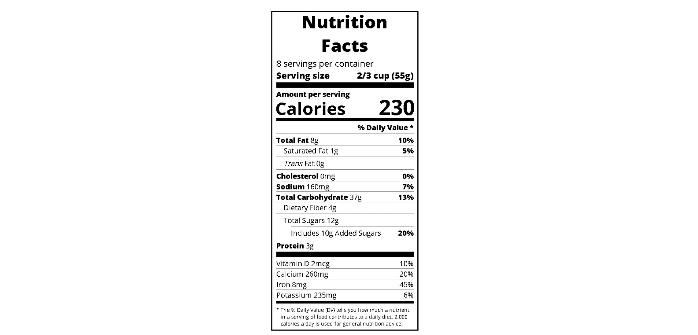

# Build a Nutritional Label

<p align="center">
  
  
  
  
</p>

> **Milestone:** Workshop setelah mempelajari Typography.

## About

Project workshop ini membangun label informasi nutrisi (*Nutrition
Facts*) menggunakan HTML dan CSS. Konten HTML menyusun informasi jumlah
sajian, ukuran sajian, kalori, kandungan nutrisi, dan persentase *Daily
Value*. CSS mengatur tipografi, garis pemisah, jarak, indentasi, serta
perataan angka agar tampil seperti label nutrisi.

Seluruh elemen HTML dan properti CSS pada project ini mengikuti arahan
freeCodeCamp. Tidak ada eksperimen tambahan di luar instruksi workshop.

## Preview



## Konsep Utama

- **HTML Document Structure** — menyusun dokumen dengan `html`, `head`,
  dan `body`.
- **HTML Elements** — menggunakan `header`, heading, paragraf, `span`,
  `i`, dan `div` untuk mengelompokkan informasi.
- **CSS Selectors** — menargetkan elemen, class, kombinasi selector, dan
  selector `:not()`.
- **CSS Box Model** — mengatur ukuran, border, margin, padding, dan
  `box-sizing`.
- **CSS Flexbox** — merapikan baris informasi dan menyelaraskan angka
  kalori.
- **CSS Typography** — mengatur jenis huruf, ukuran, ketebalan, dan
  hierarki teks.
- **CSS Borders and Dividers** — membuat garis pemisah dengan border dan
  variasi tinggi.
- **Relative Units** — menggunakan `rem` dan `em` untuk beberapa ukuran
  teks dan indentasi.

## Struktur Project

``` text
nutritional-label/
├── index.html
└── styles.css
```

## Source Code

- [`index.html`](./index.html)
- [`styles.css`](./styles.css)

## Pembahasan

### 1. Struktur HTML Label Nutrisi

Elemen `<div class="label">` menjadi wadah utama seluruh label. Bagian
`<header>` memuat judul **Nutrition Facts**, jumlah sajian, dan ukuran
sajian.

Bagian berikutnya membagi informasi menjadi beberapa kelompok:

- `.calories-info` menampilkan keterangan dan jumlah kalori.
- `.daily-value` memuat daftar nutrisi beserta persentase *Daily Value*.
- `.note` menampilkan catatan penjelasan mengenai persentase *Daily
  Value*.

Elemen `<span>` digunakan untuk memisahkan bagian teks yang perlu ditata
secara berbeda, sedangkan class seperti `.bold`, `.indent`, dan
`.no-divider` memberi penanda untuk styling.

### 2. Pengaturan Dasar dan Tipografi

Selector universal `*` menggunakan `box-sizing: border-box` agar
perhitungan ukuran elemen mencakup padding dan border.

Elemen `html` menetapkan ukuran font dasar sebesar `16px`. Elemen `body`
menggunakan font Open Sans yang dimuat melalui Google Fonts.

Beberapa selector mengatur hierarki teks:

- `.bold` memberikan ketebalan font `800`.
- `.small-text` mengecilkan ukuran teks menjadi `0.85rem`.
- `header h1` memusatkan judul dan mengatur margin serta jarak
  antarhuruf.
- `.note` menggunakan ukuran `0.6rem` untuk teks penjelasan.
- `.left-container p` dan `.calories-info span` memperbesar teks pada
  bagian kalori.

### 3. Garis Pemisah dan Penekanan Visual

Class `.divider` membuat garis horizontal menggunakan `border-bottom`.
Variasi `.large` dan `.medium` mengubah tinggi serta warna latar menjadi
hitam untuk menghasilkan pemisah yang lebih tegas.

Class `.large` memiliki tinggi `10px`, sedangkan `.medium` memiliki
tinggi `5px`. Keduanya menghilangkan border bawaan divider agar tampil
sebagai bidang hitam yang solid.

### 4. Flexbox untuk Perataan Informasi

Selector `p` menggunakan `display: flex` dan
`justify-content: space-between`. Pengaturan ini memisahkan keterangan
nutrisi di sisi kiri dan nilainya di sisi kanan.

Selector `.calories-info` juga menggunakan Flexbox:

- `display: flex` menempatkan bagian informasi kalori dalam satu baris.
- `justify-content: space-between` memberi jarak antara keterangan dan
  angka kalori.
- `align-items: flex-end` menyelaraskan keduanya pada bagian bawah.

Class `.right` menggunakan `justify-content: flex-end` untuk merapatkan
teks ke sisi kanan.

### 5. Indentasi dan Selector `:not()`

Class `.indent` memberi indentasi sebesar `1em`, sedangkan
`.double-indent` memberi indentasi sebesar `2em`. Keduanya membantu
menunjukkan tingkatan informasi nutrisi.

Selector `.daily-value p:not(.no-divider)` menambahkan garis bawah pada
paragraf di dalam `.daily-value`, kecuali paragraf yang memiliki class
`.no-divider`. Dengan begitu, aturan garis dapat diterapkan pada
kelompok paragraf tertentu tanpa mengubah semua paragraf.

### 6. Catatan Persentase Daily Value

Class `.note` mengatur teks penjelasan di bagian bawah label. Ukuran
font dibuat lebih kecil, margin dan padding disesuaikan, lalu
`text-indent: -8px` memberi indentasi gantung pada baris teks.

## Ringkasan Cepat

| Konsep                           | Fungsi                                                            |
|----------------------------------|-------------------------------------------------------------------|
| `box-sizing: border-box`         | Memasukkan padding dan border ke dalam perhitungan ukuran elemen. |
| `display: flex`                  | Menyusun dan merapikan elemen dalam layout fleksibel.             |
| `justify-content: space-between` | Memberi jarak di antara item pada satu baris.                     |
| `align-items: flex-end`          | Menyelaraskan item pada bagian bawah sumbu silang.                |
| `font-family` dan `font-weight`  | Mengatur jenis dan ketebalan huruf.                               |
| `.divider`                       | Membuat garis pemisah antarbagian label.                          |
| `:not(.no-divider)`              | Memilih paragraf yang tidak memiliki class `no-divider`.          |
| `rem` dan `em`                   | Menentukan ukuran relatif berdasarkan ukuran font acuannya.       |

## Catatan Belajar

- **Struktur HTML** membantu memisahkan judul, informasi sajian, kalori,
  daftar nutrisi, dan catatan.
- **Flexbox** membuat teks dan angka dalam satu baris lebih mudah
  disejajarkan.
- **Typography** membangun hierarki visual melalui ukuran, jenis, dan
  ketebalan huruf.
- **Class CSS** memungkinkan aturan styling digunakan pada elemen yang
  memiliki kebutuhan tampilan serupa.
- **Selector `:not()`** berguna ketika sebuah aturan perlu mengecualikan
  elemen dengan class tertentu.
- **Divider dan indentasi** membantu membedakan kelompok serta tingkatan
  informasi dalam label.

## What I Practiced

``` text
HTML Document Structure
HTML Elements and Class Attributes
CSS Selectors
CSS Box Model
CSS Flexbox
CSS Typography
CSS Borders and Spacing
CSS Pseudo-classes
Relative CSS Units
```

------------------------------------------------------------------------

**Platform:** freeCodeCamp  
**Workshop:** Build a Nutritional Label  
**Language:** HTML & CSS  
**Focus:** Typography

------------------------------------------------------------------------

<p align="center">
  <strong>Typography Section — Build a Nutritional Label Completed</strong><br>
  <sub>Next stop: continue the Responsive Web Design Certification journey.</sub>
</p>
