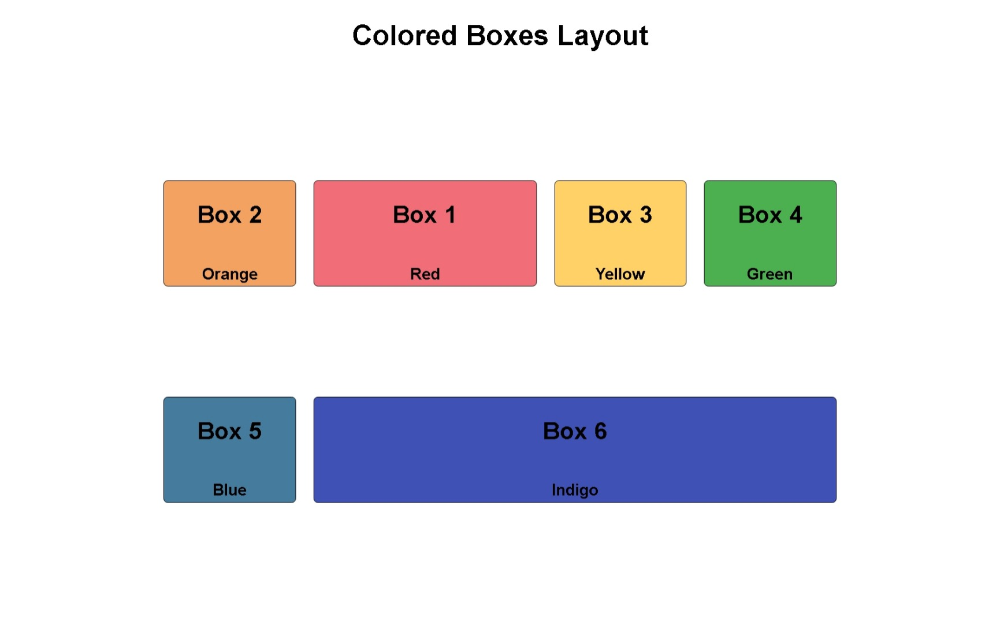

# Design a Set of Colorful Boxes

<p align="center">
  
  
  
  
</p>

> **Milestone:** Workshop setelah mempelajari Flexbox.

## About

Project ini membuat enam kotak berwarna menggunakan HTML dan CSS.

Fokus workshop adalah mempraktikkan pengaturan flex container dan flex items, termasuk wrapping, `align-content`, shorthand `flex`, `flex-grow`, `flex-shrink`, serta `order`. Setiap kotak memiliki warna dan urutan yang diatur melalui class masing-masing.

## Preview



## Konsep Utama

- Flexbox
- `display: flex`
- `flex`
- `flex-direction`
- `align-items`
- `order`
- `flex-wrap`
- `align-content`
- `flex-grow`
- `flex-shrink`

## Struktur Project

```text
set-of-colorful-boxes/
├── index.html
└── styles.css
```

## Source Code

- [`index.html`](./index.html)
- [`styles.css`](./styles.css)

## Pembahasan

### 1. Struktur HTML Setiap Box

HTML menggunakan satu `div` dengan class `flex-container` sebagai container utama.

Di dalamnya terdapat enam `div` dengan dua class: class umum `box` dan class khusus seperti `box1`, `box2`, sampai `box6`.

```html
<div class="box box1">
  <h2>Box 1</h2>
  <p>Red</p>
</div>
```

Class `box` memberikan aturan dasar yang sama untuk seluruh kotak, sedangkan class khusus mengatur warna dan beberapa flex property yang berbeda.

### 2. Membuat Setiap Box Menjadi Flex Container

Class `.box` menggunakan:

```css
.box {
  display: flex;
  flex: 0 0 150px;
  flex-direction: column;
  align-items: center;
}
```

`display: flex` membuat setiap `.box` menjadi flex container untuk elemen `h2` dan `p` di dalamnya.

`flex-direction: column` menyusun content secara vertikal.

`align-items: center` memusatkan flex items pada cross axis.

### 3. Menggunakan Shorthand `flex`

Project menggunakan:

```css
flex: 0 0 150px;
```

Shorthand `flex` tersebut menetapkan tiga nilai untuk flex item:

- `flex-grow` bernilai `0`.
- `flex-shrink` bernilai `0`.
- `flex-basis` bernilai `150px`.

Nilai tersebut membuat ukuran dasar box berada pada `150px` dan secara default tidak bertambah atau menyusut melalui shorthand tersebut.

### 4. Membuat Container Utama dengan Flexbox

Container utama menggunakan:

```css
.flex-container {
  display: flex;
  flex-wrap: wrap;
  width: 70%;
  height: 600px;
  padding: 10px;
  margin: 20px auto;
  align-content: space-evenly;
}
```

`display: flex` membuat seluruh `.box` menjadi flex items.

`flex-wrap: wrap` mengizinkan box berpindah ke baris berikutnya ketika ruang horizontal tidak cukup.

### 5. Mengatur Beberapa Baris dengan `align-content`

Project menggunakan:

```css
align-content: space-evenly;
```

`align-content` mengatur distribusi ruang antar-flex lines ketika container memiliki beberapa baris hasil wrapping.

Nilai `space-evenly` memberikan ruang yang merata di sekitar setiap flex line.

### 6. Mengubah Urutan dengan `order`

Setiap box menggunakan nilai `order` yang berbeda.

```css
.box1 {
  order: 1;
}

.box2 {
  order: 0;
}

.box3 {
  order: 2;
}
```

Flex item dengan nilai `order` lebih kecil ditempatkan lebih dahulu dalam urutan visual.

Karena `.box2` memiliki `order: 0` dan `.box1` memiliki `order: 1`, Box 2 tampil sebelum Box 1 dalam susunan Flexbox.

### 7. Menggunakan `flex-grow`

Box 1 dan Box 6 menggunakan:

```css
flex-grow: 1;
```

`flex-grow` menentukan kemampuan flex item untuk menggunakan ruang kosong yang tersedia pada flex line.

Karena kedua box tersebut memiliki nilai `1`, keduanya dapat bertambah dari ukuran dasarnya ketika masih ada ruang kosong.

### 8. Menggunakan `flex-shrink`

Box 3 menggunakan:

```css
flex-shrink: 3;
```

`flex-shrink` menentukan seberapa besar flex item dapat menyusut ketika ruang pada flex container tidak cukup.

Nilai `3` pada Box 3 memberikan faktor shrink yang lebih besar dibanding nilai default `1`.

### 9. Styling Visual Setiap Box

Setiap class khusus memberikan warna background yang berbeda.

```css
.box1 {
  background: #f16e79;
}

.box2 {
  background: #f4a261;
}

.box3 {
  background: #ffd166;
}
```

Class `.box` juga memberikan border, margin, font styling, dan `border-radius` yang sama untuk seluruh box.

## Ringkasan Cepat

| Konsep | Fungsi |
|---|---|
| `display: flex` | Membuat elemen menjadi flex container |
| `flex` | Shorthand untuk `flex-grow`, `flex-shrink`, dan `flex-basis` |
| `flex-direction: column` | Menyusun flex items secara vertikal |
| `align-items: center` | Memusatkan flex items pada cross axis |
| `flex-wrap: wrap` | Mengizinkan flex items berpindah ke baris berikutnya |
| `align-content: space-evenly` | Mendistribusikan ruang antar-flex lines secara merata |
| `order` | Mengubah urutan visual flex item |
| `flex-grow` | Menentukan kemampuan flex item menggunakan ruang kosong |
| `flex-shrink` | Menentukan kemampuan flex item menyusut saat ruang terbatas |

## Catatan Belajar

- **`flex`** dapat mengatur `flex-grow`, `flex-shrink`, dan `flex-basis` dalam satu declaration.
- **`flex-direction: column`** mengubah arah susunan child di dalam setiap box menjadi vertikal.
- **`flex-wrap: wrap`** membuat flex items dapat membentuk lebih dari satu baris.
- **`align-content`** bekerja pada kumpulan flex lines ketika wrapping menghasilkan beberapa baris.
- **`order`** mengubah urutan visual flex items tanpa mengubah urutan elemen di HTML.
- **`flex-grow`** mengatur bagaimana flex item memakai ruang kosong yang tersedia.
- **`flex-shrink`** mengatur bagaimana flex item menyusut ketika ruang tidak cukup.

## What I Practiced

```text
HTML Structure
CSS Flexbox
Flex Shorthand
Flex Direction
Flex Wrapping
Flex Line Alignment
Flex Item Ordering
Flex Grow
Flex Shrink
```

---

**Platform:** freeCodeCamp  
**Workshop:** Design a Set of Colorful Boxes  
**Languages:** HTML & CSS  
**Focus:** Flexbox

---

<p align="center">
  <strong>Flexbox Section — Design a Set of Colorful Boxes Completed</strong><br>
  <sub>Next stop: continue the Responsive Web Design Certification journey.</sub>
</p>
